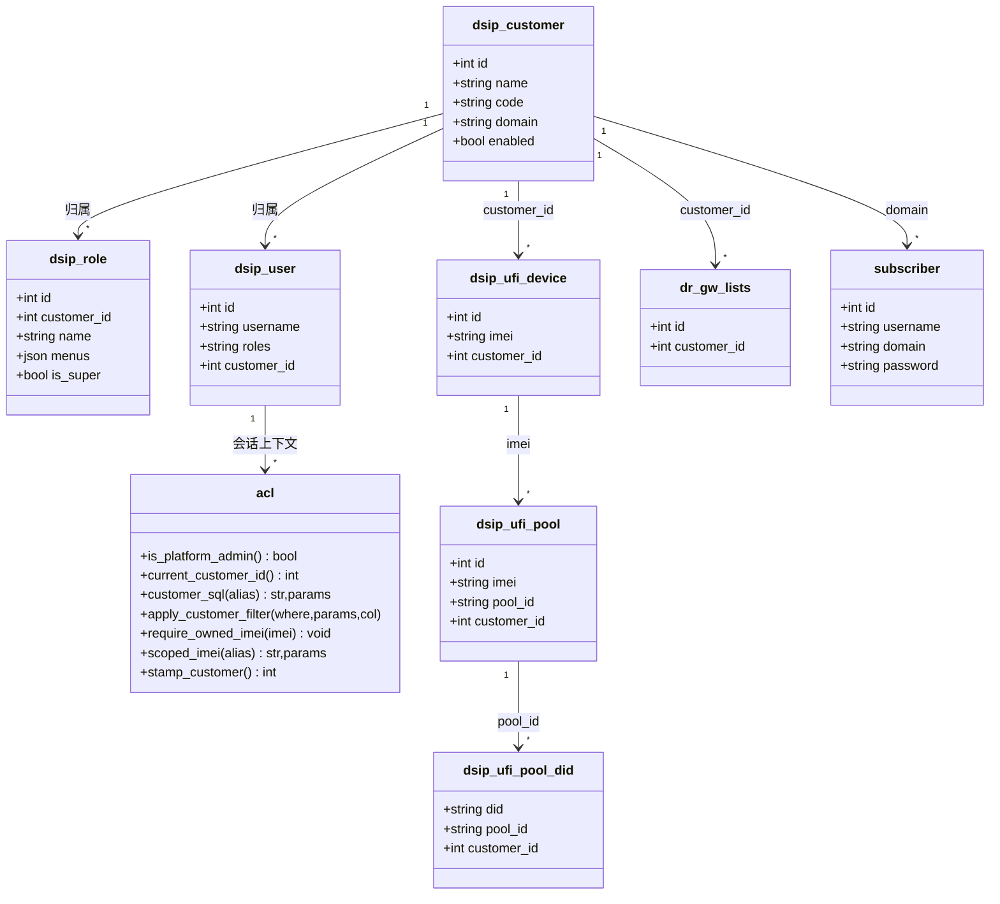
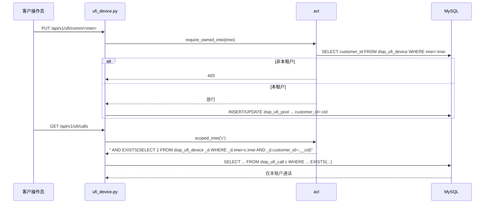

# dSIPRouter 多租户（SaaS 化）改造方案 v2

> **结论先行（v2）**：方向维持「共享实例逻辑隔离 + 每租户可选独立 SIP domain」两期落地，但 **v2 依据 QA 评审全面修正第一期隔离补全清单——实测越权读写路径 25+ 处，全部纳入任务分解，不再只列"设备列表/短信"两处。**
> 核心增量：①统一 `acl.require_owned_imei()`（写路径归属断言）+ `acl.scoped_imei()`（读路径 JOIN 反查），杜绝 25 处手写遗漏；②默认租户改用 `code='default'` 唯一键 + 启动幂等 seed，废弃 `id=1` 假设；③CDR 归属改为 **gwgroupid→dr_gw_lists.customer_id 为主**、src 反查仅 inbound 兜底；④账号增删改导入前加归属校验；⑤存量回填脚本前置到 T01/T02 与过滤开关同批上线。
> 一句话：**数据先行、SIP 渐进、存量归默认租户、平台管理员显式选归属、写路径统一断言。**

---

## v2 修订记录（相对 v1 的改动摘要）

| # | 修订点 | v1 问题 | v2 处理 | 落点 |
|---|---|---|---|---|
| 1 | 越权清单 | 只列"设备列表/短信"两处 | 补全 25+ 处读写路径，逐条写入任务 | 见 §0、§四 |
| 2 | 统一辅助函数 | 未定义写路径断言 | 新增 `acl.require_owned_imei()` + `acl.scoped_imei()`（JOIN 版） | T01 |
| 3 | 默认租户 | 假设 `id=1` | `code='default'` 唯一键 + 启动幂等 seed；区分"平台全局资源"与"默认租户业务数据" | T01 |
| 4 | 设备自注册 | 说"落默认租户"但 INSERT 不含该列 | 明确 `INSERT ... ON DUPLICATE KEY` 列清单加 `customer_id` | T02 |
| 5 | CDR 归属 | src 反查 | **gwgroupid→dr_gw_lists.customer_id 为主**，src 反查仅 inbound 兜底；`gwgroupid=0` 仅平台管理员 | T05 |
| 6 | 账号归属校验 | 未提 | add/update/delete/import 前断言 imei/sim 属当前租户 | T05 |
| 7 | 两张 SMS 表 | 未区分 | `dsip_ufi_sms`（设备上行日志，事件族，反查）≠ `dsip_ufi_sms_msg`（平台短信，已过滤） | T02/T04 |
| 8 | alert 级联 | 未发现 | `deleteUfiDevice` 级联补 `dsip_ufi_alert` | T02 |
| 9 | 回填脚本 | T07 才做 | 前置 T01/T02，与过滤开关同批上线 | T01/T02 |
| 10 | 设备改租户 vs domain | 未定义 | 第二期定义"customer_id 改租户时 subscriber.domain 是否同步迁移"预期与流程 | T07 |

---

## 〇、现状代码核验结论（v2：越权面全量清单）

> 已逐条复核 QA 证据，全部属实。越权读写路径共 **25+ 处**，分五类，全部纳入 §四 任务落点。

| 类别 | 文件:行号 | 端点/函数 | 越权风险 |
|---|---|---|---|
| **设备写** | ufi_device.py:1107 `deleteUfiDevice` | DELETE 设备 | 任意 imei 跨租户删除（且级联漏 alert） |
| | ufi_device.py:1242 `getUfiDevice` | GET 单设备 | 按 imei 越权读 |
| | ufi_device.py:1291 `sendUfiDeviceCommand` | 下发指令 | 任意 imei 下发命令 |
| | ufi_device.py:1597/1624 tunnel/admin-proxy | 隧道/代理 | 任意 imei 打通内网代理 |
| | ufi_device.py:1748 settings | POST 下发设置 | 任意 imei 改配置 |
| | ufi_device.py:2393 `getUfiCommandResult` | 命令回执长轮询 | request_id 越权读回执 |
| **流水/文件** | ufi_device.py:1155 `listUfiAlerts` | 告警列表 | 全量告警 |
| | ufi_device.py:2012 `listUfiRecords` | 事件流水 | 全量事件 |
| | ufi_device.py:2090 `listUfiCalls` | 通话记录 | `LIMIT 5000`+Python 分页，全量 |
| | ufi_device.py:2325 `listUfiFiles` / 2384 `downloadUfiFile` | 文件列表/下载 | 按 file_id `send_file` 跨租户下文件 |
| **账号管理** | api_routes.py:2181 `listUfiAccounts` | 全局 subscriber+在线 | 跨租户账号/在线状态 |
| | api_routes.py:2225 `getUfiSetupStatus` | 装机状态 | 全量统计 |
| | api_routes.py:2348/2377/2459/2493 add/update/delete/import | SIP 账号 CRUD | 任意改绑/删除 IMEI 的 SIP 账号 |
| **通信/号码池** | ufi_comm.py:857 `_comm_rows` | 全表 | 全量通信属性 |
| | ufi_comm.py:884 `listUfiComm` | 通信视图 | 设备+dbaliases+dids+carriers 全量 |
| | ufi_comm.py:973 `updateUfiComm` | 写通信属性 | 任意 imei 改 pool/carrier/并发 |
| | ufi_comm.py:258-602, 674-740 cfg/did | 号码池 cfg/did 全套 | 全局 DID/策略跨租户读写 |
| **白名单/短信** | ufi_whitelist.py:236/323 | 白名单 root/item | 全量 CIDR 读写 |
| | ufi_sms_gateway.py 全文件 | 短信通道/频控/API key | 全量通道/密钥 |
| **路由/运营商组/CDR** | api_routes.py:2286/2634/2657, dsiprouter.py:619/1721/2177 | dr_gw_lists/dr_rules CRUD | 全量运营商组/路由 |
| | api_routes.py:3449 `generateCDRS` / 3884 `listCdrGroups` / 3981 `getGatewayCDRS` | CDR 读 | `gwgroupid=0` 即全量 CDR |

---

## 一、多租户模型定义

### 1.1 三级关系

```
dsip_customer（租户） 1 ── n  dsip_user（用户）  n ── n  dsip_role（角色）
        │                            │
        │ 1 ── n dsip_role            └── customer_id（归属租户）
        │
        └── 默认租户（code='default'，唯一键，启动幂等 seed，承载存量）
```

- **租户（Customer）**：SaaS 客户 = 一组 UFI 设备 + 通信配置 + 号码/DID + 短信通道 + CDR 的隔离边界。新增 `domain` 列（可空=继承默认 domain）。
- **角色（Role）**：`customer_id IS NULL` 为平台级角色；`is_super` 仅平台级可置 1。
- **用户（User）**：`customer_id` 决定归属租户；`roles` 决定菜单/接口权限。
- **默认租户**：`code='default'` 唯一键，**启动时幂等 seed**（`INSERT IGNORE`），不依赖 AUTO_INCREMENT id；承载存量设备/账号/路由，避免"租户阶段性看不到历史数据"。

### 1.2 权限边界

| 角色层级 | 判定 | 可见 | 可写 | 菜单 |
|---|---|---|---|---|
| 平台管理员 | `is_platform_admin=True` | 全部租户 | 全部，**新建必须显式 `customer_id`，缺省落默认租户** | 全菜单 |
| 客户管理员 | 归属租户 + 管理菜单 | 仅本租户 | 仅本租户 | 授权菜单 |
| 客户操作员 | 归属租户 + 无管理菜单 | 仅本租户 | 仅本租户业务数据 | 授权菜单 |

### 1.3 隔离统一语义（v2 强化）

1. **看得到** = `customer_id = 会话租户`；平台管理员读全量。
2. **写归属** = 行 `customer_id`；平台管理员写**落默认租户**（不再 NULL）；设备自注册落默认租户。
3. **写路径统一断言**：凡按 `imei` 操作的写端点，入口先 `acl.require_owned_imei(imei)`，非本租户（且非平台管理员）直接 403。
4. **读路径统一反查**：事件/流水/文件/CDR 类大表不冗余 `customer_id`，用 `acl.scoped_imei(alias)`（**JOIN 子查询**，非 `IN`）过滤。
5. **兜底归属**：`imei → dsip_ufi_device.customer_id`；CDR 例外——以 `gwgroupid → dr_gw_lists.customer_id` 为主（见 §3.3）。
6. **两张 SMS 表区分**：`dsip_ufi_sms`（设备上行短信日志，**事件族，反查过滤**）≠ `dsip_ufi_sms_msg`（平台短信，**已有 customer_id 已过滤**），落地不混淆。

---

## 二、候选方案对比（同 v1，结论不变）

| 维度 | A 逻辑隔离 | B 独立 domain | C 物理隔离 |
|---|---|---|---|
| 改动量 | 小 | 中 | 大 |
| 隔离强度 | 低 | 中高 | 高 |
| 运维成本 | 低 | 中 | 高 |
| 扩展性 | 中 | 中高 | 高 |
| 风险 | 高（信令无隔离） | 中 | 高（改造面大） |
| 契合度 | ★★★ | ★★★★ | ★ |

---

## 三、推荐方案（拍板：方案 B，两期落地，v2 修正隔离打点）

理由同 v1：①第一期不动 Kamailio；②设备自注册归默认租户零迁移；③Kamailio 以 `(username,domain)` 为键，domain 隔离是原生机制；④当前规模物理隔离过度设计。

### 3.1 SIP domain 隔离策略

| 子项 | 设计 |
|---|---|
| 数据模型 | `dsip_customer` 加 `domain VARCHAR(128) NULL`（NULL=继承默认 domain） |
| 取值 | `_ufi_auth_domain()` → `_tenant_domain()`，默认租户 domain=旧 `EXTERNAL_IP_ADDR`，存量账号不变 |
| 建号 | `_upsert_ufi_account()` 传租户 domain（第二期） |
| 下发 | `_load_ufi_config()` 随租户下发 domain 字段 |
| 存量迁移 | 不迁移，全部留全局 domain，回填 `customer_id=默认租户` |
| 在线判活 | `location.username=IMEI` 判活补 `s.domain=租户domain` 条件 |

### 3.2 数据层隔离（v2 修正：直接加列 + 反查 + 统一断言）

**直接加 `customer_id` 列：** `dsip_ufi_device`（已加，写入补）、`dsip_ufi_pool`（已加，补过滤）、`dsip_ufi_pool_cfg`/`dsip_ufi_pool_did`（**补加**）、`dsip_ufi_sms_carrier`/`sandbox_inbox`（**补加**）、`dsip_ip_whitelist`（已加，补过滤）、`dr_gw_lists`（已加，补过滤）、`dr_rules`（**补加**）、`dsip_cdrinfo`（**补加**）。

**反查兜底（不加列）：** `dsip_ufi_event`/`alert`/`call`/`file`/`sms`（设备上行事件族）用 `scoped_imei()`；CDR 用 gwgroupid 为主（见 3.3）。

**统一机制：** 复用 `acl.customer_sql()`/`apply_customer_filter()`，新增两个原语（T01 实现）：
- `acl.require_owned_imei(imei)`：写路径断言（平台管理员放行；否则查 `dsip_ufi_device.customer_id` 必须等于会话租户，否则 403）。
- `acl.scoped_imei(alias)`：读路径返回 `EXISTS (SELECT 1 FROM dsip_ufi_device _d WHERE _d.imei={alias}.imei AND _d.customer_id=:__cid)` 片段（**JOIN 语义，避免 IN 大集合**），平台管理员返回空串。

### 3.3 SIP 路由 / 号码 / DID / CDR 隔离（v2 修正 CDR 归属）

| 资源 | 隔离设计 |
|---|---|
| `dr_gw_lists` | `customer_id` 过滤（已加列，补过滤） |
| `dr_rules` | 加 `customer_id`；写入同步 `dr_groupid→dr_gw_lists.customer_id` 校验一致性 |
| `dsip_ufi_pool_cfg`/`_did` | 加 `customer_id`；`P1` 默认池每租户一条；DID 归属租户 |
| **CDR** | **主用 `gwgroupid → dr_gw_lists.customer_id` 归属**（VOS 落地侧主叫是外线号码，src 反查会漏/错挂）；`src_username/src_domain JOIN subscriber` 仅作 **inbound 兜底**；`gwgroupid=0`（全量）**仅平台管理员可用**，租户强制限定本租户 groupid 集合 |
| `dispatcher`/`address`/mapping | 第一期保持平台级全局（仅平台管理员可见） |

### 3.4 平台管理员资源归属策略（v2 修正）

| 规则 | 设计 |
|---|---|
| 显式指定优先 | 新建/导入请求体带 `customer_id`；缺省落默认租户 |
| 默认租户 | `code='default'` 唯一键 + 启动幂等 seed；`stamp_customer()` 平台管理员返回默认租户 id（**不再返回 NULL**，改 `acl.py:201-205`） |
| 设备自注册 | `ufi_device.py:337-376` 的 INSERT 列清单**加 `customer_id=默认租户`**（v1 遗漏，QA 指出） |
| 语义区分 | 「平台全局资源」（dispatcher/address/mapping/whitelist_cfg 开关）保持 `customer_id=NULL` 仅平台可见，**不落默认租户**，避免二次迁移债 |
| 历史 dsip_admin | 是否绑默认租户 = **待产品拍板**（见 §六） |

### 3.5 账号归属校验（v2 新增）

`_upsert_ufi_account()` 及 add/update/delete/import 入口：先断言 `imei`（及 `sim` 对应 imei）属于当前租户（平台管理员放行），否则 403——否则可改写/重绑任意 IMEI 的 SIP 账号（`api_routes.py:2348/2377/2459/2493`）。

---

## 四、任务分解（v2，含全部越权打点）

> 第一期（T01~T05）最小改动可上线；第二期（T06~T08）SIP domain 硬隔离。每项标注「新增打点」。

| 任务 | 内容 | 涉及文件 | 改动类型 | 工作量 | 依赖 |
|---|---|---|---|---|---|
| **T01** | 基础设施：`dsip_customer.domain` 列 + `code='default'` 唯一键 + 启动幂等 seed；`_SCOPED_TABLES` 扩充（补 `dsip_ufi_pool_cfg`/`_did`/`dsip_ufi_sms_carrier`/`sandbox_inbox`/`dr_rules`/`dsip_cdrinfo`）；新增 `acl.require_owned_imei()` + `acl.scoped_imei()`；`stamp_customer()` 平台管理员改落默认租户；**存量回填迁移脚本（前置）** | `acl.py`、`scripts/migrate_multi_tenant.sql` | 加列/改函数/seed/脚本 | 中 | — |
| **T02** | 设备域隔离（写路径全量打点）：`deleteUfiDevice`(1107)+补 `dsip_ufi_alert` 级联、`getUfiDevice`(1242)、`sendUfiDeviceCommand`(1291)、tunnel/admin-proxy(1597/1624)、POST settings(1748)、`getUfiCommandResult`(2393) 均加 `require_owned_imei`；设备自注册 INSERT 加 `customer_id`；读路径 `listUfiAlerts`(1155)/`listUfiRecords`(2012)/`listUfiCalls`(2090)/`listUfiFiles`+`downloadUfiFile`(2325/2384) 加 `scoped_imei`（文件下载按 id 先校验归属再 send_file）；区分 `dsip_ufi_sms` 事件族反查 | `ufi_device.py` | 改写入/加断言/加过滤/级联补 | 大 | T01 |
| **T03** | 通信/号码池隔离：`_comm_rows`(857) 改按租户取、`listUfiComm`(884) 加 `customer_sql`、`updateUfiComm`(973) 加 `require_owned_imei`+写 `customer_id`、号码池 cfg/did 全套(258-602,674-740) 加列+过滤 | `ufi_comm.py` | 改查询/加列/加断言 | 中 | T01 |
| **T04** | 短信网关+白名单隔离：`ufi_sms_gateway.py` 全文件（carrier/sandbox_inbox/apikey 鉴权按 customer_id，注意与 `dsip_ufi_sms_msg` 平台短信区分）、`ufi_whitelist.py`(236/323) 加过滤（`whitelist_cfg` 保持平台级开关） | `ufi_sms_gateway.py`、`ufi_whitelist.py` | 加列/改查询/加过滤 | 中 | T01 |
| **T05** | 账号管理+运营商组/路由+CDR 隔离：账号 add/update/delete/import(2348/2377/2459/2493)+list(2181)+setup(2225) 加归属校验与过滤；dr_gw_lists/dr_rules CRUD(api_routes.py:2286/2634/2657、dsiprouter.py:619/1721/2177) 加 `customer_id`；CDR generateCDRS(3449)/listCdrGroups(3884)/getGatewayCDRS(3981) 改为 **gwgroupid→customer_id 为主**+inbound src 兜底+`gwgroupid=0` 仅平台 | `api_routes.py`、`dsiprouter.py`、`modules/cdr/*` | 改查询/加断言/加列/改归属 | 大 | T03, T04 |
| **T06** | SIP domain 租户化：`_ufi_auth_domain()`→`_tenant_domain()`；`_upsert_ufi_account()` 传租户 domain；在线判活补 `s.domain` 条件 | `api_routes.py` | 改函数/改查询 | 中 | T01 |
| **T07** | UFI 下发带 domain + **设备改租户↔domain 同步流程**（定义：`customer_id` 改租户时 `subscriber.domain`/`dbaliases.domain`/`location` 是否同步迁移，v2 明确——第一期不自动同步、第二期提供"迁移到新 domain"脚本+开关） | `ufi_device.py`、`scripts` | 改下发/迁移脚本 | 中 | T06 |
| **T08** | Kamailio 多 domain 验证 + 端到端回归（注册/路由/DID/CDR 隔离，含 25+ 打点安全回归） | `kamailio/*.cfg`、`testing/*` | 配置/测试 | 中 | T07 |

**依赖图：**
```
T01 ──> T02 ──> T05 ──> T06 ──> T07 ──> T08
  ├─────> T03 ──> T05
  └─────> T04 ──> T05
```

---

## 五、数据迁移与回滚（v2：回填前置）

### 5.1 存量回填（**T01/T02 与过滤开关同批上线**，脚本幂等）

1. **seed 默认租户**：`INSERT IGNORE INTO dsip_customer(code,name,enabled,created) VALUES('default','默认租户',1,NOW())`（依赖 `code` 唯一键），取 `default_id = SELECT id WHERE code='default'`。
2. **回填 device**：`UPDATE dsip_ufi_device SET customer_id=default_id WHERE customer_id IS NULL`。
3. **回填派生表**：`dsip_ufi_pool`/`dsip_ufi_sms_*`/`dsip_ip_whitelist`/`dr_gw_lists` 中 NULL 行按 `imei→device.customer_id` 或 `dr_groupid` 反查回填；无对应 device 的置 default_id。
4. **回填 pool_cfg/did**：加列后现 `P1` 全局数据置 default_id。
5. **dr_rules/dsip_cdrinfo**：加列后按 `dr_groupid→dr_gw_lists.customer_id` 回填。
6. **`dsip_user`**：历史 `dsip_admin` 归属 = 待产品拍板（平台管理员 or 默认租户）。
7. **`subscriber`/`dbaliases`**：第一期**不动**（domain 仍全局），第二期按需建租户 domain 账号。
8. **校验**：`SELECT customer_id, COUNT(*) ... GROUP BY`，确认业务表无 NULL（平台全局表除外）。

### 5.2 回滚

- **加列/加表**：迁移前 `mysqldump` 备份受影响表，失败 `source` 回滚。
- **过滤/断言类**：Git revert（代码回滚），无数据风险。
- **domain 类**：`_tenant_domain()` 回退全局常量即退回；租户 domain 账号用清理脚本删除。
- **顺序**：先回滚代码 → 再回滚数据，避免代码回滚后数据被误过滤。

---

## 六、待明确事项（v2 收敛）

| # | 开放问题 | 影响 |
|---|---|---|
| 1 | 租户规模与增速 | 决定是否投入第二期 domain 隔离 |
| 2 | 是否自助开通 | 自助开通需审批流 + "导入即归属" |
| 3 | DID 是否租户独享 | 决定 `dsip_ufi_pool_did` 唯一键是否加 customer_id |
| 4 | UFI 是否支持自定义 domain/Realm | 决定第二期 domain 能否真正下发到设备 |
| 5 | 历史 `dsip_admin` 归属（平台管理员 vs 默认租户） | 影响 `resolve_acl` 历史账号分支 |
| 6 | CDR 是否要求严格隔离（反查 vs 直接给 `cdrs` 加列） | 性能与改造量取舍 |
| 7 | dispatcher/address/mapping 是否租户化 | 影响第二期范围 |
| 8 | 设备改租户时 domain 是否同步迁移（v2 已给默认预期：第一期不同步、第二期提供脚本+开关） | 需产品确认最终语义 |

---

## 附：关键类/关系与隔离调用时序（Mermaid）

### 类关系（租户模型 + 隔离原语）



### 隔离调用时序（写路径断言 + 读路径反查）



---

*文档路径：`docs/system_design.md`；配套图：`docs/class-diagram.mermaid`、`docs/sequence-diagram.mermaid`。*
