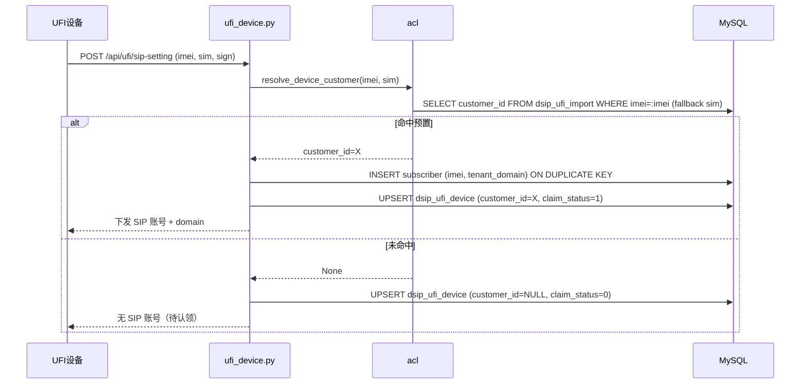
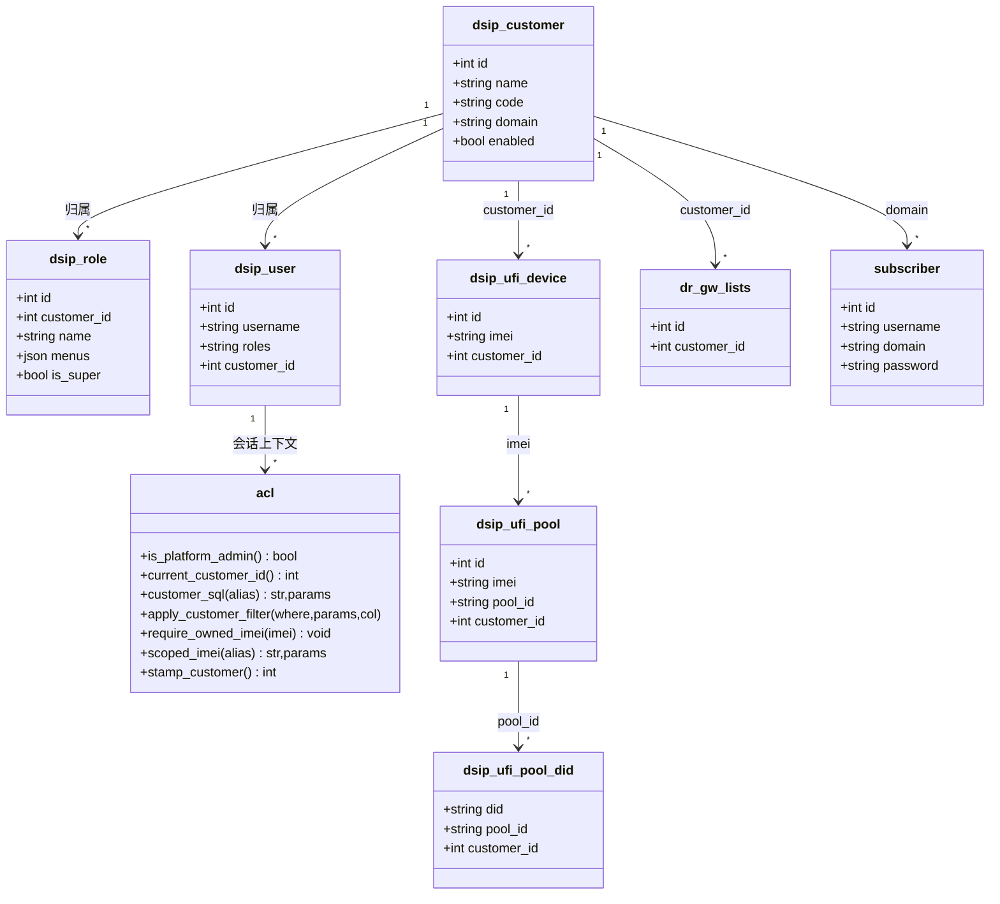
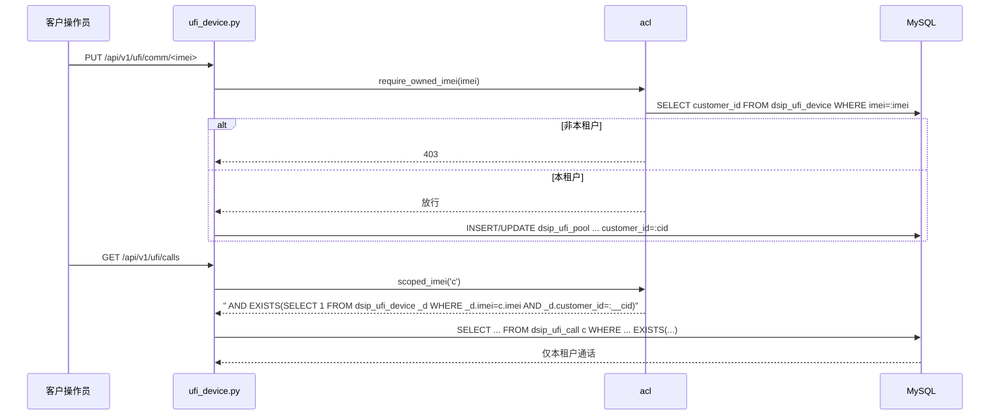

# dSIPRouter 多租户（SaaS 化）改造方案 v2

> **结论先行（v2）**：方向维持「共享实例逻辑隔离 + 每租户可选独立 SIP domain」两期落地，但 **v2 依据 QA 评审全面修正第一期隔离补全清单——实测越权读写路径 25+ 处，全部纳入任务分解，不再只列"设备列表/短信"两处。**
> 核心增量：①统一 `acl.require_owned_imei()`（写路径归属断言）+ `acl.scoped_imei()`（读路径 JOIN 反查），杜绝 25 处手写遗漏；②默认租户改用 `code='default'` 唯一键 + 启动幂等 seed，废弃 `id=1` 假设；③CDR 归属改为 **gwgroupid→dr_gw_lists.customer_id 为主**、src 反查仅 inbound 兜底；④账号增删改导入前加归属校验；⑤存量回填脚本前置到 T01/T02 与过滤开关同批上线。
> 一句话：**数据先行、SIP 渐进、存量归默认租户、平台管理员显式选归属、写路径统一断言。**

---

## v2 修订记录（相对 v1 的改动摘要）

| # | 修订点 | v1 问题 | v2 处理 | 落点 |
|---|---|---|---|---|
| 1 | 越权清单 | 只列"设备列表/短信"两处 | 补全 25+ 处读写路径，逐条写入任务 | 见 §0、§四 |
| 2 | 统一辅助函数 | 未定义写路径断言 | 新增 `acl.require_owned_imei()` + `acl.scoped_imei()`（JOIN 版） | T01 |
| 3 | 默认租户 | 假设 `id=1` | `code='default'` 唯一键 + 启动幂等 seed；区分"平台全局资源"与"默认租户业务数据" | T01 |
| 4 | 设备自注册 | 说"落默认租户"但 INSERT 不含该列 | 明确 `INSERT ... ON DUPLICATE KEY` 列清单加 `customer_id` | T02 |
| 5 | CDR 归属 | src 反查 | **gwgroupid→dr_gw_lists.customer_id 为主**，src 反查仅 inbound 兜底；`gwgroupid=0` 仅平台管理员 | T05 |
| 6 | 账号归属校验 | 未提 | add/update/delete/import 前断言 imei/sim 属当前租户 | T05 |
| 7 | 两张 SMS 表 | 未区分 | `dsip_ufi_sms`（设备上行日志，事件族，反查）≠ `dsip_ufi_sms_msg`（平台短信，已过滤） | T02/T04 |
| 8 | alert 级联 | 未发现 | `deleteUfiDevice` 级联补 `dsip_ufi_alert` | T02 |
| 9 | 回填脚本 | T07 才做 | 前置 T01/T02，与过滤开关同批上线 | T01/T02 |
| 10 | 设备改租户 vs domain | 未定义 | 第二期定义"customer_id 改租户时 subscriber.domain 是否同步迁移"预期与流程 | T07 |

---

## 〇、现状代码核验结论（v2：越权面全量清单）

> 已逐条复核 QA 证据，全部属实。越权读写路径共 **25+ 处**，分五类，全部纳入 §四 任务落点。

| 类别 | 文件:行号 | 端点/函数 | 越权风险 |
|---|---|---|---|
| **设备写** | ufi_device.py:1107 `deleteUfiDevice` | DELETE 设备 | 任意 imei 跨租户删除（且级联漏 alert） |
| | ufi_device.py:1242 `getUfiDevice` | GET 单设备 | 按 imei 越权读 |
| | ufi_device.py:1291 `sendUfiDeviceCommand` | 下发指令 | 任意 imei 下发命令 |
| | ufi_device.py:1597/1624 tunnel/admin-proxy | 隧道/代理 | 任意 imei 打通内网代理 |
| | ufi_device.py:1748 settings | POST 下发设置 | 任意 imei 改配置 |
| | ufi_device.py:2393 `getUfiCommandResult` | 命令回执长轮询 | request_id 越权读回执 |
| **流水/文件** | ufi_device.py:1155 `listUfiAlerts` | 告警列表 | 全量告警 |
| | ufi_device.py:2012 `listUfiRecords` | 事件流水 | 全量事件 |
| | ufi_device.py:2090 `listUfiCalls` | 通话记录 | `LIMIT 5000`+Python 分页，全量 |
| | ufi_device.py:2325 `listUfiFiles` / 2384 `downloadUfiFile` | 文件列表/下载 | 按 file_id `send_file` 跨租户下文件 |
| **账号管理** | api_routes.py:2181 `listUfiAccounts` | 全局 subscriber+在线 | 跨租户账号/在线状态 |
| | api_routes.py:2225 `getUfiSetupStatus` | 装机状态 | 全量统计 |
| | api_routes.py:2348/2377/2459/2493 add/update/delete/import | SIP 账号 CRUD | 任意改绑/删除 IMEI 的 SIP 账号 |
| **通信/号码池** | ufi_comm.py:857 `_comm_rows` | 全表 | 全量通信属性 |
| | ufi_comm.py:884 `listUfiComm` | 通信视图 | 设备+dbaliases+dids+carriers 全量 |
| | ufi_comm.py:973 `updateUfiComm` | 写通信属性 | 任意 imei 改 pool/carrier/并发 |
| | ufi_comm.py:258-602, 674-740 cfg/did | 号码池 cfg/did 全套 | 全局 DID/策略跨租户读写 |
| **白名单/短信** | ufi_whitelist.py:236/323 | 白名单 root/item | 全量 CIDR 读写 |
| | ufi_sms_gateway.py 全文件 | 短信通道/频控/API key | 全量通道/密钥 |
| **路由/运营商组/CDR** | api_routes.py:2286/2634/2657, dsiprouter.py:619/1721/2177 | dr_gw_lists/dr_rules CRUD | 全量运营商组/路由 |
| | api_routes.py:3449 `generateCDRS` / 3884 `listCdrGroups` / 3981 `getGatewayCDRS` | CDR 读 | `gwgroupid=0` 即全量 CDR |

---

## 一、多租户模型定义

### 1.1 三级关系

```
dsip_customer（租户） 1 ── n  dsip_user（用户）  n ── n  dsip_role（角色）
        │                            │
        │ 1 ── n dsip_role            └── customer_id（归属租户）
        │
        └── 默认租户（code='default'，唯一键，启动幂等 seed，承载存量）
```

- **租户（Customer）**：SaaS 客户 = 一组 UFI 设备 + 通信配置 + 号码/DID + 短信通道 + CDR 的隔离边界。新增 `domain` 列（可空=继承默认 domain）。
- **角色（Role）**：`customer_id IS NULL` 为平台级角色；`is_super` 仅平台级可置 1。
- **用户（User）**：`customer_id` 决定归属租户；`roles` 决定菜单/接口权限。
- **默认租户**：`code='default'` 唯一键，**启动时幂等 seed**（`INSERT IGNORE`），不依赖 AUTO_INCREMENT id；承载存量设备/账号/路由，避免"租户阶段性看不到历史数据"。

### 1.2 权限边界

| 角色层级 | 判定 | 可见 | 可写 | 菜单 |
|---|---|---|---|---|
| 平台管理员 | `is_platform_admin=True` | 全部租户 | 全部，**新建必须显式 `customer_id`，缺省落默认租户** | 全菜单 |
| 客户管理员 | 归属租户 + 管理菜单 | 仅本租户 | 仅本租户 | 授权菜单 |
| 客户操作员 | 归属租户 + 无管理菜单 | 仅本租户 | 仅本租户业务数据 | 授权菜单 |

### 1.3 隔离统一语义（v2 强化）

1. **看得到** = `customer_id = 会话租户`；平台管理员读全量。
2. **写归属** = 行 `customer_id`；平台管理员写**落默认租户**（不再 NULL）；设备自注册落默认租户。
3. **写路径统一断言**：凡按 `imei` 操作的写端点，入口先 `acl.require_owned_imei(imei)`，非本租户（且非平台管理员）直接 403。
4. **读路径统一反查**：事件/流水/文件/CDR 类大表不冗余 `customer_id`，用 `acl.scoped_imei(alias)`（**JOIN 子查询**，非 `IN`）过滤。
5. **兜底归属**：`imei → dsip_ufi_device.customer_id`；CDR 例外——以 `gwgroupid → dr_gw_lists.customer_id` 为主（见 §3.3）。
6. **两张 SMS 表区分**：`dsip_ufi_sms`（设备上行短信日志，**事件族，反查过滤**）≠ `dsip_ufi_sms_msg`（平台短信，**已有 customer_id 已过滤**），落地不混淆。

---

## 二、候选方案对比（同 v1，结论不变）

| 维度 | A 逻辑隔离 | B 独立 domain | C 物理隔离 |
|---|---|---|---|
| 改动量 | 小 | 中 | 大 |
| 隔离强度 | 低 | 中高 | 高 |
| 运维成本 | 低 | 中 | 高 |
| 扩展性 | 中 | 中高 | 高 |
| 风险 | 高（信令无隔离） | 中 | 高（改造面大） |
| 契合度 | ★★★ | ★★★★ | ★ |

---

## 三、推荐方案（拍板：方案 B，两期落地，v2 修正隔离打点）

理由同 v1：①第一期不动 Kamailio；②设备自注册归默认租户零迁移；③Kamailio 以 `(username,domain)` 为键，domain 隔离是原生机制；④当前规模物理隔离过度设计。

### 3.1 SIP domain 隔离策略

| 子项 | 设计 |
|---|---|
| 数据模型 | `dsip_customer` 加 `domain VARCHAR(128) NULL`（NULL=继承默认 domain） |
| 取值 | `_ufi_auth_domain()` → `_tenant_domain()`，默认租户 domain=旧 `EXTERNAL_IP_ADDR`，存量账号不变 |
| 建号 | `_upsert_ufi_account()` 传租户 domain（第二期） |
| 下发 | `_load_ufi_config()` 随租户下发 domain 字段 |
| 存量迁移 | 不迁移，全部留全局 domain，回填 `customer_id=默认租户` |
| 在线判活 | `location.username=IMEI` 判活补 `s.domain=租户domain` 条件 |

### 3.2 数据层隔离（v2 修正：直接加列 + 反查 + 统一断言）

**直接加 `customer_id` 列：** `dsip_ufi_device`（已加，写入补）、`dsip_ufi_pool`（已加，补过滤）、`dsip_ufi_pool_cfg`/`dsip_ufi_pool_did`（**补加**）、`dsip_ufi_sms_carrier`/`sandbox_inbox`（**补加**）、`dsip_ip_whitelist`（已加，补过滤）、`dr_gw_lists`（已加，补过滤）、`dr_rules`（**补加**）、`dsip_cdrinfo`（**补加**）。

**反查兜底（不加列）：** `dsip_ufi_event`/`alert`/`call`/`file`/`sms`（设备上行事件族）用 `scoped_imei()`；CDR 用 gwgroupid 为主（见 3.3）。

**统一机制：** 复用 `acl.customer_sql()`/`apply_customer_filter()`，新增两个原语（T01 实现）：
- `acl.require_owned_imei(imei)`：写路径断言（平台管理员放行；否则查 `dsip_ufi_device.customer_id` 必须等于会话租户，否则 403）。
- `acl.scoped_imei(alias)`：读路径返回 `EXISTS (SELECT 1 FROM dsip_ufi_device _d WHERE _d.imei={alias}.imei AND _d.customer_id=:__cid)` 片段（**JOIN 语义，避免 IN 大集合**），平台管理员返回空串。

### 3.3 SIP 路由 / 号码 / DID / CDR 隔离（v2 修正 CDR 归属）

| 资源 | 隔离设计 |
|---|---|
| `dr_gw_lists` | `customer_id` 过滤（已加列，补过滤） |
| `dr_rules` | 加 `customer_id`；写入同步 `dr_groupid→dr_gw_lists.customer_id` 校验一致性 |
| `dsip_ufi_pool_cfg`/`_did` | 加 `customer_id`；`P1` 默认池每租户一条；DID 归属租户 |
| **CDR** | **主用 `gwgroupid → dr_gw_lists.customer_id` 归属**（VOS 落地侧主叫是外线号码，src 反查会漏/错挂）；`src_username/src_domain JOIN subscriber` 仅作 **inbound 兜底**；`gwgroupid=0`（全量）**仅平台管理员可用**，租户强制限定本租户 groupid 集合 |
| `dispatcher`/`address`/mapping | 第一期保持平台级全局（仅平台管理员可见） |

### 3.4 平台管理员资源归属策略（v2 修正）

| 规则 | 设计 |
|---|---|
| 显式指定优先 | 新建/导入请求体带 `customer_id`；缺省落默认租户 |
| 默认租户 | `code='default'` 唯一键 + 启动幂等 seed；`stamp_customer()` 平台管理员返回默认租户 id（**不再返回 NULL**，改 `acl.py:201-205`） |
| 设备自注册 | `ufi_device.py:337-376` 的 INSERT 列清单**加 `customer_id=默认租户`**（v1 遗漏，QA 指出） |
| 语义区分 | 「平台全局资源」（dispatcher/address/mapping/whitelist_cfg 开关）保持 `customer_id=NULL` 仅平台可见，**不落默认租户**，避免二次迁移债 |
| 历史 dsip_admin | 是否绑默认租户 = **待产品拍板**（见 §六） |

### 3.5 账号归属校验（v2 新增）

`_upsert_ufi_account()` 及 add/update/delete/import 入口：先断言 `imei`（及 `sim` 对应 imei）属于当前租户（平台管理员放行），否则 403——否则可改写/重绑任意 IMEI 的 SIP 账号（`api_routes.py:2348/2377/2459/2493`）。

---

## 四、任务分解（v2，含全部越权打点）

> 第一期（T01~T05）最小改动可上线；第二期（T06~T08）SIP domain 硬隔离。每项标注「新增打点」。

| 任务 | 内容 | 涉及文件 | 改动类型 | 工作量 | 依赖 |
|---|---|---|---|---|---|
| **T01** | 基础设施：`dsip_customer.domain` 列 + `code='default'` 唯一键 + 启动幂等 seed；`_SCOPED_TABLES` 扩充（补 `dsip_ufi_pool_cfg`/`_did`/`dsip_ufi_sms_carrier`/`sandbox_inbox`/`dr_rules`/`dsip_cdrinfo`）；新增 `acl.require_owned_imei()` + `acl.scoped_imei()`；`stamp_customer()` 平台管理员改落默认租户；**存量回填迁移脚本（前置）** | `acl.py`、`scripts/migrate_multi_tenant.sql` | 加列/改函数/seed/脚本 | 中 | — |
| **T02** | 设备域隔离（写路径全量打点）：`deleteUfiDevice`(1107)+补 `dsip_ufi_alert` 级联、`getUfiDevice`(1242)、`sendUfiDeviceCommand`(1291)、tunnel/admin-proxy(1597/1624)、POST settings(1748)、`getUfiCommandResult`(2393) 均加 `require_owned_imei`；设备自注册 INSERT 加 `customer_id`；读路径 `listUfiAlerts`(1155)/`listUfiRecords`(2012)/`listUfiCalls`(2090)/`listUfiFiles`+`downloadUfiFile`(2325/2384) 加 `scoped_imei`（文件下载按 id 先校验归属再 send_file）；区分 `dsip_ufi_sms` 事件族反查 | `ufi_device.py` | 改写入/加断言/加过滤/级联补 | 大 | T01 |
| **T03** | 通信/号码池隔离：`_comm_rows`(857) 改按租户取、`listUfiComm`(884) 加 `customer_sql`、`updateUfiComm`(973) 加 `require_owned_imei`+写 `customer_id`、号码池 cfg/did 全套(258-602,674-740) 加列+过滤 | `ufi_comm.py` | 改查询/加列/加断言 | 中 | T01 |
| **T04** | 短信网关+白名单隔离：`ufi_sms_gateway.py` 全文件（carrier/sandbox_inbox/apikey 鉴权按 customer_id，注意与 `dsip_ufi_sms_msg` 平台短信区分）、`ufi_whitelist.py`(236/323) 加过滤（`whitelist_cfg` 保持平台级开关） | `ufi_sms_gateway.py`、`ufi_whitelist.py` | 加列/改查询/加过滤 | 中 | T01 |
| **T05** | 账号管理+运营商组/路由+CDR 隔离：账号 add/update/delete/import(2348/2377/2459/2493)+list(2181)+setup(2225) 加归属校验与过滤；dr_gw_lists/dr_rules CRUD(api_routes.py:2286/2634/2657、dsiprouter.py:619/1721/2177) 加 `customer_id`；CDR generateCDRS(3449)/listCdrGroups(3884)/getGatewayCDRS(3981) 改为 **gwgroupid→customer_id 为主**+inbound src 兜底+`gwgroupid=0` 仅平台 | `api_routes.py`、`dsiprouter.py`、`modules/cdr/*` | 改查询/加断言/加列/改归属 | 大 | T03, T04 |
| **T06** | SIP domain 租户化：`_ufi_auth_domain()`→`_tenant_domain()`；`_upsert_ufi_account()` 传租户 domain；在线判活补 `s.domain` 条件 | `api_routes.py` | 改函数/改查询 | 中 | T01 |
| **T07** | UFI 下发带 domain + **设备改租户↔domain 同步流程**（定义：`customer_id` 改租户时 `subscriber.domain`/`dbaliases.domain`/`location` 是否同步迁移，v2 明确——第一期不自动同步、第二期提供"迁移到新 domain"脚本+开关） | `ufi_device.py`、`scripts` | 改下发/迁移脚本 | 中 | T06 |
| **T08** | Kamailio 多 domain 验证 + 端到端回归（注册/路由/DID/CDR 隔离，含 25+ 打点安全回归） | `kamailio/*.cfg`、`testing/*` | 配置/测试 | 中 | T07 |

**依赖图：**
```
T01 ──> T02 ──> T05 ──> T06 ──> T07 ──> T08
  ├─────> T03 ──> T05
  └─────> T04 ──> T05
```

---

## 五、数据迁移与回滚（v2：回填前置）

### 5.1 存量回填（**T01/T02 与过滤开关同批上线**，脚本幂等）

1. **seed 默认租户**：`INSERT IGNORE INTO dsip_customer(code,name,enabled,created) VALUES('default','默认租户',1,NOW())`（依赖 `code` 唯一键），取 `default_id = SELECT id WHERE code='default'`。
2. **回填 device**：`UPDATE dsip_ufi_device SET customer_id=default_id WHERE customer_id IS NULL`。
3. **回填派生表**：`dsip_ufi_pool`/`dsip_ufi_sms_*`/`dsip_ip_whitelist`/`dr_gw_lists` 中 NULL 行按 `imei→device.customer_id` 或 `dr_groupid` 反查回填；无对应 device 的置 default_id。
4. **回填 pool_cfg/did**：加列后现 `P1` 全局数据置 default_id。
5. **dr_rules/dsip_cdrinfo**：加列后按 `dr_groupid→dr_gw_lists.customer_id` 回填。
6. **`dsip_user`**：历史 `dsip_admin` 归属 = 待产品拍板（平台管理员 or 默认租户）。
7. **`subscriber`/`dbaliases`**：第一期**不动**（domain 仍全局），第二期按需建租户 domain 账号。
8. **校验**：`SELECT customer_id, COUNT(*) ... GROUP BY`，确认业务表无 NULL（平台全局表除外）。

### 5.2 回滚

- **加列/加表**：迁移前 `mysqldump` 备份受影响表，失败 `source` 回滚。
- **过滤/断言类**：Git revert（代码回滚），无数据风险。
- **domain 类**：`_tenant_domain()` 回退全局常量即退回；租户 domain 账号用清理脚本删除。
- **顺序**：先回滚代码 → 再回滚数据，避免代码回滚后数据被误过滤。

---

## 六、待明确事项（v2 收敛）→ 已全部拍板（2026-10-19）

| # | 开放问题 | 拍板结论 | 设计影响 |
|---|---|---|---|
| 1 | 租户规模与增速 | **1~20 个** | 小规模确认：逻辑隔离（共享实例）完全够用，物理隔离彻底排除；`scoped_imei` 反查性能压力小 |
| 2 | 是否自助开通 | **不自助开通；设备尽量即插即用、少配置** | 不做审批流；设备自注册自动落默认租户是主路径，平台管理员建客户后导入/自注册即用 |
| 3 | DID 是否租户独享 | **独享** | `dsip_ufi_pool_did` 唯一键必须加 customer_id：`uk_did(did, customer_id)` |
| 4 | UFI 是否支持自定义 domain/Realm | **支持** | 第二期 domain 隔离确认可行，T06~T08 可推进 |
| 5 | 历史 `dsip_admin` 归属 | **归属默认租户** | 迁移脚本回填 `dsip_user.customer_id=默认租户`；`resolve_acl` 历史账号分支按此处理 |
| 6 | CDR 严格隔离方式 | 维持 v2 方案：主用 gwgroupid→dr_gw_lists.customer_id，src 反查仅 inbound 兜底 | 不给 acc/cdrs 表加列 |
| 7 | dispatcher/address/mapping | 维持平台级全局（第一、二期均不动） | 规模小，收益低 |
| 8 | 设备改租户时 domain 同步 | 维持 v2 默认预期：第一期不同步；第二期提供迁移脚本+开关 | — |

---

## v3 优化（即插即用归属模型）—— 2026-10-19

> **结论先行（v3）**：把「设备即插即用、少配置」从拍板表内化为归属机制——**「批量导入 + IMEI 反查自动归属」为主路径，「待认领池」兜底**。核心增量：①新增预置表 `dsip_ufi_import`，设备自注册时按 IMEI（SIM 兜底）反查自动落 `customer_id`，设备侧零配置；②未匹配的**新**设备不再落默认租户，改落**待认领池**（`customer_id=NULL` + `claim_status=0`），由平台管理员认领/改租户，堵住「所有即插即用设备都落默认租户→多租户形同虚设」的漏洞；③待认领设备**不自动开通 SIP 账号**，认领后才 provision；④第二期 UFI 自定义 domain 随归属下发，租户未配 domain 时继承全局 domain 无感过渡；⑤新增 5 个**平台管理员专属**端点（导入/预置清单/待认领池/认领），全部 `is_platform_admin()` 门禁，租户不可达，`require_owned_imei`/`scoped_imei` 零改动即可覆盖。
> 一句话：**预置导入定归属、自注册反查落租户、未匹配进待认领、认领后才开通。**

### v3.0 现状核验（代码已到 v2，v3 为纯增量）

抽查确认：v2 大部分已落码——`acl.py` 已有默认租户 seed（`code='default'` + `INSERT IGNORE`）、`domain` 列、`backfill_tenants`（`mt_backfill_v2` 门）、`require_owned_imei`/`scoped_imei`/`tenant_gwgroup_ids`/`assert_gwgroup`、`stamp_customer()` 平台管理员已返回默认租户 id（非 NULL）；`ufi_device.py` 的 `_upsert_device` 已含 `customer_id` 列且 `ON DUPLICATE KEY` 用 `IF(customer_id IS NULL, :customer_id, customer_id)` 保留既有归属。因此 **v3 只做增量**：把自注册的 `customer_id` 来源从 `default_customer_id()` 换成「预置表反查结果」，并补齐导入/待认领/认领三块。

### v3.1 与 v2 的差异对照

| # | v2 行为 | v3 变更 | 落点 |
|---|---|---|---|
| 1 | 设备自注册一律 `customer_id=默认租户` | 按预置表反查归属；未匹配落**待认领池**（NULL） | `_upsert_device` |
| 2 | 无预置表 | 新增 `dsip_ufi_import`（IMEI/SIM→customer） | `ensure_acl_tables` |
| 3 | 无待认领概念 | `dsip_ufi_device.claim_status`（0待认领/1已归属）+ 待认领池 | `_ensure_ufi_tables` + 新端点 |
| 4 | `auto_provision` 对所有自注册设备建 SIP 账号 | 仅**已归属**设备 provision；待认领不建账号 | `_handle_sip_setting` 重排 |
| 5 | 无导入/认领端点 | 新增 5 个平台管理员专属端点 | `acl.py`/`ufi_device.py` |
| 6 | domain 第二期随租户（已拍板） | domain 第二期随归属下发；`domain=NULL` 继承全局 | `_tenant_domain()` |

### v3.2 即插即用归属模型（拍板：方案 1 + 方案 3）

**决策**：主路径 = 方案 1「批量导入 + IMEI 反查自动匹配」（设备侧零配置，管理员只做一次导入）；兜底 = 方案 3「待认领池」。方案 2「出厂预置 domain」不承担第一期归属，只作为第二期 domain 隔离的载体（见 v3.4）。

#### 新增数据模型

`dsip_ufi_import`（设备归属预置表，平台管理员专属）：
```sql
CREATE TABLE dsip_ufi_import (
  id INT UNSIGNED AUTO_INCREMENT PRIMARY KEY,
  customer_id INT UNSIGNED NOT NULL,
  imei VARCHAR(32) NOT NULL DEFAULT '',
  sim VARCHAR(32) NOT NULL DEFAULT '',
  matched TINYINT NOT NULL DEFAULT 0,      -- 0=未注册(待匹配) 1=已匹配
  note VARCHAR(255) NOT NULL DEFAULT '',
  created DATETIME NOT NULL,
  matched_at DATETIME NULL,
  UNIQUE KEY uk_import_imei (imei),        -- IMEI 全局唯一，防多租户抢占
  KEY idx_import_sim (sim),
  KEY idx_import_customer (customer_id, matched)
)
```

`dsip_ufi_device` 增列：
```sql
ALTER TABLE dsip_ufi_device ADD COLUMN claim_status TINYINT NOT NULL DEFAULT 0;  -- 0=待认领 1=已归属
```
（`customer_id` 已存在；待认领 = `customer_id IS NULL AND claim_status=0`）

#### 归属决策函数（新增，`acl.py`）

`resolve_device_customer(db, imei, sim) -> int|None`：
1. `SELECT customer_id FROM dsip_ufi_import WHERE imei=:imei`（精确，IMEI 为主键身份）；
2. 未命中则 `WHERE sim=:sim`（SIM 兜底，best-effort；SIM 可换卡，故仅兜底不权威）；
3. 命中则置 `matched=1, matched_at=NOW()` 并返回 `customer_id`；均未命中返回 `None`。

#### 自注册代码路径改动（`ufi_device.py`）

- `_upsert_device()`（原 339-343）：`values['customer_id'] = default_customer_id(db)` → `values['customer_id'] = resolve_device_customer(db, imei, sim)`；`values['claim_status'] = 1 if values['customer_id'] is not None else 0`；INSERT 列清单与 `ON DUPLICATE KEY` 同步加 `claim_status`，`customer_id` 的更新仍维持 `IF(customer_id IS NULL, :customer_id, customer_id)`（**已认领设备不被预置/自注册二次改写**）。
- `_handle_sip_setting()`（原 867-878）：**先 resolve 归属，再决定是否 provision**——已归属才 `_upsert_ufi_account(db, imei, sim, tenant_domain)` + `provisioned=1`；待认领跳过账号、`provisioned=0`（设备拿到响应但无 SIP 凭证，等待认领）。
- `_handle_get_url`/`_handle_status_push`/`persist_ufi_payload`：仅 `_upsert_device`，天然复用 resolve，无需额外改动。

#### 归属决策时序



### v3.3 极简开通流程（端到端 ≤3 步）

| 步 | 操作 | 执行人 | 界面/接口 | 说明 |
|---|---|---|---|---|
| 1 | 建客户（+可选建用户/角色） | 平台管理员 | 已有「客户与权限」页 | 复用 v2 现有能力，零新增 |
| 2 | 批量导入该客户 IMEI/SIM 清单 | 平台管理员 | 新增「导入设备清单」（粘贴/文件） | 写 `dsip_ufi_import`（matched=0） |
| 3 | 设备上电自注册 | 设备（无人值守） | 设备侧零配置 | 按 IMEI 反查自动落 `customer_id` 并开通 SIP 账号 |

- 目标「≤3 步」达成：管理员只需 2 次点击/粘贴，设备端 0 配置。
- 可选第 0 步：若出厂前已知 IMEI，可在设备发货前完成步骤 2，设备到货上电即用。

### v3.4 domain 与即插即用结合（第二期）

- **何时下发**：第二期 `_handle_sip_setting` 在 resolve 得到 `customer_id` 后，取 `tenant_domain = _tenant_domain(customer_id)`，`_upsert_ufi_account(db, imei, sim, tenant_domain)`，并在下发响应中新增 `sipDomain/realm = tenant_domain` 字段（沿 ufi-hub 现有下发通道）。
- **过渡关系**：`_tenant_domain(customer_id)` = `dsip_customer.domain` 若为空则回退 `_ufi_auth_domain()`（全局 EXTERNAL_IP_ADDR）。因此**未配 domain 的租户完全无感**，仍走全局 domain，第一期行为不变。
- **存量无感迁移**：第一期存量账号留在全局 domain 不动（v2 已定）；仅当设备被「改租户/认领」到**已配置 domain** 的租户时，才触发 v2 T07 的「迁移到新 domain」脚本+开关；否则零迁移。

### v3.5 未认领 / 异常处理规则

| 场景 | 规则 |
|---|---|
| IMEI 重复归属 | `dsip_ufi_import.imei` 唯一键；导入时撞已有 IMEI（无论是否已匹配）→ 该行拒绝并逐条返回失败原因，**不跨租户抢占**；若该 IMEI 设备已被认领且属他租户 → 提示先「释放/改租户」 |
| 设备改租户 | 平台管理员 `POST /api/v1/ufi/devices/<imei>/claim` 设新 `customer_id`；同步**删除/改写**其 `dsip_ufi_import` 行，避免下次 resolve 抢回旧租户；第一期不迁移 SIP domain（v2 已定），第二期触发 domain 迁移脚本 |
| 孤儿 IMEI（已预置未注册） | `matched=0` 且超期（如 90 天）→ 平台管理员可在预置清单中删除/忽略，不占归属 |
| 孤儿 IMEI（已注册待认领） | 常驻待认领池，平台管理员可批量认领 / 忽略 / 删除设备 |
| 客户删除 | 删客户前先处理其名下设备：`dsip_ufi_device` 置 `customer_id=NULL, claim_status=0`（回待认领池，**不污染默认租户**），并删除其 `dsip_ufi_import` 行——需在 `acl_customer_one` DELETE 分支补此清理 |

### v3.6 任务分解更新（基于 v2 T01~T08 标注变更）

| 任务 | v2 内容 | v3 增量/变更 | 工作量 | 依赖 |
|---|---|---|---|---|
| **T01** 基础设施 | domain列/default seed/回填/隔离原语 | +`dsip_ufi_import` DDL；+`resolve_device_customer()`；+`_tenant_domain()` 占位；+`dsip_ufi_device.claim_status` 迁移 | 中 → 中+ | — |
| **T02** 设备域隔离 | 写路径打点、自注册落默认租户 | 自注册 `customer_id=resolve_device_customer`；`_handle_sip_setting` 先归属后 provision；+导入/预置清单/待认领池/认领 5 端点；`listUfiDevices` 增待认领态；`acl_customer_one` 删客户补设备清理 | 大 → 大+ | T01 |
| **T03** 通信/号码池隔离 | 加列+过滤+断言 | 无变化（归属仍经 `device.customer_id`） | 中（不变） | T01 |
| **T04** 短信网关+白名单隔离 | 加列+过滤 | 无变化 | 中（不变） | T01 |
| **T05** 账号管理+路由+CDR 隔离 | 归属校验/过滤 | 无变化（账号 CRUD 已用 `require_owned_imei`，待认领 NULL 自动 403） | 大（不变） | T03,T04 |
| **T06** domain 租户化 | `_ufi_auth_domain`→`_tenant_domain` | `_tenant_domain()` 正式替换；`domain=NULL` 继承全局 | 中 | T01 |
| **T07** 下发 domain + 改租户↔domain | 下发/迁移脚本 | 认领/改租户端点触发 domain 迁移（第二期）；存量全局 domain 无感 | 中 | T06 |
| **T08** Kamailio 多 domain 验证 | 注册/路由/DID/CDR 回归 | +导入/待认领/认领端到端回归 | 中 | T07 |

**依赖图（v3）**：
```
T01 ──> T02 ──> T05 ──> T06 ──> T07 ──> T08
  ├─────> T03 ──> T05
  └─────> T04 ──> T05
```
> 新增「导入/待认领/认领」全部收敛在 T02 内，不新增独立任务，保持 v2 的 8 任务骨架与依赖链不变。

### v3.7 越权 / 安全

| 新增操作面 | 是否跨租户越权风险 | 覆盖方式 |
|---|---|---|
| IMEI 匹配归属（`resolve_device_customer`） | 低 | 仅在设备自注册 API 内执行（设备签名门禁）；只能给 `customer_id IS NULL` 的设备**首次**赋值（`IF(customer_id IS NULL, …)`），无法改写已归属设备；预置表由平台管理员独占维护 |
| 批量导入 | 无（平台管理员专属） | `POST /api/v1/acl/customers/<cid>/import` 复用 `acl_customers` 的 `is_platform_admin()` + `_require_users_menu()` 门禁；`uk_import_imei` 唯一键防多租户抢占 |
| 待认领池 / 认领 / 改租户 | 无（平台管理员专属） | `GET /api/v1/ufi/devices/unclaimed`、`POST /api/v1/ufi/devices/<imei>/claim` 均 `is_platform_admin()` 门禁；租户对 `customer_id IS NULL` 设备：`require_owned_imei` → owned=None → 403，`scoped_imei` → EXISTS 不命中 → 不可见 |

- **结论**：三处新增面均落在「平台管理员专属」或「设备自注册仅首次赋值」边界内，**既有 `require_owned_imei`/`scoped_imei` 无需改动**即可覆盖；唯一需新增的断言是 `import/claim/unclaimed` 三个端点入口的 `is_platform_admin()` 判断（与 `acl_customers` 同款）。

---

## v3.8 修订（QA 复审定稿）—— 2026-10-19

> **结论先行（v3.8）**：吸收 QA 3 阻断 + 3 附加，定稿三原则——①`claim_status` **由同一次写入的最终 `customer_id` 原子推导**（`IF(customer_id IS NULL,0,1)`），杜绝 `非NULL+0` / `NULL+1` 非法态；②安全分层：**第一期 fail-closed**（空 secret 拒绝、强制治理默认 '123456'、sim 二次校验、`SELECT ... FOR UPDATE` 先到先得），**长期 per-device/per-tenant 密钥与随机 SIP 密码依赖设备固件，列为 P1 待评估**，不改 `md5(imei)[:16]`/username=SIM 既有约定；③统一 `set_device_customer` + `_delete_ufi_account` 两个原语，覆盖删客户/改租户/删设备/认领的全部清理。**不新增独立任务，全部收敛 T01/T02/T07。**

### v3.8.1 与 v3 的差异对照

| # | v3 问题 | v3.8 定稿 |
|---|---|---|
| 1 | claim_status 与 customer_id 分写，可能脱节成非法态 | claim_status 由同一语句最终 customer_id 推导 |
| 2 | secret 为空直接放行、默认 '123456' 未治理、密码可预测 | 第一期 fail-closed + 默认密钥治理 + sim 二次校验 + FOR UPDATE 锁；随机密码/密钥列长期 P1 |
| 3 | 删客户/改租户/删设备漏清理 SIP 账号、条件未统一 | `set_device_customer` + `_delete_ufi_account` 统一原语，全路径复用 |
| 4 | backfill 会污染待认领池 | `dsip_ufi_device` 从回填清单排除 |
| 5 | provisioned 被 GREATEST 累积，回待认领后仍=1 | release 路径显式置 provisioned=0 |
| 6 | 改租户/认领复用删除逻辑未清号 | 删旧域号 + 建新域号 |

### v3.8.2 定稿规则清单（每条「落点 + 规则」）

| 项 | 落点（文件:函数/行） | 规则 |
|---|---|---|
| **A1** | `ufi_device.py:_upsert_device`(349-390) | `claim_status` 不由外部独立值写，必须由同语句最终 `customer_id` 推导：INSERT 值 `IF(:customer_id IS NULL,0,1)`；ON DUPLICATE 先 `customer_id=IF(customer_id IS NULL,:customer_id,customer_id)` 后 `claim_status=IF(customer_id IS NULL,0,1)`（MySQL 同语句左到右赋值，后者读到新值） |
| **A2** | `ufi_device.py:_ensure_ufi_tables` | 加 `CHECK((customer_id IS NULL AND claim_status=0) OR (customer_id IS NOT NULL AND claim_status=1))`（MySQL 8.0.16+ 生效；旧版仅解析不强制，故 A1 代码层推导为主保证） |
| **A3** | `acl.py:set_device_customer(db,imei,cid)`（新增） | 单条原子写：`UPDATE dsip_ufi_device SET customer_id=:cid, claim_status=IF(:cid IS NULL,0,1), provisioned=IF(:cid IS NULL,0,provisioned) WHERE imei=:imei`；claim/改租户/删客户/删设备全部复用 |
| **A4** | `acl.py:backfill_tenants` / 新增 `mt_backfill_v3` | 存量修正：`UPDATE dsip_ufi_device SET claim_status=1 WHERE customer_id IS NOT NULL AND claim_status=0`；**不动 NULL 行** |
| **B1** | `ufi_device.py:_sign_fail_reason`(257) | secret 为空 → 返回 `'secret not configured'` 拒绝（fail-closed），删除 `if not secret: return None` |
| **B2** | `ufi_device.py:_ensure_ufi_tables`/`_load_ufi_config` | 若 `secret_key IN ('', '123456')` 置 `secret_pending=1`，设备 provisioning 端点 fail-closed 并提示设置强密钥；设置后经 ufi-hub 重新下发 |
| **B3** | `acl.py:resolve_device_customer` | sim 二次校验：import 行 `sim` 非空时，比对上报 sim，不匹配 → 不落归属（返回 None，进待认领） |
| **B4** | `acl.py:resolve_device_customer` | 首次匹配 `SELECT ... FOR UPDATE`（按 imei 锁 import 行）先到先得，防并发抢注 |
| **C1** | `acl.py:acl_customer_one`(511-518) | DELETE 分支补：遍历名下设备 → `_delete_ufi_account(imei)` + `set_device_customer(imei,NULL)`（回待认领+provisioned=0）+ 删其 `dsip_ufi_import` 行 |
| **C2** | `ufi_device.py:_handle_sip_setting`(867-924) | **仅已归属**才 `_upsert_ufi_account` 并下发 `sipServerAddress/sipServerPort/sippassWord` 等 SIP 凭证；待认领分支只返回 ack（无账号、无凭证） |
| **C3** | `ufi_device.py:deleteUfiDevice`(1148) | 补删 `subscriber` + `dbaliases`（`username=imei`，跨 domain），再删事件族+device |
| **D1** | `acl.py:backfill_tenants`(194) | 新增 `_BACKFILL_EXCLUDE={'dsip_ufi_device'}`，回填跳过；存量→default 由已运行的 `mt_backfill_v2` 一次性完成，v3 后 NULL=待认领为合法态 |
| **D2** | `acl.py:set_device_customer` | `cid IS NULL` 时显式 `provisioned=0`（不走 `GREATEST` 累积） |
| **D3** | claim/改租户端点（`ufi_device.py` 新增） | 改租户先 `_delete_ufi_account(imei)` 删旧域号，`set_device_customer(imei,new_cid)`，再 `_upsert_ufi_account(db,imei,sim,_tenant_domain(new_cid))` 建新域号 |

### v3.8.3 任务分解影响

| 任务 | 增量 | 工作量 | 依赖 |
|---|---|---|---|
| **T01** | +`set_device_customer` 原语；+`_BACKFILL_EXCLUDE`；+`mt_backfill_v3`（claim_status 修正）；+CHECK 约束（可选，MySQL 版本门控）；+secret fail-closed/默认密钥治理 | 中 → 中+ | — |
| **T02** | +resolve sim 二次校验 + FOR UPDATE 锁；+`_delete_ufi_account`；+`deleteUfiDevice` 补 subscriber/dbaliases；+claim/改租户/删客户编排；+`_handle_sip_setting` 条件下发凭证 | 大 → 大+ | T01 |
| **T07** | +改租户 domain 迁移时删旧域号、建新域号（复用 D3） | 中 | T06 |

- 依赖链不变：`T01→T02→T05→T06→T07→T08`、`T01→T03/T04→T05`。
- **不新增独立任务**；长期加固（per-device/per-tenant 密钥、随机 SIP 密码）列为 **P1 待评估**（依赖设备固件），不进入 T01~T08。

---

## 附：关键类/关系与隔离调用时序（Mermaid）

### 类关系（租户模型 + 隔离原语）



### 隔离调用时序（写路径断言 + 读路径反查）



---

*文档路径：`docs/system_design.md`；配套图：`docs/class-diagram.mermaid`、`docs/sequence-diagram.mermaid`。*
