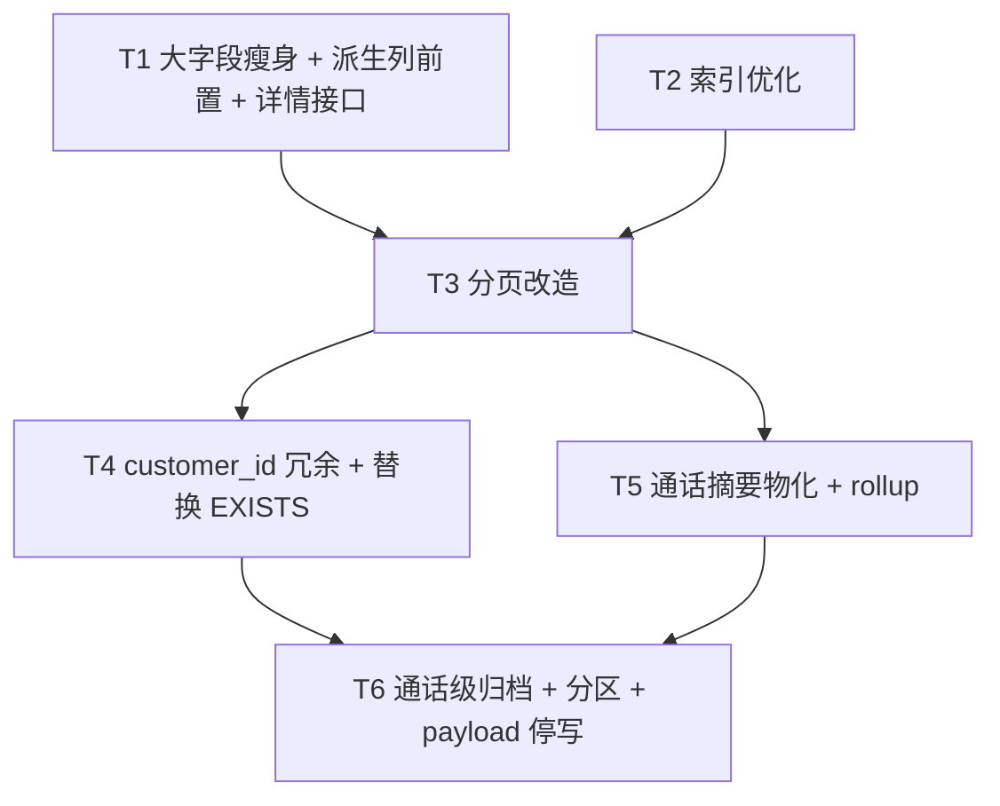
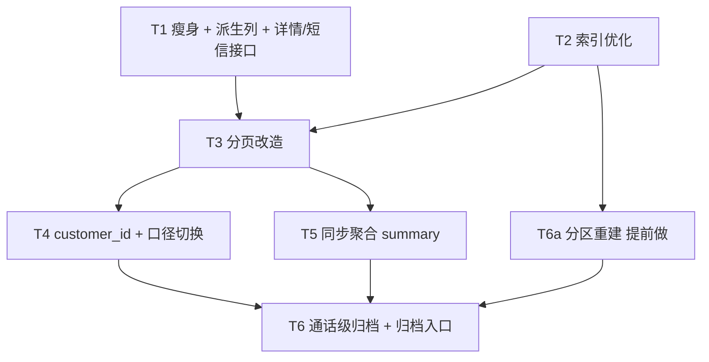
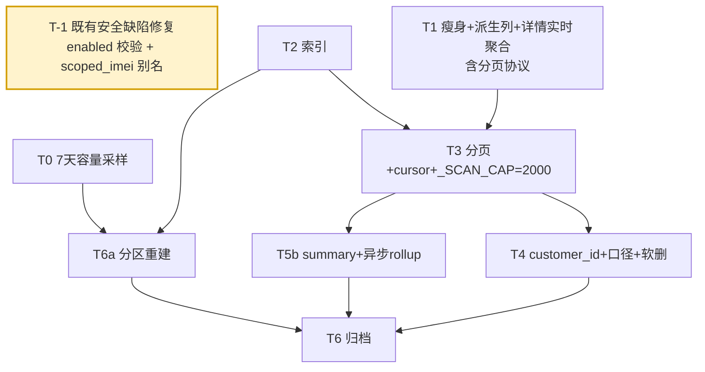
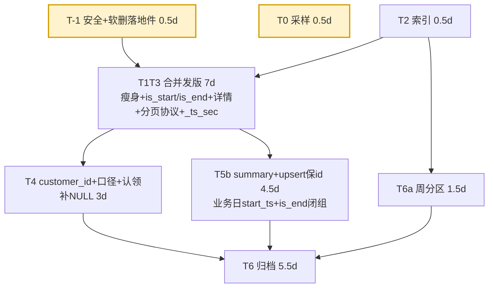
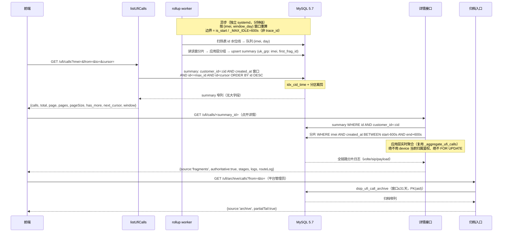
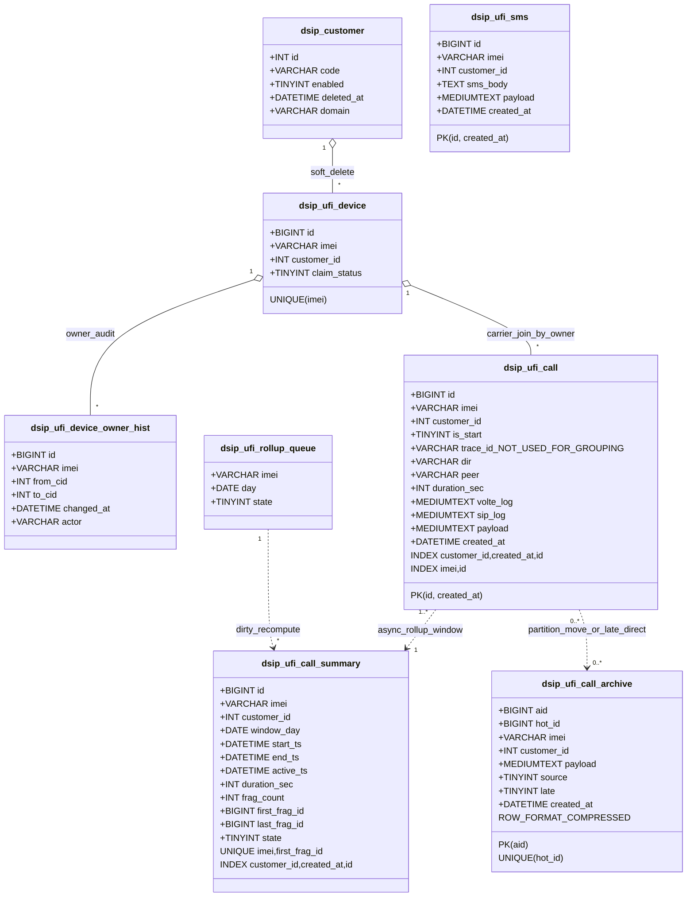

# dSIPRouter 短信记录 + 通话记录：大数据量存储与查询优化方案

> 范围：存量系统改造，硬约束为「改动尽量小、数据尽量多保存不丢、复用现有 ACL 多租户隔离」。
> 源码核验基线：`gui/modules/api/ufi_device.py`（建表/写入/查询/聚合）、`gui/modules/api/acl.py`（多租户隔离）、`gui/modules/api/ufi_comm.py`（pool 表）、`docker-compose.yml:28`（**MySQL 5.7**）。
>
> **⚠️ v5.0 版本前提修正（2026-10-22，见 `docs/db_engine_decision.md`）**：本文 §7.0 的 E1~E5 以 `docker-compose.yml` 的 MySQL 5.7 为基线，但**现网实测为 `MariaDB 10.6.23`**（Ubuntu 22.04 源装，SSH 核验；5.7 仅存在于测试栈）。据此 **E3（自增持久化）/E4（窗口函数/CTE）/E5（instant DDL、IGNORED 索引）三条不成立**，E1/E2 仍成立。对应的设计决策（软删、应用层 rollup、代码 flag）**全部保持不变**，但理由已由"版本能力不足"改为"实现可维护性"。**施工清单与人日不变，照 §十 执行。**

>
> **v4.1 定稿入口：直接跳 §十（v4.1 收口定稿）**。§一~§九 保留为历史论证与施工清单；与 §十 冲突处以 §十 为准。
> v4.1 修正了 v4 的 9 个新引入问题（N-1~N-9），其中 3 个**照 v4 施工会直接出事**：①`dsip_customer` **没有 `deleted_at` 列**（`acl.py:107-117`）→ T-1 上线即登录 500；②`_ts_sec` 是 `_aggregate_ufi_calls` 的**嵌套函数**且**不支持 ISO `T` 格式**（`ufi_device.py:2008-2018`）→ 我上轮说"兼容三格式"是错的；③`lock_wait_timeout` **全仓未设置**（MySQL 5.7 默认 1 年）+ `persist_ufi_payload` 的裸 `except: rollback`（`ufi_device.py:427-428`）→ 维护窗口内**静默丢上报**，比"批量踢设备"更隐蔽。
> v4 的四个新事实推翻了 v3 的三个核心设计：①**固件每个状态变化都换新 sessionId**（`traceId=CALL-1-<ts>`）→ v3 的 `UNIQUE(imei, trace_id)` 归并彻底不成立，T5 重写为「详情直读分片实时聚合 + summary 异步 rollup」；②**`dsip_ufi_pool.customer_id` 全仓无写入点**（建表都没这列）→ v3 的 carrier JOIN 会恒空，改 JOIN `dsip_ufi_device`；③**`scoped_imei('')` 生成恒真子查询** → 短信/事件/告警/文件四处既有跨租户越权（P0-4）；④**HA 路径装的是 MariaDB** → v3 的 E1~E5 必须标注为「MySQL 5.7 假设」并做版本核验。

---

## v2 修订记录（QA 复审定稿）

> 结论：吸收 QA 3 阻断 + 3 附加，定稿三原则——①大字段瘦身**不砍列表展示/过滤字段**：`duration_sec/peer/dir` 与 `is_start` 一起在写路径「日志正则兜底落列」，`direction/outcome` 读时基于结构列算；②`is_start` 回填完成并**对拍校验通过后**才切读列，期间双轨灰度，`_START_RE` 统一 `re.IGNORECASE` 修既有大小写 bug；③分片归档**必须通话级**——先上 T5 summary 再归档分片，晚到分片按 `start_ts` 归属月补偿归档。

| # | v1 问题 | v2 定稿 | 落点 |
|---|---|---|---|
| 1 | 「其余读大字段的统统下沉详情」不准确：`duration_sec` 回推(2091-2104)/`peer` 回退(2132-2137)/`dir` 回退(2138-2141)/`direction` 判定(1991-2001) 4 处是**列表展示/过滤字段**，瘦身后列表无 volte_log → duration 变 0、direction 误判 'in'（呼出被当呼入，direction 过滤 2378 失效）、peer/dir 缺失 | `duration_sec/peer/dir` 与 `is_start` 一起在 `_ingest_records` **日志正则兜底落列**（复用现有列，不加新列；值可为空但列必填），`direction/outcome` 读时基于结构列算，列表不再依赖 volte_log | §3.1、T1 |
| 2 | is_start 回填未定时序；`_START_RE`(2026) 大小写敏感 vs `_status_log_summary`(490-492) 小写 `state=dialing`，回填会固化既有 bug | 分批回填 → 对拍校验（is_start 列 == 读时正则）→ 再切读列（双轨灰度）；`_START_RE` 与 `dir=MO/MT` 派生正则统一 `re.IGNORECASE` | §3.1、§5、T1 |
| 3 | 分片按月归档按 `created_at`（=NOW() 插入时间，692/710）会切断跨月/跨年通话 | 归档**通话级**：先上 T5 summary 再归档分片，按 `summary.start_ts` 归属月整体搬迁；晚到分片补偿归档；未上 T5 禁止物理切分 | §3.4、T6 |
| 4 | customer_id 回填泄漏：4 表若纳入 `_SCOPED_TABLES`，`backfill_tenants`(220-246) 会把 NULL 行回填默认租户 | 4 表加列走 `_ensure_customer_cols`；回填走**独立 device-join**，并加入 `_BACKFILL_EXCLUDE`，未认领保持 NULL；记录从 `dsip_ufi_device.customer_id` 实际值落列（**不从 import 表值**，import 可被 713-717 ON DUPLICATE 单独改写致漂移）；改归属/删客户联动 UPDATE 同事务+按 imei 锁，cid=NULL 路径也置 NULL | §3.5、T4 |
| 5 | keyset 只取一页原始分片算不出精确 total（2382-2387 total=len(hits) 全量聚合）；keyset 切在通话中间会拆通话 | 读时聚合下 keyset 用「通话级时间窗口 + 回补边界分片」；total 降级为 `has_more`/近似值，精确 total 交 T5 summary | §3.3、T3 |
| 6 | payload 停写未确认边界 | call/sms 的 payload 确认为 write-only（仅 INSERT 650/663、692/710）；**dsip_ufi_event.payload 有 SELECT(2231) 不可动**；停写做开关，详情接口不依赖 payload 必填，已存保留 | §3.6、T6 |

---

## v3 修订记录（用户拍板定稿，7 项全关闭）

> 结论：v2 把 7 个问题「列为待明确」，v3 把它们**固化进设计**。本版最大变化不是优化，而是三件事：①**行为语义变更**——历史记录不再跟随设备（7.3）；②**环境事实**——MySQL 5.7 逼出「分区必须改主键 + 分区要早做」；③**容量事实**——`LIMIT 5000` 在 >30 台设备的租户上已经在**丢业务数据**，属功能缺陷而非性能问题（7.2 表 C）。

| # | v2 遗留问题 | v3 拍板定稿 | 落点 |
|---|---|---|---|
| 1 | 热表保留 3/6/12 个月？ | **3 个月**；按月 `RANGE COLUMNS(created_at)` 分区，常驻 4 个分区（当月+前2+下月预建）+ `pMAX` 兜底 | §7.4、T6 |
| 2 | 是否跨 1 年查询？ | **不跨**；列表**只查热表、不做 UNION**，归档走独立只读入口（窗口 ≤31 天） | §7.4、§7.7 |
| 3 | 归档介质？ | **本地 InnoDB 归档表**（同构 + `ROW_FORMAT=COMPRESSED`），不引入对象存储；**磁盘不省只省热表**（须先对齐预算，见 7.2） | §7.4、T6 |
| 4 | payload 停写？ | **保留，双写维持**；v2 §3.6「停写/裁剪」**作废**；详情暴露 `payload` + `payloadTruncated`；event 不动 | §7.5、T6 删开关 |
| 5 | 容量预估？ | **300 行/设备/天 × 1,000~3,000 设备 → 2,700 万~8,100 万行/3 个月**；据此定分区粒度、索引、`_SCAN_CAP` 语义 | §7.2、§7.7、§7.8 |
| 6 | 详情实时性？ | **尽量实时** → T5 由「后台 rollup」改为**写时同步 upsert summary**（同事务、按通话归并 1 次/请求）+ 每日对账兜底 | §7.6、T5 |
| 7 | 历史是否跟随设备？ | **不跟随** → `record.customer_id` 为写入时快照；**取消 T4 联动 UPDATE**；列表/详情口径统一；删客户走墓碑租户 | §7.3、T4 |

---

## v4 修订记录（QA 评审 6 P0 + 13 P1，4 项裁决落地）

> 结论：v3 **不放行**。6 个 P0 中 4 个是"v3 方案在某条代码事实上不成立"，2 个是"既有缺陷被本方案放大"。v4 的处理原则：**凡是 v3 依赖的代码事实被证伪，就改方案形态；凡是既有缺陷，就当作必要修复一起做（不夹带、但也不回避）**。

| # | P0 问题 | v4 定稿 | 落点 |
|---|---|---|---|
| P0-1 | 固件每状态变化换新 sessionId → `UNIQUE(imei, trace_id)` 让每分片独立成行，summary=2700 万行、T5 价值归零；详情只查到单个片段 | **T5 拆成两条路**：详情**直读分片、应用层实时聚合**（不依赖 summary）；summary 降级为**异步 rollup**（服务端按 `is_start` + `_MAX_IDLE` 边界归并，不用 trace_id），只供列表/统计/精确 total | §8.2 |
| P0-2 | `dsip_ufi_pool.customer_id` 全仓无写入点 → v3 的 `p.customer_id=c.customer_id` 让 carrier 恒空 | 改 `LEFT JOIN dsip_ufi_device d ON d.imei=c.imei AND d.customer_id=c.customer_id` + `LEFT JOIN dsip_ufi_pool p ON p.imei=d.imei`；carrier 过滤同条件。**不再依赖 pool.customer_id** | §8.3 |
| P0-3 | 删客户：墓碑把 N 个客户历史混成 1 个 id，丢失"谁删的"；且现状 `enabled=0` 仍可登录 | 改 **C′ 软删客户行**（`enabled=0, deleted_at=NOW()`，不删 id、不搬历史）+ **三个强制点**（登录校验 enabled / 绑定拒绝软删 / 保留码与不可删不可改）| §8.4 |
| P0-4 | `scoped_imei('')` → `_own.imei=imei` 恒真 → 短信/事件/告警/文件**既有跨租户越权** | `scoped_imei` **强制别名**（空则抛错），4 处 `''` 调用全部改具名别名；新增跨租户门禁用例。与 P0-3① 合并为 **T-1（独立先发版，0.2d，无依赖）** | §8.4、§8.11 |
| P0-5 | T6a 分区迁移缺验收；`_ensure_partitioned_tables` 若挂进 `_ensure_ufi_tables` 会在每条上报执行 DDL | **七步验收**写死；`_ensure_partitioned_tables` 只能是**只读 detector**，DDL 一律走独立迁移脚本 | §8.6 |
| P0-6 | `pMAX` 与 `ADD PARTITION` 互斥 | 改 `REORGANIZE PARTITION pMAX INTO (...)`；明确**不是 O(1)**、需表级 MDL、低峰执行；`pMAX` 有行 → **阻塞后续迁移 + 高优先级告警** | §8.7 |

**13 个 P1 处置总表（接受 / 拒绝 / 延后 + 理由）**

| # | 问题 | v4 处置 | 落点 |
|---|---|---|---|
| P1-1 | 版本核验（HA 是 MariaDB） | **接受**：E1~E5 标注为「MySQL 5.7 假设」，加版本核验门禁 + MariaDB 分支差异 | §8.0 |
| P1-2 | summary 无 duration 落点（列表时长全 0） | **接受**：summary 加 `active_ts`，`duration = COALESCE(duration_sec, end-active)` | §8.2.3 |
| P1-3 | 写放大算错（每请求最多 1 行 call） | **接受**：`_ingest_records` 单条 INSERT（675-711）→ upsert 次数 = 分片数，重算为 0.016~0.1 次/s 级 | §8.2.6 |
| P1-4 | `has_sms` 时 call 分片被静默丢弃 | **接受**：拆成两个独立 if；并登记"带 `log` 的状态上报也进 call 表"对容量的影响 | §8.9、T1 |
| P1-5 | 墓碑要**单事务**改 4~5 张表千万行（单个 300 台客户 ≈ **810 万行**）→ undo/binlog 撑爆、删客户变小时级阻塞，需分批 `LIMIT 5000` + 后台任务 | **因 C′ 消解（非忽略）**：C′ 软删**不搬历史、零改写历史行**，该风险路径整条不存在 → 不需要分批 UPDATE、不需要后台任务、不需要"删除进度条"UI。**这是选 C′ 而非墓碑的第二个收益（第一个是保留客户身份），不是漏项** | §8.3 |
| P1-6 | 删客户 | **接受**（由 C′ 解决）| §8.4 |
| P1-7 | 大表 DDL 挂在请求路径（`ensure_acl_tables` 在 `_upsert_device` 每条上报都调，~30 次元数据查询 + 3 次 commit）| **接受**：迁移移出热路径（启动时一次性 schema flag）；"同事务"改为**显式 no-commit 只读**；文档写明禁止在 device upsert 与记录 INSERT 之间 commit | §8.10 |
| P1-8 | 归档表 `PK(id)` 与"直写归档"共享 id 空间会撞 id；与"完全同构"自相矛盾 | **接受**：归档表 = 热表同构 + 3 个归档专列（`aid` PK 自增 / `hot_id` UNIQUE NULL / `source` / `late`）| §8.8 |
| P1-9 | `>90 天`判定用 VARCHAR `start_ts` 不可靠 | **接受**：改用 `_ts_sec()` 归一（ms/s/ISO 三格式）+ 多级 fallback，**且不再依赖 summary**（比 v3 更简单）| §8.8 |
| P1-10 | keyset `(created_at,id)` 并发跳行 | **接受**：改 **id 快照游标 +（created_at 自适应页窗）**；说明为何纯 created_at / 纯 id 都不行 | §8.11 |
| P1-11 | 分页协议变更破坏前端 | **接受**：保留 `total/page/pages/pageSize` 兼容字段 + 新增 `has_more/next_cursor/window`；给出前端改动清单与默认窗口 UI 说明 | §8.11 |
| P1-12 | 详情缺 legacy 回退 | **接受**：summary 未命中 → 按分片 id 直查临时聚合，标 `source:'fragments'` | §8.2.5 |
| P1-13 | 归档搬迁期晚到写入被 DROP | **部分拒绝 + 定稿**：`created_at=NOW()` 保证晚到写入落在**当月分区**（不在被 DROP 分区），故非真风险；仍按要求把补偿提到 DROP 之前执行一轮（防御）+ 搬迁期禁止改分区结构 | §8.8 |
| 另 | `routeLog` 来自 `acc`（无租户列、保留期短于 3 个月） | **接受 + 登记 + UI 标注**，附加两条收敛措施 | §8.10 |

---

## v4.1 修订记录（QA 终审：9 个 v4 新引入问题，全部收口）

> 结论：v4 的**方向对、落地件缺、两处自相矛盾**。v4.1 不改变整体架构（详情实时聚合 / summary 异步 rollup / 周分区 / 软删），只做三件事：①**补 4 个缺失的落地件**（`deleted_at` DDL、`_ts_sec` 提级、`lock_wait_timeout`、`resolve_device_customer` 的 join 与锁）；②**消灭 2 处自相矛盾**（列表数据源二义、T1/T3 分批 vs 同批）；③**把 rollup 从"增量 merge"降级成"整窗删了重建"**（更简单且天然幂等）。

| # | v4 问题 | v4.1 定稿 | 落点 |
|---|---|---|---|
| **N-1**（P0）| **列表数据源二义**：§8.1.3 契约说"列表→summary"、§8.11 也说"切 summary"，但 §8.9 分页 SQL 全是热表路线（`MAX(id) FROM dsip_ufi_call`、`need=25R+40`），P1-11 又说 `total` 来自 summary COUNT → **同一响应里 `total` 与 `calls` 属不同表的 id 空间，翻页必然对不上** | **两阶段各自单一数据源** + **cursor 版本化**（`{v:1, src:'hot'|'sum'}`），不匹配返回 `400 + {refresh:true}`；T3 阶段**禁止引用 summary** | §10.1 |
| **N-2**（P0）| **rollup 双计**：`uk_grp(imei, first_frag_id)` 只防"同组重复 upsert"，**防不住同一通话被拆成两组**（长通话中间 29 分钟无状态变化、或设备离线补传 → `_MAX_IDLE=600s` 切成两组，第二组 `first_frag_id` 是新分片 → 天然新键）| **放弃增量 merge**，改 ~~"整窗 `DELETE` + 整批 `INSERT`"~~ **← 已被 §10.14 X-1 取代（DELETE+INSERT 会让 id 变化、打崩 id 快照游标）**：改为 **`ON DUPLICATE KEY UPDATE` 保 id + 差集 `DELETE`**（同事务、`window_day` 唯一归属、天然幂等）；结束判据用 `max(end_ts)`；**开工前置：用 1 通真实 30 分钟通话的 4 个分片实测 END 分片的 `endTs` 语义** | §10.2 |
| **N-3**（P0）| `_ts_sec` **是 `_aggregate_ufi_calls` 内的嵌套函数**（`ufi_device.py:2008`），只支持 float 与 `%Y-%m-%d %H:%M:%S` → **ISO 带 `T` 必然返回 None**；v4 文档写的"兼容 ms/s/ISO 三格式"是**事实错误** | **T1 提为模块级并支持 5 种格式**（秒 / 毫秒 / `YYYY-MM-DD HH:MM:SS` / ISO `T` / 带 `Z`/`±HH:MM`）+ 6 组参数化单测；是 rollup、归档迟到判定、详情聚合**三条路径的共同前置** | §10.3 |
| **N-4** | **写路径既有 `FOR UPDATE`**：`resolve_device_customer`（`acl.py:272-296`）含 **2 处 `LIMIT 1 FOR UPDATE`**（imei / sim 各一），与 §8.1.2/§8.10 的"写路径禁止任何跨请求行锁"**直接冲突，且是既有代码在违反** | 去掉 `FOR UPDATE`（改为普通 `SELECT` + 进程内 10s 缓存），T-1 一并交付 | §10.4 |
| **N-5**（P0）| **`lock_wait_timeout` 全仓未设置**（MySQL 5.7 默认 `innodb_lock_wait_timeout=50s` / `lock_wait_timeout=31536000s` 即 **1 年**）→ MDL 阻塞时 INSERT 无限排队，而 `persist_ufi_payload` 的裸 `except: rollback`（`ufi_device.py:427-428`）**静默吞掉** → 维护窗口内**既不报错也不掉线，而是静默丢上报** | WS/ingest 会话统一 `SET SESSION innodb_lock_wait_timeout=2, lock_wait_timeout=2`；超时**必须记日志 + 计数**，禁止被裸 `except` 吞；`REORGANIZE` 只在 `pMAX` 空时执行 | §10.5 |
| **N-6** | **认领前数据永久不可见**（产品可见回归）：现网 `scoped_imei` 下设备认领后能看到**全部历史**；改为 `record.customer_id` 后，认领前的记录 `customer_id IS NULL` → 认领后**谁都看不到** | `claimUfiDevice` 补 `UPDATE dsip_ufi_call/sms/summary SET customer_id=:cid WHERE imei=? AND customer_id IS NULL`（**只补 NULL，不违反"历史不跟随"**）| §10.6 |
| **N-7** | **软删三件套缺失**：①`dsip_customer` 建表（`acl.py:107-117`）**没有 `deleted_at`**，全文无 `ALTER` → T-1 上线**登录 500**；②`resolve_device_customer` 不 join 客户状态 → **停用租户持续把新设备吸进来**；③软删后 `dsip_ufi_import` 行与 `uk_import_imei` 的冲突未定义 | ①T-1 自带**幂等** `ADD COLUMN deleted_at`；②join `dsip_customer` 且 `enabled=1 AND deleted_at IS NULL`；③import 行**保留**（审计），认领路径沿用现有 `DELETE ... WHERE imei` 覆盖语义（已核验 `1219-1223`），并把"停用客户仍持 import 行"列入巡检 | §10.7 |
| **N-8** | **分区决策树把"设备翻倍"变成"全表重建"**：v4 按 M/W 选月/半月/周，一旦选错或业务增长 → 5.7 只能 COPY 重建 | **直接按周分区，"锁死"风险归零**（5.7 上限 8192 分区，5 年周分区仅 260 个）；决策树降级为"只决定归档/DROP 频率"；原表保留为"为什么选周"的论证 | §10.8 |
| **N-9** | ①`uk_hot(hot_id)` 在 5.7 id 复用下可能被 `INSERT IGNORE` **静默丢行**；②实时流 `listUfiRecords` 用 `with_route_log=True` 每轮**数百次 acc 点查**；③文档 3 处不一致（T1 行残留 `★P0-4`、上线顺序与 C1 矛盾、§7.3.2 旧 JOIN 写法）| ①`UNIQUE(hot_id, created_at)` + 每批断言 `ROW_COUNT()==1`，为 0 告警；②改 `_attach_route_logs` 且上限压到 **80**；③三处已改（T1 行 → T-1、T1/T3 **合并为一次发版**、§7.3.2 加删除线指向 §8.2）| §10.9 |

**顺带纠正一处上游事实**（影响后续全部时间判断）：`_ts_sec` **只兼容"秒 / 毫秒 / `YYYY-MM-DD HH:MM:SS`"三种**，**不支持** ISO `T` 与 `Z`/时区偏移。v4 §8.8 的 P1-9 措辞已改，见 §10.3。

---

## v4.2 修订记录（QA 复核 §10.1/§10.2 接缝：8 个交叉问题）

> **两节各自都"条件闭合"，洞全在两节接缝处。** 方向不改（QA 明确认可"只 emit `window_day==D`"与"整窗重建"比它上轮建议更干净），只做 8 处交叉修正 + 3 处论证纠错。全部落点：**§10.1 就地改（游标字段）+ §10.2 就地改（upsert / 业务日 / 闭组常量与顺序）+ 新增 §10.14（汇总与落地件）**。

| # | 交叉问题 | v4.2 改法 | 落点 |
|---|---|---|---|
| **X-1**（P0）| **DELETE+INSERT 让 summary 拿到新自增 id**，与 §10.1 的 `max` + `id<cursor` **id 快照游标**冲突 → 重建后整窗行**从本次分页消失**（"某通电话突然不见、未看到的被永久跳过"），`total` 不变而行错位 | 改 **`ON DUPLICATE KEY UPDATE`（保住原 id）+ 差集 `DELETE`（只删消失的组）**；稳态 id 不变 | §10.2① + §10.14.1 |
| **X-2**（P0）| **`window_day=DATE(created_at)`**（入库时间）+ T5b 列表若照抄 `created_at>=:from` → **补传的 1~89 天前话务归"今天"**，查"3 天前"看不到、查"今天"反看到 3 天前的 | `window_day` 改 **`DATE(start_ts)`（业务日）**；**T5b 列表的窗口过滤与游标排序时间戳一律用 `start_ts`，禁止 `created_at`**（硬约束）| §10.1 表 + §10.2① + §10.14.2 |
| **X-3**（P1）| 归档后 `DROP PARTITION` → 补传 1~2 分片落当月分区 → 今天窗重算只看到孤片 → 产出**残缺通话**（只有 END、时长 0），而完整分片躺在归档里 | 重算前判 `D < min(hot 分区下界)` → **该 D 不 rollup，补传分片直写归档**（`source=1, late=1`）；**`late` 判据从"距 90 天"改为"目标 `window_day` 已归档"** | §10.14.3 |
| **X-4**（P1）| 默认窗随 `now` 滑移，但 `f` 按原始空串算 → 第 30 页窗口走了 10 分钟，**md5 不变 → 校验通过 → 静默丢行**（正好违反自己的"绝不静默跳行"）| 游标冻结 `wf/wt`（页 1 解析后固定）；`f` 对**解析并归一化后**的 `wf/wt` 取 md5 | §10.1 游标表 |
| **X-5** | `ts` 存本地时间字符串 → HA 双节点时区不同即漂移 | 改存 **epoch 秒整数** | §10.1 |
| **X-6** | `f` 不含 `cid` → 同浏览器切租户/多标签，B 拿 A 的 `max` 把自己新记录全滤掉 | `f` 加 **`cid`** | §10.1 |
| **X-7** | `span` 跨页累积不回落 → 撞过 96h 后每页都按 96h 扫（≈108 万行/页）| **每页以 `base_span`(6h) 起算，只在页内放大** | §10.1 |
| **X-8** | `totalApprox` 时 `pages` 虚高可点到空页 | **`has_more` 是唯一权威终止信号**，`pages` 登记为中间态 | §10.1 |

**三处论证纠错（不改就不自洽）**
1. ±1 天上下文的理由错：v4 写"`_MAX_IDLE=600s` ⇒ 最多跨 10 分钟"，已被第 5 条规则（`_LONG_IDLE`）推翻 → 改为"最多跨出 `_LONG_IDLE`=30 分钟 ≪ 1 天"。
2. `_LONG_IDLE` **3600 → 1800**，并加 `merge_suspect` 计数（合并后 `duration` 放大 >2× 即告警）；真实最长通话时长由 §10.2③ 的实测采出来，不拍 3600。
3. **5 条规则必须写死求值顺序**（`is_start` 开组**先于**所有收尾判定；`_LONG_IDLE` 只允许出现在"静默后由 END 桥接"那一支，平铺会成死分支），并给 `2037-2042` 孤儿并入分支**补置 `cur.is_end`**。

---

## 结论先行

> ⚠️ 本节为 v1/v2 结论，**已被 §七 部分覆盖**：热表保留期（6 个月→**3 个月**）、`payload` 停写（→**保留**）、归属语义（跟随设备→**不跟随**）、T5 形态（后台 rollup→**写时同步聚合**）、分页（total→**has_more + 有界 COUNT**）。以 §七 为准。

**根因一句话**：`listUfiCalls` 每次把最多 5000 行、每行携带 `volte_log + sip_log` 两个 MEDIUMTEXT 大字段拉到内存，再做「正则判边界 + 内存聚合 + Python 过滤/分页」；表上只有 `(imei, created_at)` 一个索引、没有 `customer_id` 冗余列、没有任何保留/归档策略，且 `payload` 大字段与日志内容重复且**从不被读取**。

**推荐方案（分两阶段，全部不丢数据、可回滚）：**

- **阶段一（P0，立即做，改动小、收益最大）**：
  1. **大字段瘦身**——列表接口只查窄列，`volte_log/sip_log/payload` 走新增详情接口按主键单查；**不拆表**（InnoDB 大字段本就行外存储，窄列查询不读溢出页）。
  2. **派生列前置**——把 `is_start`（通话边界）与 `duration_sec/peer/dir`（列表展示字段的日志兜底）**在写入时用同正则落列**，使列表聚合彻底摆脱大字段（v2 修订）。
  3. **加索引**——补 `(created_at, id)` 与 `(imei, id)`，支撑时间范围 + 按 id 倒序翻页。
  4. **分页改造**——去掉无界 `LIMIT 5000 + 大字段`，改为「通话级时间窗口 + keyset 游标 + 窄列 + 回补边界分片」（v2 修订）。
  5. **补短信专用列表/详情接口**（当前短信只在总览里取最近 500 条，无法检索历史）。
- **阶段二（P1，数据量上来或按需做）**：
  6. **`customer_id` 冗余列**（语义「记录跟随设备」）替换 `EXISTS` 子查询，消除逐行点查。
  7. **通话摘要物化表 `dsip_ufi_call_summary`**（后台 rollup），彻底 SQL 真分页、消除读时聚合。
  8. **通话级按月归档**（先 T5 再归档，只搬不删）+ 评估 `payload` 停写/裁剪（v2 修订）。

---

## 一、问题诊断

### 1.1 查询慢（根因与证据）

| # | 根因 | 证据（文件:行号） | 影响 |
|---|---|---|---|
| Q1 | 列表查询拉全量 5000 行 + 2 个 MEDIUMTEXT，无 SQL 分页 | `ufi_device.py:2323-2349`（`SELECT ... c.volte_log, c.sip_log ... ORDER BY c.id DESC LIMIT 5000`）；分页在 Python `2368-2387` | 每次请求大字段 IO + 内存占用，随数据量线性恶化，OOM/超时高风险 |
| Q2 | 读时内存聚合读每行大字段 + 正则判边界 + O(n log n) 排序 | `_aggregate_ufi_calls` `2004-2146`：`2031-2032` 拼 `volte_log+sip_log` 跑正则 `state=DIALING|INCOMING`；`2030` `sorted(...)`；`2082-2090` 合并日志；`2091-2104` duration 回推、`2132-2141` peer/dir 回退 | CPU/内存热点，且因需完整序列而无法真分页 |
| Q3 | 无时间索引，现有 `(imei, created_at)` 撑不起 `created_at` 范围 + `ORDER BY id DESC` | 建表 `170-184`（sms）、`186-206`（call）仅 `KEY imei_time_idx (imei, created_at)` | 带时间过滤时走全表扫描；`ORDER BY id DESC` 需额外排序 |
| Q4 | 多租户 `scoped_imei` 生成 `EXISTS` 子查询，逐候选行执行 | `acl.py:378-388`；`ufi_device.py:2218-2220 / 2333-2334` | 候选行多时 O(N) 次设备点查；且 `dsip_ufi_sms/call/event/alert` 不在 `acl.py:178-184 _SCOPED_TABLES`，无 `customer_id` 列 |
| Q5 | `LEFT JOIN dsip_ufi_pool` + 每页 `_attach_route_logs` 对 `acc` N+1 | `2328`（join）、`2149-2168`（N+1，已限当前页） | 5000 行 join 开销；每页额外 acc 查询（有界，属次要点） |
| Q6 | 无短信专用列表/详情接口 | 短信仅在 `listUfiRecords:2221-2224` 取最近 500 条 | 历史短信无法按 IMEI/时间检索、无法翻页 |

### 1.2 存储膨胀（根因与证据）

| # | 根因 | 证据（文件:行号） | 影响 |
|---|---|---|---|
| S1 | call 表 3 个 MEDIUMTEXT，且 `payload` 与 `volte_log/sip_log` 内容重复 | 建表 `186-206`；写入 `647` `payload=json.dumps(整个payload)[:16000]`；`682-689` logs 从 payload 抽出 | 单行最多 3×16MB，实际每片段数十 KB 被重复 2~3 倍 |
| S2 | `payload` 列写入后**从不读取**（write-only，call/sms 两表） | 全仓检索：call/sms `payload` 仅 INSERT（`650/710`），无 SELECT；**注意 `dsip_ufi_event.payload` 有 SELECT（`2231`），不可动** | 纯存储负担（但保留原始 JSON 有审计价值，是否停写需用户拍板） |
| S3 | SMS/CALL 无保留/归档/清理策略 | 仅 `dsip_ufi_event` 有每设备 50 条保留（`412-415`）；sms/call 无任何清理 | 长期无限膨胀 |
| S4 | 无分区，单表无限增长 | 建表无 `PARTITION` | 大表 DDL/备份/清理困难 |

---

## 二、候选方案对比

### 2.1 查询优化

| 方案 | 改动量 | 查询收益 | 存储收益 | 风险 | 是否丢数据 |
|---|---|---|---|---|---|
| ① 索引优化 + 覆盖索引 | 小（纯 DDL） | 高（时间范围 + 翻页走索引） | 无 | 低（需在线 DDL/低峰执行） | 否 |
| ② 大字段瘦身（列表不 SELECT 大字段 + 详情单查 + 派生列前置） | 中（改查询 + 新增详情接口 + 写路径落派生列） | 高（消除大字段 IO，命中根因） | 无（大字段仍保留） | 低 | 否 |
| ③ SQL 真分页 + 聚合前置 | 中–大（会话化需完整序列，须时间窗口或落表配合） | 高 | 无 | 中（一致性/回填） | 否 |
| ④ 通话摘要物化表 `dsip_ufi_call_summary` | 大（新表 + 写入/rollup + 回填 + 查询切换） | 最高（O(page) 分页、无内存聚合） | 略增（窄列冗余，但省去读大字段） | 中–高（双写/对账/回填） | 否 |

**对比结论**：②+① 是「改动小、收益高、零风险」的必做项；④ 是彻底解，但代价最大，放二期。

### 2.2 长期存储

| 方案 | 改动量 | 查询收益 | 存储收益 | 风险 | 是否丢数据 |
|---|---|---|---|---|---|
| ① 冷热分层（热表 + 归档表，定期搬迁） | 中（新表 + 定时任务 + 查询路由） | 高（热表小） | 高（老数据可压/导出） | 中（搬迁窗口、回源复杂度） | 否（搬迁不删除） |
| ② MySQL RANGE 分区（按月，按 `created_at`） | 中（重建表/DDL + 后续维护） | 中（分区裁剪） | 中（可 DROP/EXCHANGE 老分区） | 中（需重建表、唯一键约束受限） | 否 |
| ③ 冷数据压缩/只留摘要 | 小–中 | 中 | 中–高 | 中（MEDIUMTEXT 压缩率一般；「只留摘要」丢原始） | 「只留摘要」会丢原始大字段 |
| ④ 归档到文件/对象存储 | 大（导出 + 回源 + 元数据） | 中（回源慢） | 高（释放磁盘） | 中–高（介质可用性、回源体验） | 否（导出不删除） |

**对比结论**：以「不丢数据 + 改动小」为标准，**首选 ② RANGE 分区**作为冷热边界（查询透明、不丢数据），必要时再叠加 ①（EXCHANGE 老分区到归档表）。④ 仅在磁盘预算紧张或合规要求时启用。**注意（v2）**：分区只能按 `created_at` 做「整表透明裁剪」；物理切分/归档到冷表必须是「通话级」而非「分片级」（见 §3.4）。

---

## 三、推荐方案（拍板）

### 3.1 大字段瘦身：怎么做（v2 修订）

- **列表只查窄列**：`listUfiCalls` / `listUfiRecords` 的 call 分支 / 新增 `listUfiSms` 一律不 SELECT `volte_log/sip_log/payload`（sms 不 SELECT `payload`）。
- **详情按主键单查**：新增
  - `GET /api/v1/ufi/calls/<id>`：返回该聚合通话的 `volte_log/sip_log/payload` + `routeLog`（详情页弹窗用）。
  - `GET /api/v1/ufi/sms/<id>`：返回 `sms_body + payload`。
- **不拆表**：InnoDB 下 MEDIUMTEXT 超过行内阈值即存溢出页，窄列查询不触碰溢出页，因此「列表不 SELECT」本身就避开了 IO，无需把大字段搬到独立表。拆表只带来 JOIN/双写复杂度，收益有限。**仅在将来要做「归档=直接 DROP 大字段表」时才考虑拆列族。**

**（v2 修订）派生列前置——瘦身必须保留列表展示/过滤字段**：

现有 `_aggregate_ufi_calls` 读大字段除了判边界，还产出 4 个**列表展示/过滤字段**，不能下沉详情：
- `duration_sec` 回推（`2091-2104`：`VoLTE state=ACTIVE→END` 时间戳差）
- `peer` 回退（`2132-2137`：`tel=([0-9*+#]+)`）
- `dir` 回退（`2138-2141`：`dir=(MO|MT)`）
- `direction` 判定（`1991-2001`：dir 结构列 → volte_log 正则 → 默认 `'in'`，默认值会把呼出误判为呼入）

**定稿**：在 `_ingest_records` 写路径，对每个分片用**同一正则**（统一 `re.IGNORECASE`）把日志兜底值**补齐到现有结构列**（不加新列）：
- `is_start`（**新增列**）：`state=(DIALING|INCOMING)` 命中 → 1。
- `dir`：`_field(payload,'dir','callDirection')` 为空时，正则 `dir=(MO|MT)` → 落 `'outgoing'`/`'incoming'`（与现状 `2141` 一致）。
- `peer`：`_field(payload,'peer','peerNumber','teleNumber')` 为空时，正则 `tel=([0-9*+#]+)` 兜底。
- `duration_sec`：`int(durationSec)` 为 0 时，对当前分片 volte_log 正则 `VoLTE state=ACTIVE→END` 时间戳差回推。

聚合与展示改为**只读结构列**：`is_start`（边界）、`max(duration_sec)`、`dir/peer`（结构列）、`direction/outcome`（读时基于结构列算，`outcome` 本就只读结构列不受影响）。跨分片的 duration 兜底（ACTIVE 与 END 在不同分片）由 **T5 summary / 详情接口**兜底，列表允许极少数 duration=0（与现状「尽力而为」一致）。
- **`_START_RE` 大小写（v2 新增）**：`_START_RE`(2026) 现为大小写敏感，而 `_status_log_summary`(490-492) 用小写 `state=dialing`。定稿统一 `re.IGNORECASE`（`dir=MO/MT` 派生同用 `re.I` 对齐 506-507），避免回填固化既有大小写 bug。
- **改造注意点**：`listUfiRecords` 的 `keyLogs`（`2273-2279`）依赖 `calls[:80]` 的 `volteLog/sipLog`；瘦身后改为「只对前 80 通通话按 id 单查日志摘要」或降级为只展示结构化字段。

### 3.2 索引怎么加

- 现有 `(imei, created_at)` **不够**：主查询是 `ORDER BY id DESC` + `created_at` 范围 +（可选）`imei`，需要以下索引：
  - `dsip_ufi_call` / `dsip_ufi_sms` 各新增：
    - `idx_created (created_at, id)` —— 支撑时间范围过滤后按 id 倒序翻页（keyset）。
    - `idx_imei_id (imei, id)` —— 支撑按设备倒序翻页（imei 等值 + 游标）。
  - 若落地 `customer_id` 冗余列（见 3.5），主索引改为 `idx_cid_created (customer_id, created_at, id)`，成为租户+时间+分页的一体化索引。
- `ORDER BY id DESC LIMIT`：无时间过滤时天然走主键（id）反向扫描，很快；有时间过滤时靠 `(created_at, id)` 让 MySQL 在时间桶内按 id 取数。`acc` 表建议补 `(src_user, time)` / `(dst_user, time)` 以加速 routeLog 回查（次要点）。

### 3.3 分页改造：把「内存聚合 + Python 分页」改成 SQL 真分页（v2 修订）

分两种口径落地：

- **短期（窄列化后，仍读时聚合）**：把「无界 `LIMIT 5000` 大字段」改为「**通话级时间窗口 + keyset 游标 + 窄列 + 回补边界分片**」——按时间窗口取窄列候选集，游标落在窗口内时**向前回补该通话的起始分片**（避免 keyset 切在通话中间把一通电话拆开）；聚合按 `is_start` 判边界，聚合后做 `day/outcome/direction` 过滤与 Python 切片。
  - **（v2）total 降级**：读时聚合下，精确 `total`（`2382-2387 total=len(hits)`）需要全量聚合、物理上无法与 keyset 兼得。列表返回 `has_more` / `next_cursor`（或近似 total），**精确 total 交给 T5 summary**。
- **长期（summary 物化后）**：直接对 `dsip_ufi_call_summary` 执行 `WHERE customer_id=:cid AND created_at 范围 ORDER BY id DESC LIMIT/OFFSET`（或 keyset），聚合已在写入/rollup 完成，实现真正的 SQL 分页、无内存聚合、精确 total。

### 3.4 冷热分层 / 归档：多久、结构、回源、多租户（v2 修订）

- **多久归档**：建议热表保留 **6 个月**（可配），`created_at` 早于 6 个月的行按月搬迁到归档表。具体保留期见「待明确事项」。
- **归档表结构**：`dsip_ufi_call_archive` / `dsip_ufi_sms_archive`，结构与热表**完全一致**（含 `imei/customer_id` 与相同索引），避免回源查询重写。
- **（v2）通话级归档（阻断项 3 定稿）**：`created_at` 是插入时间（`692/710` = NOW()），同一通电话的分片 `created_at` 可跨月/跨年。**归档/物理切分必须以「通话」为最小单位**：
  - **先上 T5 summary**（通话级物化）再归档分片；按 `summary.start_ts` 所属月判定通话归属月，把该通话全部分片（含晚到分片）**整体搬迁**到归档表。
  - **晚到分片补偿归档**：后台对账扫描「`created_at` 晚于归档月、但 `start_ts` 属于已归档月」的分片，补搬。
  - **未上 T5 前禁止分片级物理切分**；只允许「整表 RANGE 分区 + 查询扫所有相关分区」这种不破坏聚合的形式。
- **回源方式**：优先用 **RANGE 分区 + `EXCHANGE PARTITION`/`DROP`** 做冷热边界（查询透明，MySQL 分区裁剪自动只扫相关月）；如需物理归档，按上述通话级规则 `EXCHANGE` 到归档表。查询按时间路由：**近期走热表，超期走归档表**（应用层按 `from/to` 路由，或 `UNION ALL` 热+冷）。归档表带同样 `customer_id` 列，**多租户过滤不受影响**。
- **是否分区**：1–20 租户、数百 UFI 规模下，**分区不是首要矛盾**，但其**运维收益**（按月裁剪/归档/删除老分区 O(1)）显著。建议：当前数据 < 千万行时**先不分区**，把「瘦身 + 索引 + 分页 + customer_id」做对；数据接近千万行或需保留 >1 年时再上按月 RANGE 分区 + 通话级归档。

### 3.5 多租户：是否冗余 `customer_id` 列（v2 修订）

- **推荐加，语义定为「记录跟随设备」**（与现有 `scoped_imei` 的 EXISTS 语义安全等价）：
  - **写路径（v2 修正来源）**：记录 `customer_id` 必须取 **`dsip_ufi_device.customer_id` 的实际值**（`_upsert_device` 落库后的最终值，认领后既有权属），**不能**用 `resolve_device_customer` 读到的 import 表值（`acl_customer_import` 713-717 的 ON DUPLICATE KEY 可单独改 import.customer_id 而不同步 device，会漂移）。`_ingest_records` 落列前 `SELECT customer_id FROM dsip_ufi_device WHERE imei=:imei` 取实际值。
  - **归属变更**：`set_device_customer`（`acl.py:295-303`）变更归属时，**同事务 + 按 imei 锁**（`SELECT ... FOR UPDATE` device 行）同步 `UPDATE` 该 imei 的历史记录 `customer_id`；**cid=NULL 路径也要把记录 customer_id 置 NULL**（跟随设备）。
  - **存量回填（v2 独立回填）**：4 表加列走 `_ensure_customer_cols`；回填走**独立 device-join 脚本**（`LEFT JOIN dsip_ufi_device`），**不得并入 `backfill_tenants` 的 `_SCOPED_TABLES` 批量 NULL→默认租户**，并把 4 表加入 `_BACKFILL_EXCLUDE`；**未认领设备（device.customer_id IS NULL）的记录保持 NULL，不得回填默认租户**（避免泄漏给默认租户）。
- **收益**：把「O(候选行) 次 EXISTS 点查」换成「O(1) 索引范围过滤」，并可与 `(customer_id, created_at, id)` 复合索引协同。
- **代价/风险**：写路径与归属变更需联动；属于**中改动**。故排序在查询路径修复之后（P1）。若短期不引入，`EXISTS` 在数百 UFI 规模下仍是可接受的正确实现。

### 3.6 存储瘦身：`payload` 冗余（v2 修订）

- call/sms 两表的 `payload` 与 `volte_log/sip_log` 高度重复且**从不读取（write-only，仅 INSERT 650/710）**。**推荐 P1 时停写或裁剪 `payload`**：做成**停写开关**（配置项），详情接口**不依赖 payload 为必填**（payload 为空时只返回 `volte_log/sip_log` 等），已存数据保留。
- **（v2 边界）`dsip_ufi_event.payload` 有 SELECT（`2231`）正在被读取，不可停写/裁剪**，仅针对 `dsip_ufi_call` / `dsip_ufi_sms` 两表。是否停写取决于「原始 JSON 是否需用于审计」，需用户拍板（见「待明确事项」）。

---

## 四、任务分解（v2，有序，含依赖）

> **已被 §7.9 取代**（v3 新增 T6a 分区重建、T4 取消联动 UPDATE、T5 改同步聚合、T6 改 3 个月热表）。本节保留供追溯。

> 工作量：小（≤半天）/ 中（1–2 天）/ 大（≥3 天，含回填与联调）

| ID | 任务 | 涉及文件 / 函数 | 改动类型 | 工作量 | 依赖 |
|---|---|---|---|---|---|
| T1 | 大字段瘦身（分两步）+ 派生列前置 + 详情接口 + 短信列表/详情 + 正则大小写统一 | `ufi_device.py`：`_ensure_ufi_tables`(加 is_start 列)、`_ingest_records`(落 is_start + dir/peer/duration_sec 日志兜底)、`_aggregate_ufi_calls`(切 is_start 边界、去日志合并、读结构列)、`_call_direction`(读结构列)、`listUfiCalls`/`listUfiRecords`(窄列、keyLogs 适配)、新增 `listUfiSms`/`getUfiCallDetail`/`getUfiSmsDetail`；`_START_RE` 改 `re.I` | 加列 / 改查询 / 新增接口 | 中+ | — |
| T2 | 索引优化 | `ufi_device.py`：`_ensure_ufi_tables`（`ALTER TABLE` 加 `(created_at,id)`、`(imei,id)`；`acc` 加 `(src_user,time)`/`(dst_user,time)`） | 加索引（在线 DDL） | 小 | 可与 T1 并行 |
| T3 | 分页改造（通话级时间窗口 + keyset + 回补边界分片 + total 降级为 has_more） | `ufi_device.py`：`listUfiCalls`/`listUfiRecords`/`listUfiSms` | 改查询 | 中 | T1、T2 |
| T4 | `customer_id` 冗余列 + 替换 EXISTS + 归属变更联动 + 独立 device-join 回填 | `acl.py`：`_ensure_customer_cols`(4 表加列)、`_BACKFILL_EXCLUDE`(纳 4 表)、`set_device_customer`(同事务+按 imei 锁联动 UPDATE)、`scoped_imei`(切换直连过滤)；`ufi_device.py`：`_ingest_records`(从 device 实际值落列)、查询替换过滤条件；新增独立回填脚本 | 加列 / 改查询 / 迁移脚本 | 中 | T3 |
| T5 | 通话摘要物化表 + 后台 rollup + 查询切换（精确 total / 真分页 / duration 跨分片兜底） | 新表 `dsip_ufi_call_summary`；`ufi_device.py` 或新增 `ufi_rollup.py`：后台增量 rollup（按 `created_at > watermark` 复用聚合逻辑）；`listUfiCalls` 切 summary、详情回 `dsip_ufi_call` | 加表 / 后台任务 / 改查询 / 回填 | 大 | T3 |
| T6 | 通话级按月归档 + 分区 + 归档路由 + payload 停写开关 | `dsip_ufi_call/sms`（重建为分区表）、`dsip_ufi_call_archive/sms_archive`、`cron` 搬迁任务（通话级，晚到分片补偿）、列表按时间路由热/冷、`payload` 停写开关 | 加分区 / 加归档表 / 定时任务 / 改查询 / 开关 | 大 | T5（通话级搬迁）、T4（customer_id 就位）、T2（索引） |

**T1 内部两步（可独立灰度/回滚）**：
- 步 1（is_start 前置，仍读大字段兜底）：落 is_start + 存量回填对拍 + `_START_RE` 改 `re.I` + 聚合边界切 is_start（duration/peer/dir 暂仍读 volte_log 兜底）。
- 步 2（窄列化）：步 1 校验通过后，dir/peer/duration_sec 日志兜底前置落列 + 回填对拍，列表才完全去掉 volte_log/sip_log。



---

## 五、数据安全与迁移（v2 修订）

> **v3 版见 §7.10**（按 3 个月热表 + 本地 InnoDB 归档重排的回滚点）。本节保留。

- **不丢数据原则**：除用户显式删除设备（`deleteUfiDevice`）外，**新增任何清理/归档逻辑一律只「搬迁」不「DELETE」**；`payload` 若停写，已存数据保留。
- **存量平滑过渡**：
  - **（v2）派生列回填时序**：`is_start`/`dir`/`peer`/`duration_sec` 按 id 分批 `UPDATE`（幂等、可断点续跑）；**先回填 → 对拍校验（读列值 == 读时正则结果，抽样比对）→ 再切聚合读列**；切换期双轨灰度（旧逻辑读大字段、新逻辑读列，比对输出一致后再全量切换）。
  - `customer_id` 回填：**独立 device-join 脚本**，未认领保持 NULL（不回填默认租户）；幂等。
  - **（v2）归档/分区（通话级）**：先建归档表 → 按 summary 通话级搬迁 → **校验行数一致** → 再删热表老分区（保留观察期）；晚到分片补偿归档；未上 T5 不做分片级切分。
- **DDL 执行**：一律在线 DDL（`ALGORITHM=INPLACE, LOCK=NONE`）或 pt-osc/gh-ost，低峰执行；分区表重建需停机/灰度窗口。
- **回滚方案**：
  - T1–T4：新增列/索引可 `DROP`，查询改造可 git 回滚（或用 feature flag 灰度）。
  - T5：summary 物化表可弃用，回退到读时聚合。
  - T6：分区回滚需重建表，风险高，必须灰度 + 备份后执行；归档搬迁可停任务，数据仍在归档表。

---

## 六、原「待明确事项」（v3 已全部关闭，保留供追溯）

> v3 起本节不再有待决项，全部结论见 §七；本条列表仅用于回溯"当时问过什么"。

| # | 原问题 | v3 结论 | 详见 |
|---|---|---|---|
| 1 | 冷数据保留期 3/6/12 个月？ | 3 个月热表，按月分区 | 7.4 |
| 2 | 是否跨 1 年历史查询？ | 否；归档独立入口、窗口 ≤31 天 | 7.4 |
| 3 | 归档介质与磁盘预算？ | 本地 InnoDB 归档表（COMPRESSED）；磁盘增长须先对齐（42~126 GB/月） | 7.2 / 7.4 |
| 4 | `payload` 是否停写？ | 保留，双写维持；停写开关作废 | 7.5 |
| 5 | 容量预估？ | 300 行/设备/天，1,000~3,000 设备 | 7.2 |
| 6 | 详情是否必须实时？ | 尽量实时 → 写时同步聚合 | 7.6 |
| 7 | 历史是否跟随设备？ | **不跟随**（本次最关键的语义变更） | 7.3 |

---

## 七、v3 拍板定稿（增量，覆盖前述对应条目）

> 本章为增量定稿。凡与 §一~§六 冲突，以本章为准。所有数字为自己实算（假设已列明），不照抄。

### 7.0 环境约束（先决，直接改写方案形态）

> **⚠️ v5.0 修正**：本节原以 `docker-compose.yml:28` 的 **MySQL 5.7** 为基线，但**现网生产实测为 `MariaDB 10.6.23`**（Ubuntu 22.04 源装）。下表保留 5.7 表述作为历史论证，**逐条实况见"MariaDB 10.6 实况"列**；引擎选型结论见 `docs/db_engine_decision.md`（结论：保持 10.6 不动，否决 MySQL 8.0，Doris 设闸门）。

复核部署：`docker-compose.yml:28` → `image: mysql:5.7`（**测试栈**）；生产 `mariadb-server 1:10.6.23`。5 条约束逐条重判：

| # | 约束（MySQL 5.7 表述） | **MariaDB 10.6 实况** | 对设计的强制影响 |
|---|---|---|---|
| E1 | 分区表要求**每个唯一键都必须包含分区列** | ✅ **同样成立** | `dsip_ufi_call/sms` 分区后主键必须改 `PRIMARY KEY (id, created_at)`。id 仍在首位（`auto_increment` 合法、全局唯一不变），但**"id 单列主键"从此不存在** |
| E2 | `ALTER TABLE ... PARTITION BY` 只能 **COPY 重建**，无法 INPLACE/LOCK=NONE | ✅ **同样成立**（但 `ADD/DROP PARTITION` 是 NOCOPY） | 分区 DDL 必须在**数据量小的时候**做（建议 <500 万行）。等到 2,700 万/8,100 万行再做，重建代价差 1~2 个数量级 → **工期上把"分区重建"从 T6 拆出提前**（记为 T6a，T2 后即可执行）|
| E3 | InnoDB `AUTO_INCREMENT` 计数器**不持久化** | ❌ **不成立**：10.2.4 起持久化 | 软删（决 3）**仍要做**，但理由改为"保留归属可查 + 禁止误删"，不再依赖"防 id 复用"论证 → 实现量不变 |
| E4 | 无 CTE、无窗口函数 | ❌ **不成立**：10.2+ 有窗口函数/CTE，10.6 有 `JSON_TABLE` | T5 仍选应用层分组：`is_start` 优先 + 孤儿并入 + 600s idle 的边界规则用 SQL 表达极难维护，且 rollup 是批处理、性能非瓶颈 → **不改设计** |
| E5 | 无 invisible index、无 instant ADD COLUMN | ❌ **基本不成立**：10.3+ 表尾 `ALGORITHM=INSTANT` 加列；10.6 有 `IGNORED` 索引 | 灰度仍走代码 feature flag（`IGNORED` 只能灰度索引生效，不能灰度写路径切换）→ **不改设计** |


其它可用能力：`ROW_FORMAT=COMPRESSED`（zlib，归档表省盘的唯一低成本手段，可用）；`EXCHANGE PARTITION` 可用但有结构限制，本版**不用**（改用"INSERT SELECT + 校验 + DROP PARTITION"，更可控）。

---

### 7.1 七项拍板固化表（结论 → 唯一落点 → 具体设计）

| # | 拍板结论 | 唯一落点 | 具体设计（一句话定稿） |
|---|---|---|---|
| 1 | 热表保留 **3 个月** | §7.4 / T6a、T6 | 按月 `RANGE COLUMNS(created_at)` 分区；常驻 4 分区（当月/前1/前2/下月预建）+ `pMAX`；只对 ≥3 个月的分区 `DROP PARTITION` |
| 2 | **不跨 1 年**历史查询 | §7.4 / §7.7 | 列表**只查热表、不做 `UNION ALL`**；归档走独立只读入口（仅平台管理员默认可见），强制 from/to 且跨度 ≤31 天 |
| 3 | 归档 = **本地 InnoDB 归档表** | §7.4 | 与热表**完全同构**（含 payload）+ `ROW_FORMAT=COMPRESSED KEY_BLOCK_SIZE=8`；不引入对象存储；**磁盘增长不减**，只减热表与运维成本 |
| 4 | payload **保留**（原始 JSON 作审计）| §7.5 | v2 §3.6「停写/裁剪」**作废**；call/sms 双写不变；详情接口暴露 `payload` + `payloadTruncated`；`dsip_ufi_event` 不动 |
| 5 | 300 行/设备/天 × 1,000~3,000 设备 | §7.2 | 2,700 万~8,100 万行/3 个月；单分区 900 万~2,700 万行（可接受）；`LIMIT 5000` 语义降级为"扫描预算" |
| 6 | 通话详情**尽量实时** | §7.6 / T5 | T5 从"后台 rollup"改为**写时同步 `INSERT ... ON DUPLICATE KEY UPDATE`**（同一事务、每通话每请求归并成 1 次）+ 每日对账兜底 |
| 7 | 历史**不跟随**设备 | §7.3 / T4 | 取消 T4 联动 `UPDATE` 与按 imei 锁；列表+详情口径统一为 `record.customer_id`；`pool` JOIN 加同租户条件；删客户走墓碑租户 |

---

### 7.2 容量实算校准（不照抄原始估算，重新算一遍）

**假设（拍板输入 + 实测口径）**
- 300 行/设备/天 = **100 短信 + 200 通话分片**；按 ~7 分片/通话折 → **~28 通话/设备/天**。
- 行宽（含 MEDIUMTEXT 溢出页，不含索引），典型档：短信 2.0 KB（body 0.2 + payload 1.5 + 行头 0.3）；通话分片 6.0 KB（volte 1.5 + sip 1.0 + payload 3.0 + 行头 0.5）。重负载档 = ×2。
- 索引增量 ≈ 0.25 KB/行（主键 + 4 个二级索引，见 7.8）。

**表 A｜行数**

| 档 | 设备数 | 行/天 | 行/月 | **3 个月热表** | 通话/天 | summary 3 个月 |
|---|---|---|---|---|---|---|
| 基准 | 1,000 | 30 万 | 900 万 | **2,700 万** | 2.8 万 | ~250 万 |
| 上限 | 3,000 | 90 万 | 2,700 万 | **8,100 万** | 8.4 万 | ~750 万 |

**表 B｜磁盘（GB；典型 / 重负载）**

| 档 | 数据/天 | 数据/月 | **3 个月热表** | 其中索引 | 归档年增（只搬不删）| 归档压缩后（zlib≈2.2×）|
|---|---|---|---|---|---|---|
| 1,000 设备 | 1.4 GB | 42 GB | **133 / 250 GB** | 6.7 GB | 504 GB/年 | ~230 GB/年 |
| 3,000 设备 | 4.2 GB | 126 GB | **400 / 750 GB** | 20 GB | 1.5 TB/年 | ~680 GB/年 |

**必须先对齐的预期（结论先行）**：
1. 「本地 InnoDB 归档」**不减少磁盘增长**——总盘 = 3 个月热表 + 全部历史归档，按 **42 GB/月（1,000 台）或 126 GB/月（3,000 台）**线性增长。它买到的是：热表恒定有界、列表恒定快、清理 O(1)（`DROP PARTITION`）、备份/DDL 可维护。
2. 省钱只有两条路：归档表 `ROW_FORMAT=COMPRESSED`（省 ~55%，零语义风险，已纳入 T6）或换介质（已否决）。**不允许**靠"砍 payload/日志列"省盘（7.5 定稿否决）。
3. 若 300 行/天是峰值，按均值 60% 折算；预算按典型档 ×1.5 留余量。

**表 C｜keyset 候选集 vs 现状 `LIMIT 5000`（回答"哪些场景会截断业务数据"）**

| 场景 | 时间窗 | 候选行数（1,000 设备）| 现状 `LIMIT 5000` 的实际表现 |
|---|---|---|---|
| 单设备 | 1 天 | 300 | 完整 |
| 单设备 | 7 天 | 2,100 | 完整 |
| 单设备 | 30 天 | 9,000 | **静默截断 ~44%**（最老的部分永远翻不到）|
| 单设备 | 90 天 | 27,000 | 截断 ~81% |
| 单租户 100 台 | 7 天 | 21 万 | 截断 97.6%（只能看到最近 ~1.2 小时）|
| 单租户 300 台 | 1 天 | 9 万 | 只能看到最近 ~1.6 小时 |
| 全平台 | 1 天 | 30 万 | 只能看到最近 ~24 分钟 |
| 全平台 | 3 个月 | 2,700 万 | 0.02% |

> 判定：`LIMIT 5000` 实际是**结果集上限**而不是页大小；在 **>30 台设备**的租户上已开始丢业务数据（因为 `ORDER BY c.id DESC` 丢掉的是"更早、本该能翻页看到"的历史）。**这是功能性缺陷，不是性能优化项**，v3 用 7.7 的"有界窗口 + 扫描预算"根治。

**表 D｜分区规划**

| 项 | 1,000 设备 | 3,000 设备 | 判断 |
|---|---|---|---|
| 分区方式 | `RANGE COLUMNS(created_at)` 按月 | 同 | 5.7 支持 DATETIME `RANGE COLUMNS` |
| 常驻分区数 | 4（+`pMAX` 兜底）| 4（+`pMAX`）| 3 个月热 + 1 个预建；`pMAX` 必须恒空（有行即告警，说明晚到/时钟漂移）|
| 单分区行数 | ~900 万 | ~2,700 万 | 可接受；**单分区 >3,000 万行时改半月分区**（`pYYYYMM_A/B`）|
| 单分区数据量 | ~44 GB 典型 | ~133 GB 典型 | 单分区 >100 GB 需评估（3,000 台 + 重负载档要拆半月）|
| 裁剪收益 | 单页通常只命中 1 个分区 | 同 | 配合 7.7 有界窗口后，跨分区只发生在"跨月边界页" |

---

### 7.3 【第 7 项】语义变更定稿：历史不跟随设备

**语义对照**

| | 现状（v1/v2）| v3 定稿 |
|---|---|---|
| 归属来源 | 查询时 `EXISTS (SELECT 1 FROM dsip_ufi_device d WHERE d.customer_id=:cid AND d.imei=c.imei)`（`acl.py:378-388`）| 写入时把 `record.customer_id` **固化**为当时 `dsip_ufi_device.customer_id` 的实际值 |
| A→B 迁移后 | A 的历史记录**全部消失**（device 已属 B，`EXISTS` 不成立）| A 仍能看迁移前历史（`record.customer_id` 未变），B 看不到 A 的历史 |
| 记录身份 | 依附"设备" | 依附"写入时刻的归属" = 事实上的**归属快照** |
| 代价 | 逐候选行 EXISTS 点查 | 索引范围过滤；但**产生"记录 cid ≠ device 现值"的常态**，需按 7.3.1 统一口径 |

#### 7.3.1 列表/详情口径统一（唯一口径 = `record.customer_id`）

- 新增 `acl.scoped_record(alias='')`：返回 `' AND ' + alias + '.customer_id=:__cid'`（平台管理员 → 空串；cid 为 None → `AND 1=0`）。与既有 `customer_sql()`（`acl.py:347-355`）同源，避免两套语义。
- **列表**（`listUfiCalls` / `listUfiRecords` 的 call 分支 / 新增 `listUfiSms` / 归档入口）：一律 `WHERE <scoped_record('c')>`，**彻底移除** call/sms 上对 `scoped_imei` 的使用。
- **详情**（T1 新增 `getUfiCallDetail(id)` / `getUfiSmsDetail(id)`）：`WHERE id=:id` + `scoped_record('')`；非本租户 → 返回 **404**（不用 403，避免存在性探测）。
- **硬性禁止**：详情接口**不得**用 `require_owned_imei()`（`acl.py:365-375`）或任何 device 当前归属做鉴权。否则双向越权：
  - 误拒：设备已迁 B，A 打开自己的历史记录时被 "设备不属于当前租户" 拒绝；
  - 越权：B 持有该 imei，可通过 device 校验读到 A 的历史记录（因为历史 `record.customer_id` 是 A）。
- **越权校验口径矩阵（定稿，三方以此为准）**

| 操作类别 | 校验依据 | 依据字段 | 明令禁止 |
|---|---|---|---|
| 历史数据：列表 / 详情 / 导出 / 归档查询 | 记录归属 | `record.customer_id` | device 当前归属 |
| 当前态：设备管理 / 下发指令 / 隧道 / 设置 / 在线状态 / 事件流 | 设备归属 | `dsip_ufi_device.customer_id`（`require_owned_imei`）| 记录归属 |
| 写路径（设备上报落库）| 设备归属（写入方就是设备）| `_upsert_device` 后**同事务**读出的 device 实际值 | `dsip_ufi_import` 表值（QA 已确认会漂移）|

#### 7.3.2 A 看历史时不得联动"当前设备状态"（字段级约束）

现状 `listUfiCalls` 有 `LEFT JOIN dsip_ufi_pool p ON p.imei = c.imei`（`ufi_device.py:2328`），而 `dsip_ufi_pool` 是**当前态**（`imei` UNIQUE，`carrier`/`pool_id`/`active_calls`/`in_pool` 都是 B 的现状）→ 本拍板下这是**新增越权面**：A 看自己的历史通话，会看到 B 的当前 carrier。定稿：

| 字段 | 来源 | 列表返回 | 详情返回 | 约束 |
|---|---|---|---|---|
| `imei` `traceId` `peer` `dir` `durationSec` `outcome` `direction` `answered` `rejected` `rejectCode` `result` `failReason` `startTs` `endTs` | 记录结构列 | ✅ | ✅ | 记录级事实 |
| `volteLog` `sipLog` `payload` | 记录大字段 | ❌（窄列化）| ✅ | T1 |
| `customer_id` | 记录列 | 平台管理员 ✅ / 租户侧 ❌ | 同 | 归属快照 |
| `carrier` / `poolId` / `pool_id` | **当前** pool 表 | ~~改 JOIN 条件：`LEFT JOIN dsip_ufi_pool p ON p.imei=c.imei AND p.customer_id=c.customer_id`~~ **← 已作废（pool 表无 customer_id 列，会恒空），以 §8.2 为准：`LEFT JOIN dsip_ufi_device d ON d.imei=c.imei AND d.customer_id=c.customer_id` 再 `LEFT JOIN dsip_ufi_pool p ON p.imei=d.imei`** | 同 | 归属一致才 join；设备迁走后**留空**，绝不显示 B 的 carrier |
| `carrier` 过滤参数 | 同上 | 仅对归属一致的记录生效 | — | 同上（同一 JOIN 条件自动生效）|
| `routeLog` / `routeCallId` | `acc` 表按 `[start,end]` 窗口查 | ✅ | ✅ | 时间窗被限制在该通话内，是"当时的事实"，不构成当前态泄露 |
| 设备即时状态：`last_seen` `sip_reg_status` `cellular_status` `wlan_status` `last_ip` `volte_status` `signal_level` `cpu_use` 等 | `dsip_ufi_device` | ❌ | ❌ | 只能在"设备页"，且走 device 归属校验（迁走后对 A 返回 403/404，前端置灰）|

落地方式：`listUfiCalls` / `listUfiSms` / 两个详情接口的 **SELECT 列白名单化**；需要"当前设备状态"时前端另调 `GET /api/v1/ufi/devices/<imei>`（已有 `require_owned_imei` 语义，天然正确）。

#### 7.3.3 存量回填的既定妥协（明确接受 + 影响面评估）

- **妥协内容**：存量记录无法还原"当时归属"，回填按**回填时刻 `dsip_ufi_device.customer_id` 快照**落列。→ 换过租户的存量设备，其**全部历史**会被归到**新租户**；A 在回填后看不到这批历史。
- **明确接受**：现有代码库无任何归属审计表（`claimUfiDevice` 是 `DELETE dsip_ufi_import` + 重插，`acl.py:608-623` 删客户直接删行），信息已不可恢复。**补偿措施**：T4 起新增 `dsip_ufi_device_owner_hist(imei, from_cid, to_cid, changed_at, actor)`，此后每次归属变更留痕，保证"以后能查"。
- **影响面核查 SQL（迁移前先跑，输出给业务确认）**

  | # | 目的 | SQL |
  |---|---|---|
  | ① | 当前归属分布（迁移波及面）| `SELECT customer_id, COUNT(*) n FROM dsip_ufi_device WHERE customer_id IS NOT NULL GROUP BY customer_id ORDER BY n DESC;` |
  | ② | device 与 import 归属漂移（验证"必须取 device 值"）| `SELECT d.imei, d.customer_id AS device_cid, i.customer_id AS import_cid FROM dsip_ufi_device d JOIN dsip_ufi_import i ON i.imei=d.imei WHERE NOT (d.customer_id <=> i.customer_id);` |
  | ③ | 疑似换过租户（近似，claim 会重写 import 行，只能粗筛）| `SELECT d.imei, i.matched_at, (SELECT MIN(created_at) FROM dsip_ufi_call c WHERE c.imei=d.imei) AS first_rec FROM dsip_ufi_device d LEFT JOIN dsip_ufi_import i ON i.imei=d.imei WHERE i.matched_at IS NOT NULL AND i.matched_at > (SELECT MIN(created_at) FROM dsip_ufi_call c WHERE c.imei=d.imei);` |
  | ④ | 待认领设备（回填**必须保持 NULL**）| `SELECT COUNT(*) FROM dsip_ufi_device WHERE customer_id IS NULL;` |

  ③ 的结论只能是"粗筛"——**这就是必须接受妥协的原因**；正式答案是"回填当刻快照 + 此后审计"。

#### 7.3.4 删客户场景（定稿：墓碑租户）

现状删客户（`acl.py:608-623`）：设备回待认领（`set_device_customer(None)`）+ 删 import + 用户置空 + **硬删 `dsip_customer` 行**；记录**不删**。三选一：

| 方案 | 语义 | id 复用风险（E3）| 改动量 | 结论 |
|---|---|---|---|---|
| A 记录保留原 `customer_id`（悬空）| 归属信息保留，但指向已删 id | **高**：5.7 下删掉最大 id 客户 + 重启 → 新客户可能复用同 id → **新租户凭空"继承"旧租户全部历史**（越权）| 0 | ❌ 否决 |
| B 置 NULL | 归属丢失，与"待认领"语义混淆，租户侧不可见 | 无 | 小 | ❌ 不选（违背"尽量多保存"）|
| C **墓碑租户**（✅ 定稿）| 保留一个不可登录、不出现在客户列表的系统租户 `code='_deleted'`；删客户前把该客户全部记录改挂墓碑 | **无**（墓碑 id 永不复用；默认租户保护逻辑同样覆盖它）| 小 | ✅ |

- 实施：`ensure_acl_tables` 里 `INSERT IGNORE INTO dsip_customer(code='_deleted', name='已删除租户', enabled=0, ...)`；`acl_customer_one(DELETE)` 在删客户前追加 4 条 `UPDATE ... SET customer_id=:tomb WHERE customer_id=:cid`（`dsip_ufi_call` / `dsip_ufi_sms` / `dsip_ufi_call_summary` / 两张归档表）；客户列表/登录/统计显式排除 `code='_deleted'`；平台管理员的历史归档入口可显式按墓碑筛选（"已删租户历史"）。
- 附带登记（本版**不改**）：`deleteUfiDevice`（`ufi_device.py:1259`）仍**硬删**该设备的 call/sms/event 记录。与"尽量多保存"冲突，但属于用户显式删除设备的既有行为，仅登记为已接受策略；若要保留，需改为"逻辑删 + 归档"，不在本版范围。

#### 7.3.5 T4 简化确认（取消联动 UPDATE，无一致性风险）

- v2 的「`set_device_customer` 同事务 + `SELECT ... FOR UPDATE` 锁 device 行 + `UPDATE` 该 imei 全部历史记录」**全部作废**——语义已改为"历史不跟随"，联动 UPDATE 反而**破坏**定稿语义。
- 简化后只剩 1 条写路径规则：`_ingest_records` 落列前 `SELECT customer_id FROM dsip_ufi_device WHERE imei=:imei`。**同事务成立**：`_upsert_device` 在末尾调用 `_ingest_records`（`ufi_device.py:416`），而 `persist_ufi_payload` 单次 commit（`420-431`）→ 读到的就是刚落库的 final 值；`ON DUPLICATE KEY UPDATE customer_id = IF(customer_id IS NULL, :customer_id, customer_id)`（`ufi_device.py:400`）保证认领后单向不回退。
- 风险评估（逐项）：

| 风险 | 结论 |
|---|---|
| 记录 cid ≠ device 现值 | **预期状态**，不是不一致（历史快照 vs 当前值）|
| 回填与新写入交错 | 无风险：回填只动 `customer_id IS NULL AND created_at < :cutoff`；写路径同事务先落非 NULL |
| 并发认领 vs 上报 | 无风险：device 侧 `IF(customer_id IS NULL, :cid, customer_id)` 单向认领 + 同事务快照读 |
| 外键 / 触发器级联 | 系统无外键无触发器（复核 `_ensure_ufi_tables`），无级联要求 |
| 上报事务回滚 | device 更新与记录落列一起回滚，仍一致 |
| 独立脚本并发改历史 cid | 禁止：唯一允许改历史 cid 的是"回填（只动 NULL）"和"删客户→墓碑（显式运维动作）" |

**结论：无一致性风险。** 唯一新增要求是 7.3.3 的 `owner_hist` 审计表（<10 行代码）。

#### 7.3.6 顺带定稿：记录表与事件表口径**故意不同**

- `dsip_ufi_event` / `dsip_ufi_alert` **本版不加 `customer_id`**（`event.payload` 有 SELECT `2231`，扰动风险高；且 event 是每设备 50 条滚动保留，量小，`EXISTS` 成本可接受）。
- 因此 `listUfiRecords` 的 **event / alert 分支继续用 `scoped_imei`**（= 跟随设备语义）。这**不是遗漏**，而是定位一致：**call/sms = 历史事实（不跟随）；event/alert = 设备当前态流水（跟随）**。UI 文案需体现：事件流属"设备当前状态"区域，换租户后 A 看不到该设备的事件流——符合预期。
- `dsip_ufi_call_summary.customer_id` 取与分片**同事务同源**的值，保证 summary 与分片归属永不漂移。

---

### 7.4 §3.4 归档定稿（3 个月热表 + 本地 InnoDB 归档）

**保留与分区**
- 热表保留**最近 3 个自然月**（当月 + 前 2 个月），可配 `UFI_HOT_RETAIN_MONTHS=3`。
- `RANGE COLUMNS(created_at)` 按月，分区名 `pYYYYMM`；常驻 `当月 / 前1 / 前2 / 下月预建`（4 个）+ `pMAX VALUES LESS THAN (MAXVALUE)` 兜底（晚到/未来时间戳必须有落点）。**`pMAX` 必须恒空**，每日巡检有行即告警。
- 主键改造（E1）：`PRIMARY KEY (id, created_at)`；两表无其它 UNIQUE 键（复核 `ufi_device.py:170-206`），安全。

**归档表**
- `dsip_ufi_call_archive` / `dsip_ufi_sms_archive`：与热表**完全同构**（含 `payload` / `customer_id` / `is_start`），`ROW_FORMAT=COMPRESSED KEY_BLOCK_SIZE=8`，`PRIMARY KEY (id)`，不分区；索引 `(created_at,id)` / `(customer_id,created_at,id)` / `(imei,id)`。
- 记账表 `dsip_ufi_archive_log(id, tbl, month, rows, bytes, checksum, moved_at, state)`。

**触发时点**
- 每月 **3 日 03:00** 主任务（留 2 天给跨月边界晚到分片）：搬迁"上月往前第 3 个自然月"的分区。
- 每日 **04:00** 轻任务：晚到分片补偿（见下）。

**迁移流程（每轮，针对 1 个到期分区；先建表 → 按通话级搬迁 → 校验 → 删分区 → 留观察期）**

| 步 | 动作 | 说明 / 幂等性 |
|---|---|---|
| 1 | 预建下月分区 `ADD PARTITION` | O(1)，秒级 |
| 2 | `INSERT INTO ..._archive SELECT * FROM hot PARTITION (pYYYYMM)`，**分批 1,000 行/批、`ORDER BY id`** | 避免长事务/大 undo；用 `INSERT IGNORE` + 主键幂等，可断点续跑 |
| 3 | 校验：分批 `COUNT(*)` + `BIT_XOR(CRC32(CONCAT_WS('#', id, created_at, imei, ISNULL(payload))))` 对拍 | 不一致 → 中止，**绝不删分区** |
| 4 | `ALTER TABLE hot DROP PARTITION pYYYYMM` | O(1)（这是选分区的核心理由）|
| 5 | 写 `dsip_ufi_archive_log(state='done')`；观察期 7 天 | 观察期内保留归档副本，磁盘够则留一份 `..._bak` |

- **磁盘峰值**：步骤 2~4 之间该月数据存在 2 份 → 需预留"1 个月热数据"的空闲：**典型 44 GB（1,000 台）/ 133 GB（3,000 台）**。
- **跨边界通话（v2「通话级搬家」在本版的具体形态）**：整分区搬完后再扫「`summary.start_ts` 属于已归档月、但仍有分片留在热表」的**尾部碎片**，按 `(imei, trace_id)` 定向搬入归档表并从热表删（每轮预计 <100 行）。→ 热表可能出现"半通电话"（仅尾部在热窗内），列表会显示 1 次，可接受（该通话 `start_ts` 已不在热窗）。
- **晚到分片补偿**：每日扫 `summary.start_ts < 热窗起点` 而其分片 `created_at >= 热窗起点` 者，定向搬到归档。**补偿以 T5 summary 为唯一权威**——这就是 v2「未上 T5 禁止物理切分」规则保留的原因。
- **超长补传（新定稿）**：设备离线 >90 天后一次性补传的分片，`created_at - summary.start_ts > 90 天` → **直写归档表并标记 `late=1`**，不塞回热表（否则 3 个月前的数据会污染热表翻页窗口）。

**查询路由（拍板 2 的落地）**
- **列表默认只查热表，不做 `UNION ALL`**（不需要跨 1 年）。
- 归档独立入口：`GET /api/v1/ufi/archive/calls` / `/archive/sms`：
  - 默认**仅平台管理员**（`is_platform_admin()`）；如需对租户开放，强制 `record.customer_id` 校验（同 7.3.1）；
  - 强制 `from`/`to`，跨度 **≤31 天**，`from` 不早于归档起点；分页沿用 7.7 keyset；
  - 响应标注 `source:'archive'`、`partialTail:true`（跨月尾部可能不完整）。
- **不删归档数据**（"尽量多保存"）。磁盘增长见 7.2 表 B；运维需设阈值告警（80%），超限时的后续决策（提升压缩/外置）不属本版。

---

### 7.5 §3.6 payload 定稿（保留；去重结论 = 维持双写）

| 选项 | 省盘 | 风险 | 结论 |
|---|---|---|---|
| A **维持双写**（`payload` + `volte_log/sip_log`）| 0 | 无 | ✅ **定稿** |
| B 停写 payload（v2 方案）| ~40% | 丢原始报文，审计/排障能力下降 | ❌ **作废** |
| C 只留 payload，日志列由 payload 派生 | ~40% | 详情要解析 JSON；须兼容两种固件结构（legacy `volteLog/sipLog` vs 新 `log`+`side`，`ufi_device.py:677-689`）；`DROP COLUMN` 不可逆；存量行仍是双份 → 长期混合状态 | ❌ 不选 |

**"是否还值得做 payload 与日志去重"的结论：不做。** 四条理由：
1. 用户要求保留"原始 JSON"作审计凭据——payload 是唯一"原样"来源，日志列是**被解析过的视图**；把审计凭据与排障视图耦合到同一份 JSON 结构上，固件升级即破坏审计完整性。
2. T1 之后日志列**只被详情接口读取**（列表已窄列化），冗余成本已被"列表不读大字段"消化掉绝大部分。
3. 省下来的 ~40% 远不如归档表 `ROW_FORMAT=COMPRESSED`（省 ~55%，零语义风险、可回滚、只作用于冷数据）。
4. 砍列后详情页要把"两种固件结构 + 历史双份数据"三种情况都兼容，长期维护成本高于磁盘成本。

**落地调整**
- 详情接口返回 `payload` + `payloadTruncated`（长度 ≥16000 即疑似截断）。
- **登记一个既有缺陷**：`payload = json.dumps(payload)[:16000]`（`ufi_device.py:647`；`710` 同源）是**应用层截断**——16 KB 以上的上报原始报文**已被丢弃**，审计价值天然受限。建议把上限提为 `UFI_PAYLOAD_MAX=65536`（MEDIUMTEXT 完全容得下），列为可选项（见 7.11-①）。
- `dsip_ufi_event.payload` 保持原样（有 SELECT，`2231`）。

---

### 7.6 T5 定稿：写时同步聚合（详情尽量实时）

**表 `dsip_ufi_call_summary`**

| 列 | 类型 | 说明 |
|---|---|---|
| `id` | BIGINT UNSIGNED PK auto_inc | 与查询顺序一致 |
| `imei` | VARCHAR(32) | |
| `call_key` | VARCHAR(96) | 归并键 = `trace_id`；为空时退化 `start_ts_bucket`（仅需 imei 内唯一）|
| `trace_id` | VARCHAR(64) | 原样，供详情回查分片 |
| `customer_id` | INT UNSIGNED | 与分片同事务写入（快照）|
| `dir` / `peer` | VARCHAR(16) / VARCHAR(64) | 取首个非空 |
| `start_ts` / `end_ts` | VARCHAR(64) | min / max |
| `duration_sec` | INT | `GREATEST` 累加（跨分片 ACTIVE→END 兜底在此解决）|
| `answered` / `rejected` / `reject_code` | TINYINT / TINYINT / INT | max / 首个非零 |
| `result` / `fail_reason` | VARCHAR(32) / VARCHAR(128) | 按 ts 最新者覆盖 |
| `frag_count` | INT | +1 |
| `state` | TINYINT | 0=进行中 1=已结束 2=超时关闭 |
| `created_at` | DATETIME | 首分片插入时间，用于 keyset 与（可选）分区 |
| 键 | `UNIQUE uk_call (imei, call_key)`；`KEY idx_cid_time (customer_id, created_at, id)`；`KEY idx_state (state, created_at)` | 写点唯一键 + 查走 cid_time + 对账走 state |

**写路径（`_ingest_records` 的 call 分支）**
1. 先把本次请求内所有通话分片**在内存按 `call_key` 归并**（一个 POST 常含同一通话多条分片或一个大 `log` blob）→ 得到 N 个"本次增量"；
2. 每个增量执行 **1 次** `INSERT ... ON DUPLICATE KEY UPDATE`（**每通话每请求 1 次，不是每分片 1 次**）；
3. 与分片 INSERT **同一事务**（`persist_ufi_payload` 已是单事务）→ 实时性 = 提交即可见，读取侧零延迟；
4. `state` 判定：增量含 `end_ts` 或日志出现 `state=END/DISCONNECTED` → 置 1。

**开销 / 并发 / 兜底评估**

| 项 | 数值 / 结论 |
|---|---|
| 写放大 | 每通话 +1 行 upsert ≈ 28 次/设备/天 → **0.32 次/s（1,000 台）/ 0.97 次/s（3,000 台）**，可忽略 |
| 延迟 | 唯一键点写 <1 ms，与分片 INSERT 同事务提交；P99 增量可忽略 |
| 并发冲突 | 同一通话多分片并发（设备并行上报）会争同 1 行 X 锁。缓解：①同请求内已归并成 1 次；②跨请求并发窗口 = 通话时长（秒级），`innodb_lock_wait_timeout=50s` 内必成；③失败重试 1 次后**降级为只写分片**（不阻塞上报主流程），由对账补齐 |
| 死锁 | 无（单表单行；upsert 按 `call_key` 排序进一步规避）|
| **后台兜底（必须保留）** | 每日 05:00 对账：①近 7 天 `summary.frag_count` vs `COUNT(*) FROM dsip_ufi_call WHERE imei=? AND trace_id=?` 不一致 → 整行重算；②`state=0 AND start_ts < now-2h` → 置 2 并重算 duration；③`pMAX` 分区非空 → 告警 |
| 存量回填 | 一次性 `INSERT ... SELECT ... GROUP BY imei, trace_id`，**只处理 `created_at >= now-3 个月`**（更老的留给归档侧、不建 summary）；2,700 万分片 → ~250 万行 summary，5 万行/批、按 id 区间推进 |
| 详情实时性 | 详情 = summary 主行 + `SELECT id, created_at, volte_log, sip_log, payload FROM dsip_ufi_call WHERE imei=? AND trace_id=? ORDER BY id`；`state=0` 也能展示"进行中" |
| 查询切换 | `listUfiCalls` 有 summary 走 summary 真分页（O(page)）；无 summary 的旧窗口回退 legacy 路径（灰度双轨）|

---

### 7.7 §3.3 分页定稿（有界窗口 + keyset + 扫描预算）

| 参数 | 定稿值 | 理由 |
|---|---|---|
| 默认时间窗 | imei 维度 **最近 7 天**；租户全域 **最近 24 小时** | 无 `from` 时禁无界扫描（候选 2,100 / 30 万，见 7.2 表 C）|
| 窗口上限 | 热表 **90 天**；归档 **31 天** | 热表只有 3 个月；归档仅审计 |
| 游标 | 不透明 `cursor` = base64(`created_at`,`id`) + 过滤指纹 | 5.7 分区下只有 `(created_at,id)` 能跨分区稳定有序；`created_at=NOW()` 与自增 id 单调等价（`ufi_device.py:692/710`）|
| 排序 | `ORDER BY created_at DESC, id DESC` | 与 `(created_at,id)` 同序，分区内可索引序扫描 |
| **扫描预算** | `_SCAN_CAP = 5000` **行/请求**（沿用常量，**语义从"结果集上限"改为"扫描预算"**）| 25 通/页 × 7 分片 + 回补 ≈ 300 行，正常远不到 cap |
| 撞 cap 时 | 返回 `has_more=true, scan_truncated=true, next_cursor` | **绝不静默丢数据**：前端提示"结果过多，请缩小时间范围"，可继续用游标 |
| 边界回补 | 页首/页尾通话向前回补至 `_MAX_IDLE=600s` 或最多 40 行 | 保证 keyset 不把一通电话切成两条（v2 定稿保留）|
| total | 主返回 `has_more`；需要数字时用**有界 COUNT**：`SELECT COUNT(*) FROM (SELECT 1 FROM ... LIMIT 100001) t`，>100000 显示"≥10 万"；T5 后改 summary 精确 COUNT | 900 万行全量 COUNT = 数百 ms~秒级，不可接受 |
| 页大小 | ≤200，默认 25 | 现状保持 |
| 过滤下推 | `day`→SQL（`created_at` 天窗 + 聚合后按 `start_ts` 精裁）；`direction`→`dir` 结构列 SQL + 聚合后兜底；`outcome`→`answered/rejected` SQL，`failed/unanswered` 仍聚合后过滤；`carrier`→同租户 pool join | 提高命中率，避免撞 cap |

**直接回答"total 在 900 万行级是否必须交 T5"**：**不必须**。有界 COUNT 把单次成本压到固定上限（扫 10 万索引项 ≈ 30~60 ms）；但**只有 T5 能给经得起审计的精确 total**。产品口径取"≥N + has_more"即可，T5 上线后自动升级为精确值，无需前端改协议（字段 `totalApprox:bool`）。

---

### 7.8 索引定稿（含 5.7 分区约束）

| 表 | 索引 | 用途 | 取舍 |
|---|---|---|---|
| call / sms | `PRIMARY KEY (id, created_at)` | E1 分区要求 + id 全局唯一 | **分区后必需**（替代原 id 单列主键）|
| call / sms | `idx_cid_time (customer_id, created_at, id)` | **主查询索引**：租户 + 时间窗 + keyset | **必建**。选择性不高（单租户=全表 3%~30%），但它服务的是**有序范围扫描**，不是高选择过滤 |
| call / sms | `idx_time (created_at, id)` | 平台管理员全平台时间窗查询 | **必建**（无 `customer_id` 条件时）|
| call / sms | `idx_imei_id (imei, id)` | 单设备倒序翻页 | **必建**（选择性 1/1,000~1/3,000，极高）|
| call / sms | `imei_time_idx (imei, created_at)`（既有）| 对账 / 巡检 / duration 回补 | **保留不删**：~60 B/行，2,700 万行 ≈1.6 GB；删了只省 <2% 磁盘却断掉对账唯一快路径 |
| summary | `uk_call (imei, call_key)` / `idx_cid_time` / `idx_state` | 写时 upsert / 查询 / 对账 | 必建 |
| acc | `(src_user, time)` / `(dst_user, time)` | routeLog 回查 | 可选（次要）|

**选择性结论**：`(created_at,id)` 选择性差，它的价值是**有序 + 分区裁剪**而非过滤；`(imei,id)` 选择性足够；`(customer_id,created_at,id)` **必须要有**——否则租户侧只能靠 `(created_at,id)` 扫全平台再丢掉 97% 行（3,000 台时一页要多扫约 1,000 倍无用行）。写放大：4 个二级索引 × 90 万行/天 = 360 万次索引写/天 ≈ 42 次/s，无压力。

---

### 7.9 任务分解 T1~T6（v3 版，标注本版变化）

> 工作量：小（≤0.5 天）/ 中（1~2 天）/ 中+（3 天）/ 大（≥5 天，含回填与联调）

| ID | 任务 | **v3 变化（相对 v2）** | 涉及文件 / 函数 | 工作量 | 依赖 |
|---|---|---|---|---|---|
| **T1** | 大字段瘦身（两步）+ 派生列前置 + 详情/短信接口 | ①详情接口**先按现状语义（`scoped_imei`）鉴权**，T4 再一键切 `record.customer_id`（过渡期内与现状等价，不算回归）；②详情增返 `payload` + `payloadTruncated`；③SELECT 列白名单化 | `ufi_device.py`：`_ensure_ufi_tables`(加 `is_start`)、`_ingest_records`(落 `is_start`/`dir`/`peer`/`duration_sec` 兜底)、`_aggregate_ufi_calls`、`_call_direction`、`listUfiCalls`/`listUfiRecords`、新增 `listUfiSms`/`getUfiCallDetail`/`getUfiSmsDetail`、`_START_RE` 改 `re.I` | 中+ 3d | — |
| **T2** | 索引优化 | 明确 `(customer_id,created_at,id)` **与** `(created_at,id)` 都要；既有 `imei_time_idx` **保留**；`acc` 索引降为可选 | `_ensure_ufi_tables`（`ALTER ... ADD INDEX`，5.7 支持 INPLACE/LOCK=NONE）| 小 0.5d | 可与 T1 并行 |
| **T6a**（新增，从 T6 拆出）| **分区重建**：主键改 `(id, created_at)` + 按月 `RANGE COLUMNS(created_at)` + 4 分区 + `pMAX` | **本版新增**。因 E2（5.7 只能 COPY 重建），必须在**数据量小时**做（<500 万行）。做法：建新表 → 分批 `INSERT SELECT` → `RENAME TABLE` 原子切换 → 保留旧表 7 天 | `_ensure_ufi_tables` 新增 `_ensure_partitioned_tables()` | 中 1d + 维护窗口 | T2 |
| **T3** | 分页改造 | 定稿默认窗口（7d/24h）、窗口上限（90d）、`(created_at,id)` 游标、`_SCAN_CAP` 语义、`scan_truncated`、total 有界 COUNT、过滤下推 | `listUfiCalls`/`listUfiRecords`/`listUfiSms` | 中 2d | T1、T2 |
| **T4** | `customer_id` 冗余 + 口径切换 | **取消联动 UPDATE 与按 imei 锁**；新增 `dsip_ufi_device_owner_hist` 审计表；删客户→墓碑租户；回填加 `cutoff` 边界；列表/详情切 `scoped_record`；pool JOIN 加 `p.customer_id=c.customer_id` | `acl.py`：`scoped_record`（新）、`_ensure_customer_cols`、`set_device_customer`（**只留原 UPDATE，不加历史联动**）、`acl_customer_one`（墓碑）；`ufi_device.py`：`_ingest_records` 落列、查询替换；独立回填脚本 | 中 2d | T3 |
| **T5** | 通话摘要物化表 | 由「后台 rollup」改为**写时同步 upsert**（按通话归并 1 次/请求）+ 每日对账兜底；存量仅回填近 3 个月 | 新表 `dsip_ufi_call_summary`；`ufi_device.py` `_ingest_records` 内 upsert；新增 `ufi_rollup.py`（对账/回填/超时关闭）；`listUfiCalls` 切 summary | 中+ 3d | T3（可与 T4 并行）|
| **T6** | 通话级按月归档 + 归档入口 | 3 个月热表；整分区 `INSERT SELECT` + 校验 + `DROP PARTITION`；跨边界尾部补搬；晚到分片补偿；>90 天补传**直写归档**；归档独立只读入口；**删除 payload 停写开关**；归档表 `ROW_FORMAT=COMPRESSED` | 新表 `..._archive` ×2 + `dsip_ufi_archive_log`；cron 迁移/补偿任务；`/api/v1/ufi/archive/*` | 大 5d | T5（通话级权威）、T4（cid）、T6a（分区）|

**依赖图**



工作量合计 ≈ **15.5 人日**（不含 T6 观察期与业务核对）。

---

### 7.10 迁移与回滚（按 3 个月热表 + 本地 InnoDB 归档）

| 阶段 | 内容 | 回滚点 |
|---|---|---|
| P0 | T1 步 1：加 `is_start` + 分批回填 + 对拍 + `_START_RE` 改 `re.I`（仍读大字段兜底，双轨灰度）| `DROP COLUMN is_start`、git 回滚、feature flag 关 |
| P1 | T2 索引（在线 DDL）+ **T6a 分区重建（趁数据量小）** | 索引 `DROP INDEX`；分区用「保留的旧表 + `RENAME TABLE`」回切（这是 T6a 必须留旧表 7 天的原因）|
| P2 | T1 步 2 窄列化 + T3 分页 + 详情/短信接口 | git 回滚 + feature flag（E5：无隐藏索引，只能靠代码开关）|
| P3 | T4 加列 + 独立 device-join 回填（`created_at < cutoff`）+ 口径切 `scoped_record` + 墓碑租户 + `owner_hist` | 加列可 `DROP`；口径切换靠 flag（旧路径 `scoped_imei` 保留一个版本）；墓碑租户行保留不影响 |
| P4 | T5 summary 建表 + 写时 upsert（双写灰度：先只写不读 → 对账 7 天 → 再切读）| 停写 summary、查询回退 legacy 路径（表可留）|
| P5 | T6 归档任务（每月）+ 晚到补偿（每日）+ 归档入口 | 停 cron；数据仍在归档表；**`DROP PARTITION` 不可回滚** → 必须先过校验、观察 7 天、且备份归档表 |

**不丢数据原则（v3 强化）**：除用户显式 `deleteUfiDevice` 外，所有清理路径一律"只搬不删"；归档 `DROP PARTITION` 前必须有 `COUNT + checksum` 双校验通过 + 归档行已落盘；`payload` 一律保留。

---

### 7.11 剩余真正未决事项

| # | 事项 | 影响 | 建议默认值 |
|---|---|---|---|
| ① | `payload` 的 `[:16000]` 应用层截断是否放宽（审计完整性 vs 写路径体积）| 16 KB 以上原始报文当前**已丢失** | 提到 `UFI_PAYLOAD_MAX=65536`，超限再截断并置 `payloadTruncated` |
| ② | 归档**总保留年限**与磁盘上限（本地 InnoDB 归档会无限增长）| 1,000 台约 42 GB/月、3,000 台约 126 GB/月 | 不删；设 80% 告警；超限再决策"提升压缩/外置介质" |
| ③ | 超长补传窗口上限（>90 天直写归档）的取值 | 影响"老数据是否可能回流热表" | 90 天（可配 `UFI_LATE_INGEST_DAYS`）|
| ④ | 墓碑租户是否需在客户列表可见（平台管理员视角）| 运维可发现性 vs 界面噪音 | 客户列表隐藏，仅在"历史归档查询"入口可按墓碑筛选 |
| ⑤ | 租户是否可自助删除自己的历史记录（合规/删除权）| 当前仅 `deleteUfiDevice` 能硬删 | 本版不做；如需要，后续做"逻辑删 + 归档" |
| ⑥ | 历史记录能否有 `carrier` 过滤（记录级快照）| 本版 A 看已迁走设备的历史时 `carrier` 为空、无法按 carrier 过滤 | 接受；如需，后续在写入时把 `pool.carrier` 快照到记录列（新增 1 列，不在本版）|

---

## 八、v4 定稿（可施工版）

> 本章替换 §七 的以下内容：7.6（T5）、7.3.2 的 carrier JOIN、7.3.4（删客户）、7.3.6（event/alert 用 scoped_imei）、7.2（容量）、7.7（分页）、7.9（任务）、7.10（迁移）。§七 其余部分（7.0 环境约束框架、7.3.1 口径矩阵、7.3.3 存量妥协、7.3.5 T4 简化、7.4 归档流程骨架、7.5 payload）继续有效。

---

### 8.0 版本与环境核验（决 4 / P1-1）

**门禁（上线前必须做的第一条）**

```sql
SELECT VERSION();   -- 记录到 docs/ 与发布单；两种结果走两条分支
```

> **v5.0 补充**：生产已知为 `10.6.23`，本门禁的意义从"未知分支探测"变为**"确认本次部署实例未被改动"**。若探测结果为 `8.0.x`，**不在下表任何一行内**——按 `docs/db_engine_decision.md` 的结论，8.0 已被否决，出现即视为环境偏离，须停工核实（8.0 有 2 处脚本会原地报错 + 新建表与旧表 JOIN 的 collation 冲突）。

| 分支 | 判定 | E1 主键 | E2 分区 DDL | E3 自增持久化 | E4 CTE/窗口函数 | E5 invisible index |
|---|---|---|---|---|---|---|
| **MariaDB 10.6**（**生产主路径**，`106.75.29.22` 实测 `10.6.23`）| `10.6.x` | **必须** `PK(id, created_at)` | COPY 重建，必须趁小做 | **持久化** → 无 id 复用风险 | 可用（10.2+）| 部分可用（`IGNORED` 索引 / 表尾 instant 加列）|
| **MySQL 5.7**（`docker-compose.yml:28`，**仅测试栈**）| `5.7.x` | **必须** `PK(id, created_at)` | COPY 重建，必须趁小做 | **不持久化** → id 复用风险真实存在 | 不可用 | 不可用 |
| **MariaDB 10.2+**（HA 路径 `HA/mysql/installAAGaleraReplication.sh:441`）| `10.2+` | 同上 | 同上 | **持久化** | 可用 | 不可用 |

**MariaDB 分支的简化可能性（只在 `SELECT VERSION()` 确认 MariaDB 时启用）**
1. E3 失效 → 软删（决 3）**仍要做**（理由变成"保留归属可区分 + 不可删保护"，不再是为了防 id 复用），但**可以放弃"id 永不复用"这条论证**，实现难度不变，故不简化。
2. E4 可用 → rollup 可以用 `ROW_NUMBER() OVER (PARTITION BY imei ORDER BY ts)` 替代应用层分组，**但 v4 仍选应用层分组**：因为 `_aggregate_ufi_calls` 的边界规则（`is_start` 优先 + 孤儿并入后续组 + 600s idle）用 SQL 表达会非常难维护，且 rollup 是批处理、性能不是瓶颈。→ **E4 差异不改变设计**。
3. E1/E2 无差异 → T6a 七步验收对两分支通用。

**结论**：两种分支的施工方案**只差一条**（E3 的论证强度），代码与 DDL 完全一致 → 不需要双套实现。这是 v4 特意选的"分支不敏感"设计。

---

### 8.1 决 1：T5 新形态（P0-1）

#### 8.1.1 为什么 v3 的 `trace_id` 归并彻底不成立

事实（`.workbuddy/memory/2026-10-08.md:23`，且 17:12/17:52 两次修复记录互相印证）：**设备固件对每通电话每次状态变化（DIALING/ALERTING/ACTIVE/END）都以全新 sessionId 上报（`traceId=CALL-1-<本条时间戳>`），peer 全空，日志增量**。

后果（若沿用 v3）：
- `UNIQUE uk_call(imei, call_key=trace_id)` → 每个分片一行 → summary 行数 = 分片数 = **2,700 万**（不是 250 万），一张与热表等量的"摘要表"，**T5 价值归零**；
- 详情 `WHERE imei=? AND trace_id=?` → 只返回**一个状态片段**，看不到 DIALING→END 全链路；而 T1 刚把大字段从列表移走、详情是唯一可看处 → **新功能上线即残废**。

#### 8.1.2 为什么不选"服务端推导 call_key + `SELECT ... FOR UPDATE` 最近未结束行"

事实链：
- `persist_ufi_payload(payload, extra)` 被 **async handler 同步直调**（`ufi_ws.py:282`，无 `run_in_executor`）→ 任何 DB 阻塞都卡住整个事件循环；
- `websockets.serve(..., ping_interval=20, ping_timeout=20)`（`ufi_ws.py:486`）→ 事件循环停 20s = **全平台设备批量断连**；
- 一行 X 锁等 1s 就足够在这个单循环里造成雪崩。

→ **写路径禁止任何跨请求的行锁/重试/多语句依赖**。这条约束同时否决了 v3 的"同事务 upsert summary"（它虽然只有唯一键点写，但把"实时性负担"压在了写路径上，且 trace_id 归并不成立）。

#### 8.1.3 定稿架构：详情直读分片，summary 异步 rollup

```
设备上报 ──(1 条窄事务: device upsert + 1 sms/1 call INSERT + customer_id)──> 热表
                                                                              │
        ┌─────────────────────────────────────────────────────────────────────┘
        │  (A) 详情路径（实时，不带任何锁）
        │      GET /ufi/calls/<summary_id>  或  /ufi/calls/frag/<frag_id>
        │      → 读分片 (imei + [start-600s, end+600s] 窗口, 通常 ≤ R 行)
        │      → 复用 _aggregate_ufi_calls 在同一次请求内聚合
        │      → 返回全链路日志 + authoritative:true
        │
        └── (B) 列表路径（准实时，允许 分钟级延迟）
               rollup worker（独立线程/进程，按 (imei, day) 窗口重算）→ dsip_ufi_call_summary
               → listUfiCalls 走 summary（O(page)、精确 total）
```

**契约（写进接口文档，前端按此展示）**

| 通道 | 数据源 | 延迟 | 字段 | 标注 |
|---|---|---|---|---|
| 实时流（现有 `/ufi/records`）| 热表最近 500 行 + 应用层聚合 | 实时 | 现有字段全保留 | `source:'live'` |
| 通话列表 `/ufi/calls` | **summary** | **分钟级**（rollup 周期 60s，尾部未定稿通话 ≤ `_MAX_IDLE`=600s）| 窄列 + `has_more` | `source:'summary'`, `lagSec` |
| 通话详情 `/ufi/calls/<id>` | **分片实时聚合** | **实时** | 全字段 + 全链路日志 + routeLog | `source:'fragments'`, `authoritative:true` |

> 拍板 6"详情尽量实时"由 (A) 满足；拍板"列表要快、要有 total"由 (B) 满足。两者用**不同的数据源**，因此不需要"summary 必须实时"这个不可能的要求。

#### 8.1.4 `dsip_ufi_call_summary` 表结构（v4，含 P1-2 的 active_ts）

| 列 | 类型 | 说明 |
|---|---|---|
| `id` | BIGINT UNSIGNED PK auto_inc | 列表 keyset 用 |
| `imei` | VARCHAR(32) | |
| `customer_id` | INT UNSIGNED | 取该组**首个分片**的 `customer_id`（快照，7.3.1 口径）|
| `window_day` | DATE | **重算单元**（= DATE(该组首分片 created_at)），rollup 幂等键之一 |
| `start_ts` / `end_ts` | DATETIME | 由 `_ts_sec(startTs/endTs/created_at)` 归一后写入（ms/s/ISO 三格式兼容）|
| `active_ts` | DATETIME NULL | **P1-2**：该组首个 `state=ACTIVE` 观察点；用于 `duration = end-active` 兜底 |
| `duration_sec` | INT | 固件 `durationSec` 非 0 用之；否则 `TIMESTAMPDIFF(SECOND, active_ts, end_ts)`；再否则 0 |
| `answered` / `rejected` / `reject_code` | TINYINT / TINYINT / INT | max / 首个非零 |
| `dir` / `peer` | VARCHAR(16) / VARCHAR(64) | 首个非空；peer 由 rollup 从 `volte_log` 的 `tel=` 正则兜底（**不查 acc**，见 8.10-routeLog）|
| `result` / `fail_reason` | VARCHAR(32) / VARCHAR(128) | 按 ts 最新者 |
| `frag_count` | INT | 组内分片数 |
| `first_frag_id` / `last_frag_id` | BIGINT | 详情定位与对账 |
| `state` | TINYINT | 0=进行中 1=已结束 2=超时关闭 |
| `created_at` | DATETIME | = 该组首分片 created_at（用于 keyset/分区）|
| 键 | `KEY idx_cid_time (customer_id, created_at, id)`、`KEY idx_win (imei, window_day)`、`KEY idx_state (state, created_at)`、**`UNIQUE uk_grp (imei, first_frag_id)`** | 幂等 upsert 走 `uk_grp` |

> 注意：**没有 trace_id 列**，也**没有** `UNIQUE(imei, trace_id)`。归并键 = 服务端推导的组身份 `(imei, first_frag_id)`。

#### 8.1.5 rollup 算法（服务端推导归并键；可重算、幂等）

**重算单元 = `(imei, window_day)`**。理由：分片按 `created_at`（=NOW()）单调落库，同一设备的同一自然日的分片集合是确定的；窗口只需要 ±1 天重叠（跨日通话用 `_MAX_IDLE` 兜底）。

**边界规则（与 `_aggregate_ufi_calls:2030-2050` 逐条对齐，不另立语义）**
1. 新组开始条件（任一）：首行 / `is_start=1` / imei 变化 / `t0 - cur.t_end > _MAX_IDLE(600s)`；
2. `is_start` 且当前组尚未 started 且同 imei → 并入当前组（孤儿归并规则，`2037-2042`）；
3. 组内 `t_end = max(t_end)`，`active_ts` = 首次观察到 `state=ACTIVE` 的时刻。

**执行流程**

| 步 | 动作 |
|---|---|
| 1 | 按 `dsip_ufi_call.id` 水位线扫新分片（每轮 5000 行），收集 `DISTINCT (imei, DATE(created_at))` → `dsip_ufi_rollup_queue(imei, day, state, enqueued_at)`（`INSERT IGNORE`）|
| 2 | worker 取队列 → 读 `WHERE imei=? AND created_at BETWEEN day-1 AND day+1 ORDER BY id`（≤ 3×300×M 行，narrow + 只对组内行读 volte_log 判 ACTIVE/END）|
| 3 | 应用上述边界规则分组；**只定稿 `last_ts < now - _MAX_IDLE` 的组**；跨窗口尾组留给下一轮（或写 `state=0` 进行中行）|
| 4 | 按 `uk_grp(imei, first_frag_id)` `INSERT ... ON DUPLICATE KEY UPDATE`（幂等，可无限重算）|
| 5 | 删除该 `(imei, window_day)` 内已不存在的 summary（`DELETE WHERE imei=? AND window_day=? AND first_frag_id NOT IN (...)`）|
| 6 | 标记队列完成；水位线推进 |

**乱序 / 迟到分片（QA 关注点）**
- 判定：`_ts_sec(payload.startTs|ts) < now - 15 min` → 视为迟到（设备离线补传）。
- 处理：写路径只多做 **1 条 `INSERT IGNORE INTO dsip_ufi_rollup_queue(imei, DATE(FROM_UNIXTIME(start)), ...)`**（无锁、无 SELECT、可失败），worker 看到就**整窗重算**该 `(imei, day)`。
- 极迟到（>90 天，见 8.8）：直写归档，不进热表、不入队列。

**周期与成本（1,000 台 / M=1）**

| 项 | 数值 |
|---|---|
| 新增分片 | 30 万/天 ≈ 3.5 行/s |
| 队列条目 | 1,000 个 `(imei, day)`/天，去重后每轮 ≤ 数条 |
| 单窗重算开销 | 读 ≤900 行 + 写 ≤900/R 行；R=3 时 300 行 |
| 稳态 CPU | 每分钟 1 轮，每轮处理 ≤ 60s 内新增的分片（≈210 行）→ 亚秒级 |
| 写路径新增开销 | **0 条 SQL**（正常分片），迟到分片 **1 条 INSERT IGNORE** |
| 3,000 台 | 全部 ×3，仍是分钟级；单 worker 不够可 `imei % N` 分片并行 |

**P1-3 更正**：v3 说"按通话归并 1 次/请求"，错了——`_ingest_records` 每请求**最多 1 行 call**（单条 INSERT，`690-711`），且 `has_sms` 时直接跳过（`675`）。v4 的 rollup 是批处理，写放大与上报频率无关，只在 rollup 侧；结论：**写路径零增负**。

#### 8.1.6 对账与超时关闭（每日 05:00）

| 检查 | 动作 |
|---|---|
| 近 7 天 `summary.frag_count` vs `COUNT(*)`（按 `imei + [start,end]`）| 不一致 → 重算该 `(imei, window_day)` |
| `state=0 AND start_ts < now-2h` | 置 2（超时关闭）+ 重算 duration |
| `pMAX` 分区非空 | 高优先级告警（见 8.7）|
| summary 缺失但热表有分片（水位线滞后）| 补入队 |

#### 8.1.7 详情接口定稿（含 P1-12 legacy 回退）

| 端点 | id 语义 | 行为 |
|---|---|---|
| `GET /api/v1/ufi/calls/<summary_id>` | summary 主键 | ①读 summary（`+ scoped_record`）②读分片 `imei=? AND created_at BETWEEN start-600s AND max(end,start)+600s` ③`_aggregate_ufi_calls` 聚合 ④挑出含 `first_frag_id` 的组返回；`authoritative:true` |
| `GET /api/v1/ufi/calls/frag/<frag_id>` | 分片主键 | ①读分片（`+ scoped_record`）②以该分片 `created_at` 为中心取 `±600s` 分片 ③聚合 ④挑出含该 frag_id 的组。**这是 P1-12 的 legacy 回退**：summary 未定稿/rollup 滞后/降级只写分片时，列表仍可点开 |
| `GET /api/v1/ufi/sms/<sms_id>` | 短信主键 | 直接单查 + `scoped_record` |

**两者都用 `record.customer_id` 校验（7.3.1 矩阵），非本租户 404。** 详情永不 `SELECT ... FOR UPDATE`，永不写库。

---

### 8.2 决 2：carrier 归属改 JOIN `dsip_ufi_device`（P0-2）

事实：`dsip_ufi_pool` 建表（`ufi_comm.py:832-847`）**根本没有 `customer_id` 列**；4 处 INSERT（`1013/1059/1065/1071`）列清单不含它；所有 `UPDATE dsip_ufi_pool` 都不写它。→ v3 的 `AND p.customer_id=c.customer_id` 会让 carrier **恒空**、carrier 过滤**恒返 0 行**（把"越权显示"换成"功能消失"）。

**定稿 JOIN（`listUfiCalls` / `listUfiSms` / 归档列表统一）**

```sql
FROM dsip_ufi_call c
LEFT JOIN dsip_ufi_device d ON d.imei = c.imei AND d.customer_id = c.customer_id
LEFT JOIN dsip_ufi_pool   p ON p.imei = d.imei
WHERE c.customer_id = :cid ...
```

- 语义：**"carrier 可见" ⇔ "设备当前归属 == 记录归属"**。设备迁走后 `d` 为 NULL → `p` 为 NULL → carrier 为空，B 的 carrier 不泄露，A 的其它记录 carrier 正常显示。
- carrier 过滤条件同源：`AND COALESCE(p.carrier,'') = :carrier`（`d` 不匹配时 p 为 NULL → 自然过滤掉，符合"历史不跟随"口径）。
- **存量 pool 无 customer_id 完全不影响**：v4 不再引用该列，也不需要回填、不需要补写入点（少 5 处改动）。
- 附加收益：`d.customer_id` 已是 `UNIQUE(imei)` 点查，`d.imei` 上有唯一索引 → JOIN 是唯一键点查，无性能损失。

---

### 8.3 决 3：软删客户 C′（P0-3）

**定稿**：删客户 = `UPDATE dsip_customer SET enabled=0, deleted_at=NOW() WHERE id=:cid`；**不删行、不删 id、不改写任何历史记录**（`record.customer_id` 原样保留）。

| 对比 | 墓碑（v3）| **C′ 软删（v4）** |
|---|---|---|
| "哪个客户删的" | ❌ N 个客户混成 1 个 id | ✅ 原 id 保留，可按客户区分 |
| 数据改写 | 5 张表 `UPDATE`（可能上千万行） | ✅ 零改写 |
| id 复用 | 不需要论证 | ✅ id 不复用（行还在） |
| 实现复杂度 | 中（新增客户行 + 列表过滤 + 归档筛选） | ✅ 低（1 条 UPDATE + 列表过滤） |

**P1-5 由此消解（非忽略）**：墓碑方案要在**单事务**里改 4~5 张表的历史行——单个 300 台客户 ≈ 810 万行 `UPDATE`，会把 undo log / binlog 撑爆并让"删客户"变成小时级阻塞（需分批 `LIMIT 5000` + 后台任务 + 进度 UI）。C′ **不改写任何历史行**，该风险路径整条不存在。→ 这是选 C′ 的第二个收益（第一个是保留"哪个客户删的"身份信息）。

**三个强制点（缺一不可，否则软删拦不住访问）**

| # | 位置 | 现状（已核验）| 必须补 |
|---|---|---|---|
| ① | `acl.resolve_acl`（`acl.py:442-473`）| 只取 `name`，**完全不看 `enabled`**；`dsiprouter.py:374-392` 登录只比密码 → **现状 `enabled=0` 本来就能登录**（独立于本方案的既有缺陷）| `SELECT enabled, deleted_at, name ... WHERE id=:i`；`enabled=0 OR deleted_at IS NOT NULL` → 拒绝登录、清 session、返回 403「租户已停用」；同时把 `is_platform_admin` 置 False |
| ② | `acl_assign_user`（`acl.py:886-899`）| 直接 `UPDATE dsip_user SET customer_id=:c`，不校验客户 | 校验目标客户 `enabled=1 AND deleted_at IS NULL`，否则 400；客户列表/统计/下拉一律 `WHERE deleted_at IS NULL` |
| ③ | 客户创建/维护（`acl.py:577-582`、`acl_customer_one`）| 无保留码校验；`code` 可由用户任意指定 | ①保留码拒绝（`default` 及系统码，否则 `_cache_default_customer`/`default_customer_id` 会被劫持、删客户保护被绕过）；②软删客户**不可删、不可改**（与 `acl.py:610` 的 default 保护对齐）；③列表过滤软删 |

**附带的语义说明（写进产品口径）**
- 软删后：该客户用户**无法登录**（①生效后）；其设备仍在 `dsip_ufi_device` 且 `customer_id` 不变 → 平台管理员可"复活"（`enabled=1`）或手工把设备转给别的租户（走 `set_device_customer`，历史仍不跟随）。
- "删客户 → 设备回待认领池"（v3.8 原语义）**改为"删客户 = 停用"**；如业务确实要"设备回池"，作为**独立的运维动作**（`POST /api/v1/ufi/devices/<imei>/release`），不再与删客户耦合。→ 这是本版的一处**语义收敛**，需产品确认文案（不代表反对，只是把两个动作解耦）。

---

### 8.4 P0-4：`scoped_imei` 强制别名 + 既有越权修复

**缺陷机理**（已核验）：`scoped_imei(alias='', column='imei')` → `col='imei'` → 生成
`AND EXISTS (SELECT 1 FROM dsip_ufi_device _own WHERE _own.imei=imei AND _own.customer_id=:cid)`。
子查询里裸 `imei` 按作用域**优先解析为 `_own.imei`** → `_own.imei=_own.imei` 恒真 → **整个 EXISTS 退化为 `_own.customer_id=:cid` 的"存在任一客户设备"判定**，即租户只要有一台设备就放行全部行。

**受影响调用点（全部已核验，4 处越权 + 2 处正确）**

| 位置 | 传参 | 受影响接口 | 越权范围 |
|---|---|---|---|
| `ufi_device.py:2218` | `''` | `listUfiRecords` 的 **sms** 分支 | 全平台**短信正文/号码** |
| `ufi_device.py:2220` | `''` | `listUfiRecords` 的 **event + alert** 分支 | 全平台**事件与告警** |
| `ufi_device.py:1304` | `''` | `listUfiAlerts` | 全平台**告警** |
| `ufi_device.py:2546` | `''` | `listUfiFiles` | 全平台**文件清单**（不含下载校验）|
| `ufi_device.py:2219/2333` | `'c'` | calls | ✅ 正确 |
| `api_routes.py:2192` | `'s','username'` | 其它 | ✅ 正确 |

**定稿修复**
1. `acl.scoped_imei(alias, column='imei')`：`if not str(alias or '').strip(): raise ValueError('scoped_imei requires an explicit table alias')`。保留默认值移除（默认 `'d'` 也要去掉，避免新代码再踩）。
2. 4 处调用点：给表加别名（`FROM dsip_ufi_sms s WHERE 1=1` + `scoped_imei('s')`；event `e`、alert `a`、file `f`）；`ORDER BY id` 等裸列名保持（单表无歧义）。
3. `gui/tests/test_multitenant_acl.py:47` 的现有断言适配（`scoped_imei('c')` 行为不变；新增 `alias=''` 抛错用例）。
4. **门禁用例（T1 交付）**：种子租户 A（设备 imeiA + 1 短信 + 1 事件 + 1 告警 + 1 文件）与租户 B（设备 imeiB）；以 B 登录调 `/api/v1/ufi/records`、`/ufi/alerts`、`/ufi/files`，断言响应**不含任何 imeiA 的数据**。这条用例覆盖 call/sms/event/alert/file 五张表。

> 这条是**既有安全缺陷**，与存储优化无关；定稿为 **T-1（独立 P0 安全修复，0.2d，无依赖，可单独发版）**，与 `resolve_acl` 的 enabled 校验**一起先上**，不要等 T1。

---

### 8.5 P0-5：T6a 分区迁移七步验收

前提（E2）：`ALTER ... PARTITION BY` 是 COPY 重建，**必须在数据量小时做**（建议 <500 万行）；且 **`_ensure_ufi_tables`（`ufi_device.py:97-217`）每条上报都执行**（`2216/2299` 等处），**DDL 绝对不能挂在里面**。

**职责切分（定稿）**

| 组件 | 职责 | 禁止 |
|---|---|---|
| `_ensure_partitioned_tables(db)` | **只读 detector**：查 `information_schema.PARTITIONS` 判断是否已分区、分区名集合、是否缺下月分区；返回状态字典。**不执行任何 DDL** | 任何 `ALTER/CREATE/DROP` |
| `scripts/migrate_partition.py`（独立脚本，运维执行）| 七步迁移 + 分区维护（预建/重组/删除）| 被请求路径 import |
| `_ensure_ufi_tables` | 只做 `CREATE TABLE IF NOT EXISTS` + 加列（且**加列也迁移出去**，见 8.10 P1-7）| 分区 DDL、批量 `ALTER` |

**七步验收（每张表 `dsip_ufi_call` / `dsip_ufi_sms` 各执行一次，可并行）**

| 步 | 动作 | 验收判据 |
|---|---|---|
| 1 | `CREATE TABLE dsip_ufi_call_new (...) PARTITION BY RANGE COLUMNS(created_at) (...) AUTO_INCREMENT=<MAX(id)+1>` | `SHOW CREATE TABLE` 确认 `PK(id, created_at)` + 分区名 `pYYYYMM` + `pMAX`；`AUTO_INCREMENT` 值 = 源表 `MAX(id)+1`（**防止新表 id 从 1 开始撞号**）|
| 2 | 分批 `INSERT INTO new SELECT * FROM old WHERE id BETWEEN ? AND ? ORDER BY id`（1 万行/批，记录 `max_copied_id`）| 每批 `ROW_COUNT()` 与源侧 count 一致；`SHOW PROCESSLIST` 无常驻大事务 |
| 3 | **冻结写入**：置 feature flag `UFI_CALL_WRITE_SINK='new_table'`（E5 无 invisible index，**只能代码级冻结**）→ 新上报写 `_new` 表 | flag 生效验证：插入 1 条测试行落在 `_new` |
| 4 | **delta 补搬**：`INSERT INTO new SELECT * FROM old WHERE id > :max_copied_id` | 源表 `COUNT(*) WHERE id>:max_copied_id` = 0 后进入下一步 |
| 5 | **双向对拍**：①总行数 `COUNT(*)` ②每分区行数 ③`BIT_XOR(CRC32(id))`（分批计算，避免全表排序）| 三项全等；任一不等 → **停止，回退到 old** |
| 6 | `RENAME TABLE dsip_ufi_call TO dsip_ufi_call_v3_bak, dsip_ufi_call_new TO dsip_ufi_call`（**原子**）| 原子切换，无中间态；切换后立刻验证 `SELECT COUNT(*)` + 首末各 1 行内容 |
| 7 | 解冻：flag 置回默认（写 `dsip_ufi_call`）；观察 7 天；**删旧表前置条件：`COUNT(*)` == 步骤 5 的对拍值，否则告警不删** | 7 天内任何异常 → `RENAME` 反向回切（旧表还在）|

**回滚**：任一步失败 → 步骤 6 之前一律"丢 `_new`"；步骤 6 之后 → 反向 `RENAME`（旧表保留 7 天的唯一理由）。

---

### 8.6 P0-6：`pMAX` 与分区的互斥处理

**事实**：分区表最后一个是 `PARTITION pMAX VALUES LESS THAN (MAXVALUE)` 时，`ADD PARTITION` 会报 `VALUES LESS THAN value must be strictly increasing`。

**定稿**
```sql
ALTER TABLE dsip_ufi_call REORGANIZE PARTITION pMAX INTO (
  PARTITION p202602 VALUES LESS THAN ('2026-03-01'),
  PARTITION pMAX    VALUES LESS THAN (MAXVALUE)
);
```
| 项 | 结论 |
|---|---|
| 是否 O(1) | **不是**。`REORGANIZE` 会重建涉及的分区（本例只涉及 `pMAX`，正常应为空表）→ 代价 = 空表重建，秒级；**若 `pMAX` 有数据，代价 = 行数级** |
| 锁 | 需要**表级 MDL**，会短暂阻塞该表写入 → **低峰执行**（凌晨），且与上报高峰错开 |
| 触发 | 每月 1 日 02:00（早于 3 日归档任务），或 detector 发现"下月分区缺失"时告警后人工执行 |
| `pMAX` 有行的处置（**P0-6 升级**）| ①立即**阻塞后续所有迁移/删分区**（因为分区归属不可信）②高优先级告警（含行数、时间范围、imei 样本）③人工定位（`created_at` 越界 = 时钟漂移/未来时间戳，或 `REORGANIZE` 漏建月）→ 修正数据后 `REORGANIZE` 归位 |

> 备选（若不想用 `REORGANIZE`）：**不要 `pMAX`**，改为"预建未来 3 个月分区 + 巡检缺分区即告警"。代价是漏建时插入报错（**上报失败**），比静默进 `pMAX` 更显性。→ **定稿选保留 `pMAX` + REORGANIZE**（宁可静默进兜底分区也不能丢上报），但把"`pMAX` 非空"当 P1 级事故处理。

---

### 8.7 容量重算（三敏感度 + 采样 SQL + 分区决策树）

v3 的容量口径有两个错误，v4 拆成三个**互相独立**的参数，避免再混：

| 参数 | 含义 | v3 的错误 | v4 取值 |
|---|---|---|---|
| **M** | 行数倍率：用户给的"≤300 行/设备/天"是否低估 | 当成确定值 | M ∈ {1, 3, 5, 10}，**必须 7 天采样实测** |
| **W** | 平均行宽（KB）| 按 6.0 KB 估，忽略 `payload = json.dumps(...)[:16000]` 是 **16000 字符**（UTF-8 中文 3B → 上界 **48 KB**）| W ∈ {3, 5, 8, 12, 24} KB |
| **R** | 分片数/逻辑通话比 | 按 7 分片/通话凭空换算"28 通/天"（无依据）| R ∈ {3, 5, 10, 20}，采样实测；**只影响 summary 行数与分页候选集，不影响热表行数** |

**关键澄清（v3 的换算错误的根因）**：`_ingest_records` 里 `has_call` 含 `'log'`（`644`），且 `679-711` 无条件 INSERT → **任何带 log 字段的上报（含 `Ufi-Status-Log-Indication`）都写 1 行 `dsip_ufi_call`**。所以"300 行/天"是**上报行数**，不是"通话分片数"；"28 通/天"这个换算在 v3 里是无依据的，v4 删除该数字，改为由 R 参数化。

**表 A｜3 个月热表数据量（GB，含溢出页，不含索引）**

| W \ 规模 | 1,000 台 M=1 | 3,000 台 M=1 | 1,000 台 M=3 | 3,000 台 M=3 | 极端角 M=10 |
|---|---|---|---|---|---|
| 3 KB | 81 | 243 | 243 | 729 | 810（1,000 台）|
| 5 KB | 135 | 405 | 405 | 1,215 | 1,350 |
| 8 KB | 216 | 648 | 648 | 1,944 | 2,160 |
| 12 KB | 324 | 972 | 972 | 2,916 | 3,240 |
| 24 KB | 648 | 1,944 | 1,944 | 5,832 | 6,480 |

> `M` 与 `W` **反相关**（行多 ⇒ 多为短状态日志 ⇒ W 小），乘积比单因子稳定。现实区间：**1.5 ~ 7 GB/天（1,000 台）**、**4.5 ~ 21 GB/天（3,000 台）**；预算按 **12 GB/天（1,000 台）/ 36 GB/天（3,000 台）** 封顶留余量。
> 索引增量按 0.25 KB/行：M=1 时 6.7 GB/3 月（1,000 台）；M=3 时 20 GB。

**表 B｜行数（与 W 无关）**

| 规模 | 行/天 | 行/月 | 3 个月 | summary 行/3 月（R=3 / R=10 / R=20）|
|---|---|---|---|---|
| 1,000 台 M=1 | 30 万 | 900 万 | 2,700 万 | 900 万 / 270 万 / 135 万 |
| 3,000 台 M=1 | 90 万 | 2,700 万 | 8,100 万 | 2,700 万 / 810 万 / 405 万 |
| 3,000 台 M=3 | 270 万 | 8,100 万 | 2.43 亿 | 8,100 万 / 2,430 万 / 1,215 万 |

**表 C｜分页候选集（每页 25 通，候选 = 25×R + 40 边界回补）**

| R | 每页候选行 | `_SCAN_CAP` v3(5000) 的余量 | v4 `_SCAN_CAP=2000` |
|---|---|---|---|
| 3 | 115 | 43× | 17× ✅ |
| 5 | 165 | 30× | 12× ✅ |
| 10 | 290 | 17× | 6.9× ✅ |
| 20 | 540 | 9× | 3.7× ✅ |

→ 有了 R 的上界（≤20），`_SCAN_CAP` 可以从 5000 **降到 2000**（减少 filesort 数据量），且撞 cap 的概率极低。

**上线前必做：7 天真实采样（阻塞 T6a）**

> **执行硬约束（运维事故预防，不是性能优化）**
> 1. **只能在只读副本 / 从库执行**；无副本时退而求其次：低峰窗口 + `SET SESSION max_execution_time = 30000;`（30s 自动中止），**禁止在业务库高峰跑全表聚合**；
> 2. 采样 SQL 必须带 `WHERE created_at >= NOW() - INTERVAL 7 DAY`（否则退化为全表扫描，2,700 万~8,100 万行）；
> 3. ①②③⑤ 各自独立执行、串行跑，不要拼成一条大 SQL；⑥ 只查 `information_schema`，无压力；
> 4. 采样期间若 `SHOW PROCESSLIST` 出现 `Sending data` 超 30s 或 `Threads_running > 20` → 立即 `KILL` 并改到夜里；
> 5. 采样结果 + `SELECT VERSION()` + 执行时刻一并写进发布单与 §8.7 的"实测值"表。

```sql
-- ① 每设备每天行数 + 行宽（M 与 W 的实测）
SELECT imei, DATE(created_at) d, COUNT(*) n,
       ROUND(SUM(LENGTH(payload)+LENGTH(volte_log)+LENGTH(sip_log))/1024) kb
FROM dsip_ufi_call
WHERE created_at >= NOW() - INTERVAL 7 DAY
GROUP BY imei, DATE(created_at);

-- ② 分布（均值会被话务大的设备带偏，必须看 P95）
SELECT ROUND(AVG(n)) avg_n, MAX(n) max_n FROM (
  SELECT imei, DATE(created_at) d, COUNT(*) n FROM dsip_ufi_call
  WHERE created_at >= NOW() - INTERVAL 7 DAY GROUP BY 1,2) t;

-- ③ 分片/通话比 R（T1 落地前用正则近似，落地后改用 is_start）
SELECT ROUND(COUNT(*)/NULLIF(SUM(
         volte_log LIKE '%state=DIALING%' OR volte_log LIKE '%state=INCOMING%'),0),2) frags_per_call
FROM dsip_ufi_call WHERE created_at >= NOW() - INTERVAL 7 DAY;
-- T1 之后： SELECT ROUND(COUNT(*)/NULLIF(SUM(is_start),0),2) FROM dsip_ufi_call WHERE created_at >= NOW()-INTERVAL 7 DAY;

-- ④ 短信 : 通话行 比例（容量分配）
SELECT (SELECT COUNT(*) FROM dsip_ufi_sms  WHERE created_at>=NOW()-INTERVAL 7 DAY) sms_rows,
       (SELECT COUNT(*) FROM dsip_ufi_call WHERE created_at>=NOW()-INTERVAL 7 DAY) call_rows;

-- ⑤ payload 实际长度（校验 W，并看 16000 截断命中率）
SELECT ROUND(AVG(LENGTH(payload))/1024,1) avg_kb, ROUND(MAX(LENGTH(payload))/1024,1) max_kb,
       SUM(LENGTH(payload)>=16000) hit_cap,
       SUM(LENGTH(payload)-LENGTH(CHAR_LENGTH(payload))) -- 多字节占比，近似 UTF-8 开销
FROM dsip_ufi_call WHERE created_at >= NOW() - INTERVAL 7 DAY;

-- ⑥ 磁盘实测（比对公式）
SELECT table_name, ROUND((data_length+index_length)/1024/1024/1024,1) gb, table_rows
FROM information_schema.TABLES WHERE table_schema=DATABASE() AND table_name LIKE 'dsip_ufi_%';
```

**分区决策树（采样后一次性决策；一旦上线改动=全表重建）**

> **⚠️ v4.1 已废弃本决策树 → 直接按周分区，见 §10.8。** 本节保留为"为什么选周"的论证：月档在 3,000 台 + W=8KB 时单分区 216 GB（超 100 GB 阈值 2 倍），半月档 108 GB 仍超，只有**周档（~54 GB）**能达标且留 2 倍余量；而周分区的分区数代价为零（13~14 个 vs 5.7 上限 8192）。

判据两条：**月行数**（单分区 ≤3,000 万行）与**月数据量**（单分区 ≤100 GB）。

```
采样 → 计算 月行数 Rm、月数据量 Sb、单分区上限 = min(3000万行, 100GB)
│
├─ Rm ≤ 3,000万 且 Sb ≤ 100GB ────────────► 按月分区（v3 方案）
│     （1,000 台 M=1 的全部 W 档都落在 81~648 GB/3月 → 月 27~216 GB；
│       W≥12KB 时月 >100GB，落到下一档）
│
├─ 100GB < Sb ≤ 200GB 或 3,000万 < Rm ≤ 6,000万 ─► 按半月分区（pYYYYMM_A / pYYYYMM_B）
│     （单分区减半 → 1,000台W=12KB: 54GB ✅；3,000台W=5KB: 67GB ✅）
│
├─ 200GB < Sb ≤ 400GB 或 6,000万 < Rm ≤ 1.2亿 ──► 按周分区（pYYYYMMW1..W5）
│     （3,000台W=8KB: 216GB/月 → 周 54GB ✅；分区数 ~17，5.7 上限 8192 无压力）
│
└─ Sb > 400GB 或 Rm > 1.2亿 ───────────────► 按周分区 + 归档周期同步改周
      + 强制压缩归档 + 上报侧限流排查（此时应回看 M 是否异常）
```

**热表保留与归档粒度联动**：分区粒度 = 归档任务的搬迁/删除粒度。按月 → 每月 1 次；按半月 → 每月 2 次；按周 → 每周 1 次。**归档窗口与补偿窗口同步缩短**（周粒度下补偿必须每周执行）。

---

### 8.8 归档定稿的 v4 增量（P1-8 / P1-9 / P1-13）

**归档表结构（修正 v3 的"完全同构"自相矛盾）**

`dsip_ufi_call_archive` / `dsip_ufi_sms_archive` = **热表全列** + 3 个归档专列：

| 列 | 类型 | 作用 |
|---|---|---|
| `aid` | BIGINT UNSIGNED PK auto_inc | 归档表自身主键（**不共享热表 id 空间**，解决 P1-8）|
| `hot_id` | BIGINT UNSIGNED NULL，`UNIQUE uk_hot (hot_id)` | 来自热表的分片 id；**迁移幂等键**（`INSERT IGNORE` 复用）；直写归档的行为 NULL（MySQL UNIQUE 允许多 NULL）|
| `source` | TINYINT | 0=热表搬迁 1=直写（超长补传）|
| `late` | TINYINT | 1=迟到直写（便于审计与对账筛出）|
| 其余 | 同热表 | `imei/customer_id/is_start/dir/peer/duration_sec/payload/volte_log/sip_log/created_at/...` |
| 键 | `PK(aid)`；`KEY (created_at, hot_id)`、`KEY (customer_id, created_at, hot_id)`、`KEY (imei, hot_id)`；`ROW_FORMAT=COMPRESSED KEY_BLOCK_SIZE=8` | 查询与对账 |

> 直写归档的行**不做幂等去重**（与现状热表行为一致：重复上报产生重复行）。这是明确接受的（迟到直传本身罕见，且重放去重会把复杂度引回写路径）。

**P1-9：`>90 天`判定改为不依赖 summary**

```python
ts = _ts_sec(payload.startTs) or _ts_sec(payload.ts) or _ts_sec(payload.endTs)
late = bool(ts) and (time.time() - ts) > UFI_LATE_INGEST_DAYS(90) * 86400
if late:  # 直写归档，不进热表、不入 rollup 队列
```
- **（v4.1 纠正）**`_ts_sec` **只兼容"秒 / 毫秒 / `YYYY-MM-DD HH:MM:SS`"三种**，**不支持** ISO `T` 与 `Z`/时区偏移，且它是 `_aggregate_ufi_calls` 的**嵌套函数**（`2008-2018`）。→ 必须先按 **§10.3** 提为模块级并补齐 5 种格式，否则本条与 §10.2 的 rollup 都会出错。
- `ts` 为 None（固件未带任何时间戳）→ **按正常写入热表**（保守，不丢数据）；
- v3 里"summary 不存在时无判据"的问题**自然消失**：判据只用分片自身的 `startTs` 与 `created_at=NOW()`。

**P1-13：搬迁与晚到写入的时序（定稿 + 部分反驳）**
- 反驳要点：**晚到分片的 `created_at = NOW()`**（`ufi_device.py:692/710`），所以它落在**当月分区**，不可能落进"正在被 DROP 的历史分区" → 不存在"搬迁期写入被 DROP"的路径。
- 仍按要求加固：**月度任务顺序固定为** ①预建/`REORGANIZE` 下月分区 → ②**晚到补偿一轮** → ③拷贝归档 → ④双校验 → ⑤`DROP PARTITION` → ⑥记账。补偿放在 DROP 之前，且**搬迁期间禁止任何分区结构调整**（脚本加互斥锁 `dsip_schema_flag(name='partition_maintenance')`）。
- 残留风险（登记）：若设备时钟严重漂移（`created_at` 仍为服务端 NOW()，故不受影响）或人工 `INSERT` 指定历史 `created_at` → 由"`pMAX` 非空告警"兜住。

---

### 8.9 分页定稿 v4（P1-10 / P1-11）

**为什么两个简单方案都不行**

| 方案 | 问题 |
|---|---|
| 纯 `(created_at, id)` keyset（v3）| `created_at` 是**秒精度**、id 在 INSERT 时分配、**commit 后才可见** → 页间有空档时，晚提交的行 `id > cursor_id` 且 `created_at <= cursor_ts` → **永久跳过（丢行）** |
| 纯 `id` keyset | 分区表跨分区 `ORDER BY id DESC` 无法用索引序 → MySQL 5.7 **filesort 整个窗口**（3,000 台 24h = 27 万行/页）|

**定稿：id 快照游标 + `created_at` 自适应页窗**

```
第 1 页：
  max_id = SELECT MAX(id) FROM dsip_ufi_call WHERE customer_id=:cid AND created_at >= :from
  cursor = {max_id, id:max_id, ts:<该行 created_at>, span:6h}
第 N+1 页：
  WHERE c.customer_id = :cid
    AND c.id <= :max_id                        -- 快照一致性：新行不进本次分页
    AND c.id <  :cursor_id                     -- 严格 keyset，不重不漏
    AND c.created_at >= :from                  -- 请求窗口（分区裁剪）
    AND c.created_at >= GREATEST(:from, :cursor_ts - :span)   -- 自适应页窗（限 filesort 规模）
  ORDER BY c.id DESC LIMIT :need               -- need = page_size*R + 40
  若返回行数 < need 且未到 :from → span *= 4 重试（≤3 次，最大 96h）
```

| 设计点 | 说明 |
|---|---|
| 快照一致性 | `id <= max_id` 让第 1 页之后新提交的行不进入本次分页 → **不重不漏**；用户刷新即看到新行 |
| `id ≡ created_at` 单调 | `created_at` 全部是 `NOW()`（`692/710`），且 id 自增，同事务写入 → id 序 = 时间序（**这是本方案成立的前提，T1 必须在注释里写死**）|
| filesort 有界 | 页窗把命中行限制在 `page_size*R + 少量`，跨分区合并的代价有界；单分区时走索引序无 filesort |
| 分区裁剪 | `created_at >= :from` 恒定存在 → 只扫相关 `pYYYYMM` |
| 尾部完整性 | 页首/页尾通话按 `_MAX_IDLE=600s` 回补，避免把一通电话切两半 |

**协议兼容（P1-11）**

| 字段 | v4 | 说明 |
|---|---|---|
| `total` / `page` / `pages` / `pageSize` | **保留** | `app.js:1997-1999`、`render()` 依赖；`total` 取自 summary 有界 COUNT（`LIMIT 100001`）→ 值语义不变 |
| `calls` | 保留 | 元素字段不变（另加 `source`）|
| `has_more` / `next_cursor` | 新增 | 前端优先用 cursor；旧逻辑（page++）仍可工作（T5 后 summary 支持 offset 分页）|
| `window:{from,to}` / `totalApprox` | 新增 | UI 显示"默认最近 7 天（可改）"，`totalApprox` 时展示"≥N" |
| 空 `from/to` | **保留可用** | 服务端补默认窗（imei 维度 7 天 / 租户全域 24h），响应带 `window` 让 UI 解释差异（`app.js:1976-1980` 不改也能跑）|

**前端改动清单（T3）**：`ufi-callcenter/app.js` 的 `reload()`（传 cursor）+ `render()`（读 `has_more/window/totalApprox`）；`ufi-callcenter/data.js` 的 `loadCalls`（透传 cursor）；`ufi-console`、`ufi-sms` 同构两处（若也调 `/ufi/calls`）。`data.js:23/39` 只特判 401 → 需补非 2xx 的统一提示（分页参数错误 400 时不再静默）。

**`_SCAN_CAP` 5000 → 2000 的连带约束（硬性）**

现有 `listUfiRecords`（`LIMIT 500`/`LIMIT 5000` 语义）与 `listUfiCalls`（`LIMIT 5000`）都把这个常量当**隐式结果集上限**用。**只把常量从 5000 改成 2000、不同步上线分页协议 = 把"静默丢 97%"变成"静默丢 50%"，仍然是 bug。**

因此定稿三条：
1. **T1 的分页协议（`scan_truncated` + `has_more` + `next_cursor` + `window`）与 T3 的 `_SCAN_CAP=2000` 必须同批上线**，代码层面用同一 feature flag 控制，禁止分两次发；
2. `_SCAN_CAP` 只是**安全阀**，不是分页手段：正常路径靠 id 快照游标 + 自适应页窗在 `need = page_size*R + 40` 行内取满即停；撞到 cap 时**必须**返回 `scan_truncated:true` 且 `next_cursor` 有效（可继续翻），前端提示"结果过多，请缩小时间范围或继续翻页"；
3. **回归用例**：构造 1 台设备 30 天窗（≈9,000 行）与 100 台租户 7 天窗（≈21 万行），断言 ①第 1 页 `scan_truncated` 与 `has_more` 正确 ②连续翻页到末页拿到的逻辑通话总数 == 服务端 bounded count（误差 0，因为 summary 未上线时必须走 legacy 全量对拍）；③任一页都不返回 `volte_log/sip_log/payload`。

同批上线的理由：`_SCAN_CAP` 降低后，若 `has_more/scan_truncated` 没实现，前端拿到的是"更少的结果但没有更多提示"，用户体验与数据完整性双降；这是**同一改动的两个面**，拆开发必然产生一次"看起来更糟"的中间态。

---

### 8.10 其余 P1 处置（P1-4 / P1-7 / routeLog）

**P1-4：`has_sms` 时 call 分片被静默丢弃**
```python
# 现状 ufi_device.py:675
if has_call and not has_sms:      # ← 一个上报同时带 smsBody 和 log 时，call 行被丢掉
# 定稿
if has_call:                      # 两个独立 if
```
- 影响：修复后 call 行数**可能增加**（混合上报从 1 行变 2 行）→ 采样统计要用修复后的数据，或把该比例单独统计（`SUM(smsBody<>'' AND log<>'')`）。
- 风险：`record_sms_alert` 的 `LAST_INSERT_ID()` 用法（`667`）在 call INSERT 之后不再成立 → 必须先取 sms 的 id 再插 call（顺序已在 sms 之后，安全）。

**P1-7：大表 DDL / 元数据查询挂在请求路径**
事实：`_upsert_device:349-354` 每条上报都 `ensure_acl_tables(db)`，其中 `_ensure_customer_cols`（`acl.py:189-198`）对 18 张表各跑一次 `SHOW COLUMNS`，`backfill_tenants`（`220-266`）另含多次查询，共 **3 次 `db.commit()`**（`172/198/266`）。在 WS 单事件循环里这是**每条上报几十次元数据查询 + 3 次 commit**。

**定稿三件事**
1. **迁移移出热路径**：`ensure_acl_tables` 改为启动时一次性执行（`dsip_schema_flag('acl_schema_v4')`），`_upsert_device` 只留 `resolve_device_customer`（本来就有）；
2. **显式事务纪律**：`_upsert_device` → `_ingest_records` 之间**禁止任何 commit**。T4 新增的"读 device.customer_id"必须是纯 `SELECT`（不 commit、不 FOR UPDATE）。→ 因此 7.3.5 的"同事务"结论**从"依赖偶然顺序"升级为"显式约束 + 代码注释 + 单测断言"**（单测：mock DB 记录 commit 次数，断言 = 1）；
3. **加列/加索引/分区检查**：全部移到 `scripts/migrate_*.py`，`_ensure_ufi_tables` 只保留 `CREATE TABLE IF NOT EXISTS`（新库引导）与**只读 detector**。

**routeLog（P1 附加项）：接受 + 登记 + 两条收敛**
- 事实：`_route_log_for_call`（`2171-2205`）用 `WHERE src_user=:imei OR dst_user=:imei AND time BETWEEN`，`acc` 表（Kamailio）**无租户列**；SIP 账号若被回收给别的租户，历史通话的 route 日志可能混入他人呼叫；且 `acc` 保留期通常远短于 3 个月 → 老通话 routeLog **恒空**。
- 定稿：**接受**（不新增租户列、不改 Kamailio schema）。
- 收敛 2 条：①**列表永不返回 routeLog**（v3 已是），只在详情按单通话取，泄露面收敛到"单通 + 需账号回收事件"；②详情返回 `routeLogWindow:{from,to}` + `routeLogEmpty:bool`，UI 标注「路由侧日志来自 Kamailio `acc`，按 SIP 账号 + 时间窗匹配，保留期短于通话记录，历史通话可能为空；账号回收后可能与其它租户呼叫混同」。
- 是否改为"按边号校验"：**拒绝**（`acc` 没有可靠的 imei→租户映射列，用 `dst_ouser` 猜会引入新的错配），登记为已知限制。

---

### 8.11 任务分解 v4（含工期重估）

> **⚠️ 已被 §10.10 取代**（T1/T3 合并为 `T1T3` 一次发版、T6a 改周分区并解除对 T0 的依赖、T-1 扩到 0.5d 含软删落地件、总工期 24.5 人日）。本节保留供追溯。

> 与 v3 相比：**T5 拆成 T5a（详情实时聚合，并入 T1）+ T5b（rollup）**；**新增 T-1（既有安全缺陷，独立先发版）与 T0（容量采样，阻塞 T6a）**；T4 吸收软删三强制点与 P1-7；T1 吸收 P1-4（P0-4 移到 T-1）。

| ID | 任务 | 内容（v4 增量用 ★ 标）| 工作量 | 依赖 |
|---|---|---|---|---|
| **T-1**（新，**独立先上**）| **现网既有安全缺陷修复**（施工级清单见 **§九**）| ①`resolve_acl` 补 `enabled/deleted_at` 判定（降级 WARN 带 username）②`dsiprouter.login` **重排 `logged_in` 与 `resolve_acl` 顺序**（不改则①白做）③**每请求守门** `customer_active`（60s 缓存）+ `api_security` 钩子（拦"已登录"的停用租户）④`scoped_imei` **强制别名** + 4 处调用点改具名别名（`1304/2218/2220/2546`）⑤2 条门禁用例 + 空别名抛错用例 | 小 **0.3d** | **无**（可单独发版，不依赖任何任务）|
| **T0**（新）| **7 天容量采样** | 按 §8.7 的 6 条 SQL（**只读副本/低峰 + `max_execution_time`**）产出 M/W/R 实测值 + 分区决策 → 回填 §8.7 | 0.5d + 7 天日历时长 | 无（**阻塞 T6a**）|
| **T1** | 瘦身 + 派生列 + 详情/短信接口 + **分页协议** | ★P1-4 拆两个 if；★详情改为**分片实时聚合**（8.1.7 两个端点，取代 v3 的 summary 依赖）；`payloadTruncated`；★**分页协议字段（`scan_truncated/has_more/next_cursor/window`）在本任务落地**（P0-4 已移至 T-1）| 中+ **4d** | — |
| **T2** | 索引优化 | `idx_cid_time` / `idx_time` / `idx_imei_id`；`imei_time_idx` 保留 | 小 **0.5d** | 可与 T1 并行 |
| **T3** | 分页改造 | ★id 快照游标 + 自适应页窗；`_SCAN_CAP=2000`；★协议兼容字段；★前端 3 处改动 | 中 **3d** | T1、T2 |
| **T4** | customer_id + 口径 + 软删 | ★软删 C′ + 三强制点（登录 enabled / 绑定校验 / 保留码与不可删改）；★`ensure_acl_tables` 移出热路径 + commit 纪律单测；★owner_hist；carrier 改 JOIN device | 中 **3d** | T3 |
| **T5b** | summary + 异步 rollup | ★表含 `active_ts`（P1-2）+ `uk_grp(imei, first_frag_id)`；★按 `(imei, window_day)` 重算；★迟到分片队列；★对账/超时关闭；列表切 summary | 中+ **4d** | T3、T1 |
| **T6a** | 分区重建 | ★七步验收 + 只读 detector + `REORGANIZE pMAX`；★分区粒度由 T0 决策 | 中 **1.5d** + 窗口 | T2、**T0** |
| **T6** | 归档 + 归档入口 | ★归档专列（aid/hot_id/source/late）；★迟到直写用 `_ts_sec` 不依赖 summary；★月度任务六步时序；归档独立入口 | 大 **5d** | T5b、T4、T6a |

**合计 ≈ 21.8 人日 + 联调回归 2 人日 = 23.8 人日**（与 QA 的 22~25 一致；日历时长因 T0 的 7 天采样 ≥ 8 个工作日；T-1 若单独发版则首日即可上线）。



**同批上线硬约束（不满足不许发）**

| 约束 | 内容 |
|---|---|
| C1 | **T1 的分页协议（`scan_truncated/has_more/next_cursor/window`）与 T3 的 `_SCAN_CAP=2000` 必须同一批上线**（同一 feature flag），禁止只降常量不改协议 → 否则"静默丢 97%"变"静默丢 50%" |
| C2 | T-1 全部 4 处调用点改完才能合入（漏 1 处 = 该接口 500）→ 合入前 `grep -n "scoped_imei('')"` 必须为空 |
| C3 | T6a 必须等 T0 采样结论（分区粒度）；采样未完成不许执行任何分区 DDL |
| C4 | T4 的软删检查与 T-1 的 enabled 检查**共用同一段判定**（不在两处各写一遍），避免"登录放行但绑定拒绝"的不一致 |

**建议上线顺序**：**①T-1（1h，独立发版）** → ②T1 → ③T2 → ④T0 采样 → ⑤T6a → ⑥T3（与 T1 协议同批）→ ⑦T4 → ⑧T5b → ⑨T6。

---

### 8.12 迁移与回滚 v4（增量）

| 阶段 | 新增风险点 | 回滚 |
|---|---|---|
| P0 | **T-1：既有安全缺陷修复**（独立先发版）| ①`resolve_acl` 补 `enabled/deleted_at` → 停用即拒登 ②`scoped_imei` 强制别名 + 4 处调用点 ③门禁用例 | 反向 flag 关；`resolve_acl` 用 try/except 包裹，异常降级为"按原逻辑"（宁可暂不拦截也不能锁死平台管理员）|
| T0 采样 | 只读 SQL，`GROUP BY imei, DATE` 在 2,700 万行上可能重 | 加 `WHERE created_at >= NOW()-INTERVAL 7 DAY`；必要时 `LIMIT`/抽样 |
| T6a | 冻结窗口内的上报写入目标切换 | 反向 `RENAME`（旧表留 7 天）；flag 回切 |
| T4 软删 | ①改 `resolve_acl` 会让"已停用租户"整批掉线（**预期行为**，需提前通知）| 单条 `UPDATE dsip_customer SET enabled=1` 即恢复 |
| T4 移 `ensure_acl_tables` | 若某环境 schema 落后，启动时迁移失败 → 服务起不来 | 迁移脚本幂等 + 启动失败时降级"只读模式"并告警 |
| T5b rollup | 摘要与热表偏差 | rollup 幂等可重算；列表可 flag 回退 legacy 路径 |
| T6 | `DROP PARTITION` 不可回滚 | 六步时序 + 双校验 + 归档表 `uk_hot` 幂等；分区维护互斥锁 |

**新增纪律**：`partition_maintenance` / `rollup_worker` / `archive_job` 三个后台任务**互斥**（同一 `dsip_schema_flag` 行做软锁），避免归档 DROP 与 rollup 扫描同一分区时互相踩。

---

### 8.13 剩余真正未决事项

| # | 事项 | 影响 | 建议默认 |
|---|---|---|---|
| ① | ~~P1-5 原文缺失~~ → **已关闭**：原文为「墓碑单事务改千万行撑爆 undo/binlog（300 台客户 ≈810 万行）→ 删客户变小时级阻塞」。C′ 软删**零改写历史行** → 该风险路径不存在，**因方案变更而消解，非忽略**（见 §8.3）| — | 无需动作 |
| ② | 容量采样结果（M/W/R）| **阻塞 T6a 分区粒度**、影响磁盘预算与 `_SCAN_CAP` | 先按 W=8KB、M=1、R=10 做预算；采样后回填 §8.7 |
| ③ | "删客户"是否保留"设备回待认领池"语义（v4 解耦成独立动作）| 产品文案与运维流程 | 建议解耦：删客户=停用；回池=独立接口 |
| ④ | 已停用租户的用户被强制下线，是否要给"停用公告页"而非 403 | 体验 | 403 + 明确文案，后续再做公告页 |
| ⑤ | `payload[:16000]` 字符截断是否放宽（中英文混排下实际 16~48 KB）| 审计完整性 | `UFI_PAYLOAD_MAX=65536`，采样 ⑤ 的 `hit_cap` 决定是否必做 |
| ⑥ | 归档总保留年限 / 磁盘上限（本地 InnoDB 无限增长）| 42~126 GB/月线性增长 | 不删 + 80% 告警；超限再决策 |
| ⑦ | rollup 运行形态（GUI 内线程 vs 独立 systemd 单元）| 稳定性（rollup 卡住不能拖累 WS 循环）| **独立 systemd 单元**（与 GUI 进程隔离），共用一个 CLI 入口 |
| ⑧ | 归档查询是否对租户开放 | 权限面 | 默认仅平台管理员 |

---

## 九、G1（T-1）逐函数变更清单（施工级）

> **⚠️ v4.1 已扩充本组**：新增 **C11 `deleted_at` 幂等 DDL**、**C12 `resolve_device_customer` join 客户状态**、**C13 去掉两处 `FOR UPDATE` + 10s 缓存**、**C14 `lock_wait_timeout=2` + 超时留痕**（见 §9.13）。**C11 是硬依赖——不写进 T-1，上线后 `resolve_acl` 查 `deleted_at` 直接 1054 报错 → 全体用户登录 500。**

> 交付目标：**只发 G1、不发其他**也必须是完整可用的修复。因此本组**不新增任何列、不改任何表结构、不动分页协议、不改响应字段**，只改 4 个文件（`acl.py` / `ufi_device.py` / `dsiprouter.py` / `api_functions.py`）+ 1 个测试文件。

### 9.1 交付边界（硬纪律）

| 允许 | 禁止 |
|---|---|
| 改 `resolve_acl` 的查询与判定 | ❌ 新增 `customer_id` 列 / `is_start` 列 / 任何 DDL |
| 新增 `customer_active()` 纯读函数 + 进程内缓存 | ❌ 新增表（含缓存表/队列表） |
| 改 `scoped_imei` 签名 + 4 处调用点加别名 | ❌ 改 `/ufi/calls` 的任何响应字段或分页协议 |
| 登录失败路径改 `403 + flash` | ❌ 依赖 T1~T6 的任何代码（`scoped_record`、summary、分区） |

**判定标准**：把 G1 单独 cherry-pick 到当前主干，服务能起、所有页面能开、越权被堵 → 即通过。

### 9.2 变更项一览

| ID | 文件:函数 | 类型 | 直接影响 | 风险 |
|---|---|---|---|---|
| C1 | `acl.py:resolve_acl`(442-473) | 加 enabled/deleted_at 判定 + 降级 WARN | 登录 | 低 |
| C2 | `dsiprouter.py:login`(378-395) | **重排 `logged_in` 与 `resolve_acl` 的顺序** + 捕获 Forbidden | 登录 | **中**（不改则 C1 白做，见 9.4）|
| C3 | `acl.py:customer_active`(新) + `api_functions.py:api_security`(89-114) | 每请求守门（60s 缓存）| **所有 `@api_security` 接口** | **中** |
| C4 | `acl.py:scoped_imei`(378-388) | 去掉默认值 + 空别名抛错 | 所有调用方 | 低（调用点同批改完）|
| C5 | `ufi_device.py:listUfiAlerts`(1300-1310) | 别名 `a` | `/api/v1/ufi/alerts` | 低 |
| C6 | `ufi_device.py:listUfiRecords`(2218-2258) | 别名 `s`/`e` + **拆出 `a`** | `/api/v1/ufi/records` | 中（2256 复用 `ev_frag` 的坑）|
| C7 | `ufi_device.py:` 同函数内 alert 分支(2255-2258) | 独立 `scoped_imei('a')` | 同上 | 中 |
| C8 | `ufi_device.py:listUfiFiles`(2543-2552) | 别名 `f` | `/api/v1/ufi/files` | 低 |
| C9 | `tests/test_multitenant_acl.py` | 补 2 条断言（空别名抛错）| CI | 低 |
| C10 | `tests/test_ufi_tenant_isolation.py`(新) | 跨租户门禁用例 | CI | 低 |

### 9.3 C1 `acl.resolve_acl`：登录期 enabled 判定

**为什么**：`resolve_acl` 现在只取 `name`，完全不看 `enabled`。`enabled=0` 的存量客户用户**一直能登录**（`dsiprouter.py:385` 只比密码）。这是现网缺陷，与存储优化无关。

**改前**（`acl.py:452-459`）
```python
    row = db.execute(text(
        "SELECT id, roles, customer_id FROM dsip_user WHERE username=:u LIMIT 1"
    ), {'u': username}).mappings().first()
    roles = [r for r in str((row or {}).get('roles') or '').split(',') if r]
    cid = (row or {}).get('customer_id')
    cname = ''
    if cid:
        cname = db.execute(text("SELECT name FROM dsip_customer WHERE id=:i"), {'i': cid}).scalar() or ''
```

**改后**
```python
    row = db.execute(text(
        "SELECT id, roles, customer_id FROM dsip_user WHERE username=:u LIMIT 1"
    ), {'u': username}).mappings().first()
    roles = [r for r in str((row or {}).get('roles') or '').split(',') if r]
    cid = (row or {}).get('customer_id')
    cname = ''
    if cid:
        crow = db.execute(text(
            "SELECT name, enabled, deleted_at FROM dsip_customer WHERE id=:i"
        ), {'i': cid}).mappings().first()
        if crow is None or not int(crow.get('enabled') or 0) or crow.get('deleted_at') is not None:
            # 租户被停用/软删：拒绝建立会话上下文（调用方必须捕获 Forbidden，见 C2）
            _acl_warn('login denied: customer disabled id=%s user=%s' % (cid, username))
            raise http_exceptions.Forbidden('租户已停用，请联系平台管理员')
        cname = crow.get('name') or ''
```

**降级 WARN（team-lead 要求）**：在 `acl.py` 顶部加一个 3 行的轻量日志器（不引入 logger 配置）：
```python
import logging
_acl_log = logging.getLogger('dsip.acl')
def _acl_warn(msg):
    try:
        _acl_log.warning(msg)
    except Exception:
        pass
```
`resolve_acl` 整体仍保留"查库异常不阻断登录"的语义：**只把"明确停用"作为 Forbidden 抛出**，其它异常（表不存在/连接失败）继续走原逻辑——否则 DB 抖动会让全平台无法登录。**因此 C1 的判定只允许在"查到了 customer 行且明确 enabled=0/deleted_at 非空"时抛错，`crow is None` 也算停用（软删后行还在，None 说明数据被外部删了，按停用处理）**。

**验收断言**
1. 平台内置账号（`builtin=True`）**不受影响**（该分支在函数开头 return，不走 C1）。
2. `enabled=0` 的客户用户 → 登录被拒，页面停在登录页并 flash"租户已停用"。
3. `enabled=1` 且 `deleted_at IS NULL` 的用户 → 登录行为与改前**完全一致**（`customer_id/customer_name/is_platform_admin/menus` 四项逐字段相同）。
4. `dsip_customer` 查库抛异常 → 登录**成功**（降级），日志有 WARN。

**回归影响面**：`/login` 表单登录；`gui/settings.py:GUI_INACTIVE_TIMEOUT=20`（会话 20 分钟）。**需人工点验**：平台管理员登录、正常租户 A 登录、正常租户 B 登录三个账号的菜单与数据可见性无变化。

---

### 9.4 C2 `dsiprouter.login`：**顺序重排（不改这里，C1 等于没做）**

**为什么**（这是本条最容易踩空的地方）：现状 `session['logged_in'] = True` 在 `resolve_acl` **之前**执行，且 `resolve_acl` 被 `except Exception` 吞掉——即使 C1 抛了 Forbidden，用户**照样登录成功**，只是 `apply_session` 没执行 → `customer_id` 为空 → `customer_sql()` 退化为 `AND customer_id=-1` → 租户看到**空数据**而不是被拒。用户会以为"系统坏了"，而不是"我被停用"。

**改前**（`dsiprouter.py:385-393`）
```python
                if decrypted and secrets.compare_digest(decrypted, form['password']):
                    session['logged_in'] = True
                    session['username'] = form['username']
                    session['user_groups'] = getUserRoles(form['username'])
                    try:
                        acl.apply_session(acl.resolve_acl(db, form['username'], builtin=False))
                    except Exception as acl_ex:
                        debugException(acl_ex)
                    return redirect(_sanitize_nextpage(form.get('nextpage')))
```

**改后**
```python
                if decrypted and secrets.compare_digest(decrypted, form['password']):
                    try:
                        ctx = acl.resolve_acl(db, form['username'], builtin=False)
                    except http_exceptions.Forbidden:
                        session.clear()
                        flash(_('该账号所属租户已停用，请联系平台管理员'))
                        return redirect(url_for('index'))
                    except Exception as acl_ex:
                        debugException(acl_ex)
                        ctx = {}          # 降级：与改前一致（登录成功但无租户上下文）
                    session['logged_in'] = True          # ← 必须在 resolve_acl 之后
                    session['username'] = form['username']
                    session['user_groups'] = getUserRoles(form['username'])
                    acl.apply_session(ctx)
                    return redirect(_sanitize_nextpage(form.get('nextpage')))
```

（`http_exceptions`、`flash`、`url_for`、`_` 在 `dsiprouter.py:16/26` 已导入，无需新增 import。）

**验收断言**：①被停用 → 停在登录页 + flash 文案 + `session` 全清（`logged_in` 不存在）②正常用户 → 三项 session 与 `apply_session` 结果同改前 ③`resolve_acl` 抛非 Forbidden 异常 → 登录成功且 `session['customer_id']` 不存在（与改前一致，行为零变化）。

**回归影响面**：只影响 `/login`（多用户表分支）。**auth_modules 分支（`dsiprouter.py:368-373`）不经过 `resolve_acl`，本组不动**——见 9.12 已知遗留。

---

### 9.5 C3 每请求守门 `acl.customer_active` + `api_security`

**为什么必须做**：`api_security`（`api_functions.py:96-97`）只判 `session.get('logged_in')`，**不重新解析 ACL**。Flask session 是**客户端签名 cookie**（`session.permanent=True`，`dsiprouter.py:167`），活跃用户每次请求都会续期 → **一个已登录的停用租户用户，只要保持活跃，可以永久访问**。C1/C2 只拦"下一次登录"，拦不住"已经登录的人"。

**新增（`acl.py`，放在 `scoped_imei` 之前、`HTTP API` 分界（514 行）之前，保证测试 exec 能加载）**
```python
_ACTIVE_CACHE = {}                 # cid -> (expire_ts, active:bool)
_ACTIVE_CACHE_TTL = 60

def customer_active(cid, ttl=None):
    """租户是否可用（enabled=1 且未软删）。进程内 60s 缓存，供每请求守卫使用。
    DB 异常一律降级为 True（不能因查库失败把全平台锁死），并打 WARN。"""
    if not cid:
        return False
    cid = int(cid)
    now = time.time()
    hit = _ACTIVE_CACHE.get(cid)
    if hit and hit[0] > now:
        return hit[1]
    ok = True
    db = None
    try:
        from database import startSession
        db = startSession()
        row = db.execute(text(
            "SELECT enabled, deleted_at FROM dsip_customer WHERE id=:i"
        ), {'i': cid}).mappings().first()
        ok = bool(row) and bool(int(row.get('enabled') or 0)) and row.get('deleted_at') is None
    except Exception as ex:
        _acl_warn('customer_active downgrade allow cid=%s err=%s' % (cid, ex))
        ok = True
    finally:
        try:
            if db is not None:
                db.close()
        except Exception:
            pass
    _ACTIVE_CACHE[cid] = (now + (ttl or _ACTIVE_CACHE_TTL), ok)
    return ok

def invalidate_customer_active(cid=None):
    if cid is None:
        _ACTIVE_CACHE.clear()
    else:
        _ACTIVE_CACHE.pop(int(cid), None)
```
需在 `acl.py` 顶部补 `import time`（现有 `json/re/datetime`）。

**改前**（`api_functions.py:95-97`）
```python
        # Session auth (GUI)
        if session.get('logged_in'):
            return func(*args, **kwargs)
```

**改后**
```python
        # Session auth (GUI)
        if session.get('logged_in'):
            # 每请求守门：租户停用后不等会话过期就拦下（60s 缓存，命中零 DB）
            try:
                from modules.api.acl import is_platform_admin, current_customer_id, customer_active
                cid = current_customer_id()
                if (not is_platform_admin()) and cid and not customer_active(cid):
                    session.clear()
                    wants_html = bool(re.search(r'text/html', accept_header or '', flags=re.IGNORECASE))
                    if wants_html:
                        return render_template('index.html', version=settings.VERSION), StatusCodes.HTTP_UNAUTHORIZED
                    return createApiResponse(error='http', msg='租户已停用',
                                             status_code=StatusCodes.HTTP_FORBIDDEN)
            except Exception as guard_ex:
                try:
                    log.warning('api_security guard downgrade: %s', guard_ex)
                except Exception:
                    pass
            return func(*args, **kwargs)
```
（`re`、`settings`、`render_template`、`StatusCodes`、`createApiResponse`、`session` 在 `api_functions.py` 同一函数内已使用；`log` 若未定义则用模块已有 logger 或 `logging.getLogger(__name__)`——施工时按文件现状取。）

**为什么返回 401 而不是 403 给 HTML**：前端 `data.js:23/39` 只对 **401** 做"跳登录页"自愈（`location.href='/'`），403 会静默失败。所以 **HTML 走 401（触发跳转）、JSON 走 403（语义正确）**——这个不对称是刻意的，别"统一"掉。

**性能**：命中缓存时 = 2 次 session dict 读 + 1 次 dict 查找；未命中每租户每 60s 一次点查。

**验收断言**：①正常租户所有页面正常 ②平台管理员（`customer_id` 为 None）**完全不进这段逻辑** ③测试租户停用后**下一次请求**即被踢（HTML 跳登录页、JSON 403）④恢复启用后 ≤60s 自动可再用 ⑤`dsip_customer` 查库抛异常 → 请求照常成功 + WARN ⑥API Token 路径（`apiToken.isValid()`）行为不变（token 是平台级，不归属租户）。

**回归影响面（最广）**：**所有带 `@api_security` 的接口**（`/api/v1/*` 几乎全部）+ 全部前端页面（`ufi-console` / `ufi-callcenter` / `ufi-sms` / `dashboard` / `cdrs` / `kamailio` 等）。**必须人工点验**：①平台管理员走一遍主菜单 ②租户账号走一遍主菜单 ③三套 UFI 前端各开一次 ④一个页面保持 5 分钟不动再操作（确认不误踢）⑤停用一个**测试**客户，确认其用户被踢且平台管理员不受影响。

---

### 9.6 C4 `acl.scoped_imei`：强制别名

**为什么**：`alias=''` 时生成 `EXISTS(... WHERE _own.imei=imei ...)`，裸 `imei` 按作用域优先解析为 `_own.imei` → 恒真 → 退化为"客户有任一设备就放行全部行"。

**改前**（`acl.py:378-388`）
```python
def scoped_imei(alias='d', column='imei'):
    """读路径：JOIN 语义的 EXISTS 片段。平台管理员返回空串。"""
    col = (alias + '.' if alias else '') + column
```

**改后**
```python
def scoped_imei(alias, column='imei'):
    """读路径：JOIN 语义的 EXISTS 片段。平台管理员返回空串。

    alias 必填：空别名会让子查询里的裸列名解析到 `_own`，使 EXISTS 恒真（跨租户越权）。
    """
    if not str(alias or '').strip():
        raise ValueError('scoped_imei() requires a non-empty table alias')
    col = alias + '.' + column
```
（函数体其余不变；`if is_platform_admin(): return '', {}` 与 `cid is None → ' AND 1=0'` 保持原样。）

**grep 全量结果（`grep -rn "scoped_imei(" gui/`，改前必须复核为同一集合）**

| 位置 | 传参 | 判定 | 处理 |
|---|---|---|---|
| `ufi_device.py:1304` | `''` | ❌ 越权 | → `'a'`（C5）|
| `ufi_device.py:2218` | `''` | ❌ 越权（sms）| → `'s'`（C6）|
| `ufi_device.py:2220` | `''` | ❌ 越权（event）| → `'e'`（C6）|
| `ufi_device.py:2546` | `''` | ❌ 越权（files）| → `'f'`（C8）|
| `ufi_device.py:2219` | `'c'` | ✅ | 不动 |
| `ufi_device.py:2333` | `'c'` | ✅ | 不动 |
| `api_routes.py:2192` | `'s','username'` | ✅ | 不动 |
| `acl.py:378` | 定义 | — | C4 |
| `tests/test_multitenant_acl.py:47/64/67` | `'c'` / `'s'` | ✅ | 不红，见 9.8 |

### 9.7 C5~C8 四个调用点（改前/改后）

**统一手法**：`FROM` 加别名 + `scoped_imei('<别名>')` + `WHERE/ORDER BY` 里的列**只限定别名、SELECT 列表保持裸列名**（单表无歧义，标签名不变，避免动下游 dict 键）。

**C5 `listUfiAlerts`（`ufi_device.py:1300-1310`）**
```python
# 改前
sql = ("SELECT imei, kind, level, detail, offline_from, offline_to, created_at "
       "FROM dsip_ufi_alert WHERE 1=1")
params = {}
frag, fp = scoped_imei('')
...
    sql += " AND imei = :imei"
...
sql += " ORDER BY id DESC LIMIT 200"
```
```python
# 改后
sql = ("SELECT imei, kind, level, detail, offline_from, offline_to, created_at "
       "FROM dsip_ufi_alert a WHERE 1=1")
params = {}
frag, fp = scoped_imei('a')
...
    sql += " AND a.imei = :imei"
...
sql += " ORDER BY a.id DESC LIMIT 200"
```

**C6 `listUfiRecords` 的 sms + event（`ufi_device.py:2218-2232`）**
```python
# 改前
sms_frag, sms_p = scoped_imei('')
call_frag, call_p = scoped_imei('c')
ev_frag, ev_p = scoped_imei('')
sms_rows = db.execute(text(
    "SELECT imei, sms_id, ... FROM dsip_ufi_sms WHERE 1=1" + sms_frag + " ORDER BY id DESC LIMIT 500"), sms_p)...
event_rows = db.execute(text(
    "SELECT imei, msg_type, payload, created_at FROM dsip_ufi_event WHERE 1=1" + ev_frag + " ORDER BY id DESC LIMIT 40"), ev_p)...
```
```python
# 改后
sms_frag, sms_p = scoped_imei('s')
call_frag, call_p = scoped_imei('c')          # 不变
ev_frag, ev_p = scoped_imei('e')
sms_rows = db.execute(text(
    "SELECT imei, sms_id, ... FROM dsip_ufi_sms s WHERE 1=1" + sms_frag + " ORDER BY s.id DESC LIMIT 500"), sms_p)...
event_rows = db.execute(text(
    "SELECT imei, msg_type, payload, created_at FROM dsip_ufi_event e WHERE 1=1" + ev_frag + " ORDER BY e.id DESC LIMIT 40"), ev_p)...
```

**C7 ⚠️ 同函数内 alert 分支（`ufi_device.py:2255-2258`）——这是最容易踩的坑**
现状它**复用了 `ev_frag`**，但查询的表是 `dsip_ufi_alert`（未加别名）。若只把 `ev_frag` 改成 `'e'`，这条 SQL 会因为 `e.imei` 不存在而 **500**（且该分支被 `try/except` 包着 → **静默吞掉告警，页面少一块**，比 500 更难发现）。
```python
# 改前
alert_rows = db.execute(text(
    "SELECT imei, kind, level, detail, offline_from, offline_to, created_at FROM dsip_ufi_alert WHERE 1=1" + ev_frag + " "
    "ORDER BY id DESC LIMIT 40"
), ev_p).mappings().all()
```
```python
# 改后（独立 frag，独立别名 'a'）
al_frag, al_p = scoped_imei('a')
alert_rows = db.execute(text(
    "SELECT imei, kind, level, detail, offline_from, offline_to, created_at FROM dsip_ufi_alert a WHERE 1=1" + al_frag + " "
    "ORDER BY a.id DESC LIMIT 40"
), al_p).mappings().all()
```

**C8 `listUfiFiles`（`ufi_device.py:2543-2552`）**
```python
# 改前
query = "SELECT id, imei, file_name, file_size, stored_path, created_at FROM dsip_ufi_file WHERE 1=1 "
params = {'limit': limit}
frag, fp = scoped_imei('')
...
    query += "AND imei = :imei "
...
query += "ORDER BY id DESC LIMIT :limit"
```
```python
# 改后
query = "SELECT id, imei, file_name, file_size, stored_path, created_at FROM dsip_ufi_file f WHERE 1=1 "
params = {'limit': limit}
frag, fp = scoped_imei('f')
...
    query += "AND f.imei = :imei "
...
query += "ORDER BY f.id DESC LIMIT :limit"
```
（`stored_path` 后续 `item.pop('stored_path')` 不受影响；`id` 裸列在 SELECT 里保持不变。）

**C5~C8 共同验收断言**：①同一账号改前改后返回**行数一致**（正常单租户场景，即"没有越权数据存在时结果不变"）②租户 B 的响应中 `imei` 集合 ⊆ B 的设备集合 ③`ORDER BY` 走同一索引（`EXPLAIN` 改前改后 type/key 相同）④`/ufi/records` 的 `sms/events/calls/keyLogs` 四个数组都存在且非空（防止 C7 静默吞掉）。

**回归影响面**：4 个接口 + 对应页面（告警列表、设备监控实时流、文件列表）。**需人工点验**：平台管理员看全部数据无变化；租户只看自己；`/ufi/records` 的 keyLogs 面板仍渲染。

### 9.8 受影响测试（已 grep 确认）

| 文件 | 引用 | 改后是否变红 | 处理 |
|---|---|---|---|
| `gui/tests/test_multitenant_acl.py:47` | `acl.scoped_imei('c')` | **不红**（传 `'c'`，非空）| 不动 |
| `:64` | `acl.scoped_imei('c')` | 不红 | 不动 |
| `:67` | `acl.scoped_imei('s','username')` | 不红 | 不动 |
| 全仓其余 | 无 | — | — |

**结论：现有测试不会因为"空即抛"变红**（这一点已核实，`tests/` 下无空串调用）。但仍需补 C9：
```python
def test_scoped_imei_requires_alias():
    app = _app()
    with app.test_request_context():
        session['is_platform_admin'] = False
        session['customer_id'] = 2
        for bad in ('', None, '   '):
            try:
                acl.scoped_imei(bad)
                raise AssertionError('empty alias must raise')
            except ValueError:
                pass
```
注意：该测试用 `exec` 加载 `acl.py` 到 `# ─── HTTP API ───` 之前的部分（514 行），因此 **`customer_active` 与 `_acl_warn` 必须定义在 514 行之前**，否则新测试无法引用（施工时确认位置）。

### 9.9 C10 新增门禁用例 `gui/tests/test_ufi_tenant_isolation.py`

设计（不依赖 MySQL，用现有 `FakeDB` 风格 or Flask test client + 打桩）：
1. 种子：客户 A(id=2, enabled=1) + 设备 `imeiA` + 1 条 sms/event/alert/file；客户 B(id=3, enabled=1) + 设备 `imeiB`。
2. 以 B 的 session 依次请求 `/api/v1/ufi/records`、`/ufi/alerts`、`/ufi/files`，断言响应 JSON 中**不出现 `imeiA`**（覆盖 sms/event/alert/file 四张表；calls 已正确，顺带断言）。
3. 断言 `scoped_imei('')` 抛 `ValueError`（C9 覆盖）。
4. （可选）`customer_active` 缓存行为：打桩 DB 首次返回 enabled=0 → 第二次不查库即返回 False。

### 9.10 人工点验清单（上线前逐项打勾）

| # | 场景 | 期望 |
|---|---|---|
| 1 | 平台管理员登录 → 走主菜单 8 个页面 | 数据齐全、无报错 |
| 2 | 租户 A 登录 → 通话/短信/告警/文件四页 | 只见 A 的设备 |
| 3 | 租户 B 登录 → 同上四页 | 只见 B 的设备，**断言无 A 的 imei**（越权修复的核心验收）|
| 4 | 设备监控页实时流（`/ufi/records`）| sms/events/calls/keyLogs 四块都渲染 |
| 5 | 页面静置 5 分钟后继续操作 | 不被误踢 |
| 6 | 停用一个**测试**客户 → 其用户刷新页面 | 立即跳登录页；平台管理员不受影响 |
| 7 | 恢复该客户 enabled=1 → 等 60s → 该用户重新登录 | 正常 |
| 8 | 三套 UFI 前端（console/callcenter/sms）各开一次 | 无 403/白屏 |

### 9.11 上线与回滚

- **回滚**：单 commit `git revert` 即可（无 DDL、无数据迁移、无新表）。
- **灰度**：无服务端开关（本组不值得加 flag）；用"先在测试客户上停用/启用"验证 C3。
- **前置检查（合入前必跑）**：①`grep -rn "scoped_imei(" gui/` 结果与 9.6 表格**逐行一致**（出现第 7 处 → 停下来加别名）②`pytest gui/tests/test_multitenant_acl.py` 绿 ③`pytest gui/tests/test_ufi_tenant_isolation.py` 绿 ④手工按 9.10 打勾。
- **工作量修正**：原估 0.2d → **实际 0.3d**（C2 的顺序重排 + C3 的每请求守门 + C10 门禁用例是新增量；C1 单独做等于没做，所以不能拆）。

### 9.12 已知遗留（登记，不在 G1 范围）

| # | 遗留 | 为什么不在 G1 | 建议 |
|---|---|---|---|
| L1 | `dsiprouter.py:368-373` 的 **auth_modules 登录分支不经过 `resolve_acl`** → 该路径用户无租户上下文（`customer_sql` 退化为 `-1`，数据看不到），且若其角色含 `dsip_admin`，`menu_allowed`（`acl.py:490-491`）会放行全部菜单 | 需要产品决策"auth_modules 用户归属哪个租户"，硬改会破坏现有第三方认证接入 | 在 T4（软删语义落地）时一并处理：该分支也调 `resolve_acl`，查不到客户则按平台管理员或拒绝 |
| L2 | `API Token` 路径（`apiToken.isValid()`）不校验租户 | token 是平台级凭据，语义上不属于任何租户 | 若将来做租户级 token，再加 customer 绑定校验 |
| L3 | 已登录会话的**菜单缓存**（`session['menu_perms']`）在租户菜单变更后不刷新，直到重新登录 | 与越权无关，属体验问题 | 后续在 `api_security` 里加版本号比对 |

### 9.13 v4.1 追加的四项（T-1 必须一起交付）

> 这四项都属于"既有缺陷"或"T-1 的硬依赖"，与越权/登录同源，**必须与 C1~C10 同一发版**。

#### C11 `deleted_at` 幂等 DDL（**不写就是登录 500**）

**事实**：`dsip_customer` 建表（`acl.py:107-117`）只有 `id/name/code/note/enabled/created`，**没有 `deleted_at`**。C1 的新查询 `SELECT name, enabled, deleted_at FROM dsip_customer` 会 1054 → 登录 500。

```python
# acl.py：新增，放在 ensure_acl_tables() 内、resolve_acl 使用之前（启动时一次性执行，幂等）
def _ensure_customer_soft_delete(db):
    try:
        cols = [r[0] for r in db.execute(text("SHOW COLUMNS FROM dsip_customer")).all()]
    except Exception:
        return
    if cols and 'deleted_at' not in cols:
        db.execute(text("ALTER TABLE dsip_customer ADD COLUMN deleted_at DATETIME NULL"))
        db.execute(text("ALTER TABLE dsip_customer ADD INDEX idx_deleted_at (deleted_at)"))
        _acl_warn('schema: dsip_customer.deleted_at created')
    db.commit()
```
- **幂等判据**：连跑 2 次无报错、`SHOW COLUMNS FROM dsip_customer` 只出现一列（门禁用例 #6）。
- **执行位置**：`ensure_acl_tables()`（`acl.py:172` 附近，`_ensure_customer_cols` 之后）。该函数是所有入口（含 `_upsert_device` 与被 T-1 移除前的登录）的前置。
- **DDL 风险**：`ADD COLUMN` 在 5.7 是 INPLACE，`dsip_customer` 是**小表**（租户数级别），秒级完成，不需要维护窗口。
- **回滚**：`ALTER TABLE dsip_customer DROP COLUMN deleted_at`（T-1 整体 revert 时一并）。

**验收断言**：①连跑 2 次幂等 ②`resolve_acl` 在 `enabled=0` 与 `deleted_at IS NOT NULL` 两种情况下都拒绝登录 ③`enabled=1 AND deleted_at IS NULL` 行为与改前完全一致。

#### C12 `resolve_device_customer`：join 客户状态（防"停用租户继续吸设备"）

**为什么**：软删后 `dsip_ufi_import` 行保留（§10.7③），若不 join 客户状态，`resolve_device_customer` 仍返回该 cid → `_upsert_device` 把**新上报的设备挂到已停用租户**。

```python
# 改前（acl.py:275-278 与 283-286 两处）
"SELECT id, customer_id, sim FROM dsip_ufi_import WHERE imei=:imei LIMIT 1 FOR UPDATE"
"... WHERE sim=:sim AND sim<>'' LIMIT 1 FOR UPDATE"

# 改后（imei 分支）
"SELECT i.id, i.customer_id, i.sim FROM dsip_ufi_import i "
"JOIN dsip_customer c ON c.id=i.customer_id AND c.enabled=1 AND c.deleted_at IS NULL "
"WHERE i.imei=:imei LIMIT 1"
# 改后（sim 分支）
"SELECT i.id, i.customer_id, i.sim FROM dsip_ufi_import i "
"JOIN dsip_customer c ON c.id=i.customer_id AND c.enabled=1 AND c.deleted_at IS NULL "
"WHERE i.sim=:sim AND i.sim<>'' LIMIT 1"
```
**注意**：`i.id` 必须显式别名——后面有 `UPDATE dsip_ufi_import SET matched=1 WHERE id=:id`（`acl.py:289-291`），若 `SELECT id` 取自 join 后的歧义列表会拿错值。

**验收断言（A6）**：①停用客户的 import 行存在但 `resolve_device_customer` 返回 `None` ②该 IMEI 新上报 → `device.customer_id` 保持 NULL（进待认领）③启用后立即恢复吸附。

#### C13 去掉两处 `FOR UPDATE` + 10s 缓存（N-4）

```python
# 改前：两处 LIMIT 1 FOR UPDATE   →  改后：LIMIT 1（见 C12 的改后 SQL）
```
```python
# 新增进程内缓存（模块级，与 _ACTIVE_CACHE 同风格）
_RESOLVE_CACHE = {}      # key: ('imei', imei) / ('sim', sim) -> (expire_ts, cid_or_None)
_RESOLVE_TTL = 10

def resolve_device_customer(db, imei, sim=''):
    key = None
    ...  # 先查缓存；命中直接返回
    ...  # 未命中走 C12 的 SQL；结果写缓存（含 None，避免穿透）
    ...
def invalidate_resolve_cache(imei=None, sim=None):
    ...  # claim / set_device_customer / 删客户 / import 变更时调用
```
**为什么可以去掉锁**：本函数的写副作用只有 `UPDATE dsip_ufi_import SET matched=1, matched_at=NOW()`（幂等）；归属权威来源是 `dsip_ufi_device.customer_id`（`_upsert_device:400` 的 `IF(customer_id IS NULL, :cid, customer_id)` 单向认领）。竞态最坏只是 `matched_at` 时间戳偏差，**不会写错归属**。用跨请求行锁保护一个非权威时间戳，在 WS 单事件循环里 ROI 为负。
**缓存失效点（必须全挂）**：`claimUfiDevice`、`set_device_customer`、`acl_customer_one`（软删）、`dsip_ufi_import` 的任何写入。
**验收断言**：①`grep -n "FOR UPDATE" ` 在该函数段内为空 ②100 台模拟上报无 lock wait ③认领后上报不被回退。

#### C14 `lock_wait_timeout=2` + 超时留痕（N-5）

```python
# 建议放在 database.startSession() 之后（所有 ingest/WS 会话统一）或 persist_ufi_payload 内：
db.execute(text("SET SESSION innodb_lock_wait_timeout=2, lock_wait_timeout=2"))
```
```python
# persist_ufi_payload 的 except 必须区分超时，不许裸吞（ufi_device.py:427-428）
    except Exception as ex:
        db.rollback()
        _msg = str(ex)
        if '1205' in _msg or 'Lock wait timeout' in _msg or '1206' in _msg or 'lock wait timeout' in _msg.lower():
            _incr('ufi_ingest_lock_timeout_total')
            _ufi_warn('ingest lock timeout imei=%s err=%s' % (_field(payload, 'imei'), ex))
        else:
            _ufi_warn('ingest failed imei=%s err=%s' % (_field(payload, 'imei'), ex))
```
**为什么**：MySQL 5.7 的 `lock_wait_timeout`（MDL）默认 **1 年**，`innodb_lock_wait_timeout` 默认 50s；`ping_timeout=20` 意味着 20s 的阻塞就批量断连。而裸 `except: rollback` 把超时变成**静默丢上报**（既不报错也不掉线）。
**验收断言（A1/A2）**：①ingest 会话 `SELECT @@session.lock_wait_timeout, @@session.innodb_lock_wait_timeout` = `2, 2` ②人为制造行锁 → 2s 内失败并写 WARN + 计数 +1 ③非超时异常也必须有日志（不许静默）。

---

## 十、v4.1 收口定稿（可直接施工）

> 本章为最终定稿。相对 §八/§九 的改动只有两类：**补落地件**（缺的 DDL/函数/会话参数）与**消除矛盾**（列表数据源、T1/T3 分批）。整体架构不变。

---

### 10.1 【决 A / N-1】单一数据源 + cursor 版本化（P0，最严重）

**问题**：v4 同时写了两种列表路线——§8.1.3 契约与 §8.11 任务表说"列表 → summary"，§8.9 的分页 SQL 却全是热表路线（`MAX(id) FROM dsip_ufi_call`、`need = 25R + 40`），而 `total` 又要取 summary 的 COUNT。**同一个响应里 `calls` 与 `total` 来自两张表的 id 空间 → 翻页必然对不上，且 `total` 会大于实际能翻到的条数。**

**定稿：两个阶段，各自单一数据源，cursor 自带版本与来源**

| 项 | **T3 阶段（热表）** | **T5b 阶段（summary）** |
|---|---|---|
| 列表数据源 | `dsip_ufi_call` / `dsip_ufi_sms` | `dsip_ufi_call_summary` |
| 游标键 | 分片 `id`（页 1 取 `MAX(id)` 做快照上界）| summary `id`（页 1 取 `MAX(id)`）|
| `need`（单页扫描量）| `page_size × R + 40`（R 由 T0 采样，默认 10）| `page_size + 40`（**删除 R 因子**）|
| **窗口过滤列** | `created_at`（= 分片入库时间，T3 阶段无业务时间可用）| **`start_ts`（业务时间），禁止用 `created_at`** ← 见 §10.14 X-2 |
| 排序 | `id DESC` | `id DESC` |
| 排序时间戳（进游标 `ts`）| 分片 `created_at` → epoch | summary **`start_ts`** → epoch |
| `total` | **必须从热表算**：有界 `COUNT(LIMIT 100001)`，或只回 `has_more` 且 `totalApprox:true` | summary **精确** `COUNT`（窗口内）|
| 允许引用另一张表？ | **禁止引用 summary**（一条 SQL 都不许）| 允许（详情回热表取日志）|

**cursor 协议（base64url 编码的 JSON，不透明字符串）** — **v4.2 已按 §10.14 X-4/X-5/X-6/X-7 修正**
```json
{"v":1,"src":"hot","max":987654,"id":987001,"ts":1770108153,"span":21600,
 "wf":"2026-02-03 00:00:00","wt":"2026-02-04 00:00:00","f":"a1b2c3"}
```
| 字段 | 含义 | 校验失败时的行为 |
|---|---|---|
| `v` | 协议版本，当前 `1` | `400 + {refresh:true}` |
| `src` | `"hot"` 或 `"sum"`，必须等于服务端当前阶段（由 flag `UFI_LIST_SRC` 决定）| **`400 + {refresh:true}`**（列表数据源已切换，旧游标作废）|
| `max` | 快照上界 id（页 1 定，后续不变）| — |
| `id` | 上一页最后一行 id（严格 keyset）| — |
| `ts` | 该行**排序时间戳的 epoch 秒整数**（T3=分片 `created_at`；T5b=summary `start_ts`）| — |
| `span` | **本页**窗宽（秒）。每页以 `base_span`（默认 6h）起算，**只在页内放大，不跨页累积** | — |
| `wf` / `wt` | **页 1 解析后的绝对窗口（冻结）**。第 2 页起直接用 `wf/wt`，**不再重新解析 `from/to`** | — |
| `f` | 过滤指纹 = `md5(cid \| imei \| carrier \| wf \| wt \| outcome \| direction)`，对**解析并归一化后**的 `wf/wt` 取值（与 SQL 用同一份归一化：`[:10]`/`strip()`/`lower()`）| **`400 + {refresh:true}`**（用户改了过滤条件或切了租户，旧游标语义已变）|

**四条的"为什么"（X-4/X-5/X-6/X-7，全部是静默丢行的成因）**
| 字段 | 不改会怎样 |
|---|---|
| `wf/wt` 冻结 | `from/to` 为空时服务端补默认窗（`now-24h`），**每页重新解析就会随 `now` 滑移**：翻到第 30 页时窗口整体走了 10 分钟，最老一段被挤出 → 而 `f` 算的是原始空串、md5 不变 → **校验通过 → 静默丢行**，正好违反本条"绝不静默跳行"的核心要求 |
| `f` 用解析后的 `wf/wt` | 同上：`f` 必须对**真正进 SQL 的那两个值**取指纹，否则"窗口变了但指纹没变"= 校验形同虚设 |
| `f` 含 `cid` | 同一浏览器切租户/多标签复用时，B 会拿到 A 的 `max` → 把 B 自己的新记录全滤掉（**不越权，但是可见缺陷**）|
| `ts` 存 epoch 整数 | 存本地时间字符串在 HA 双节点（时区不同）会漂移 → 页窗错位。**epoch 无时区语义** |
| `span` 每页回落 `base_span` | 不回落就**累积**：一旦某页撞过 96h，后续每页都按 96h 扫（3000 台 ≈ 108 万行/页）→ 单页秒级变分钟级 |

**400 契约（新增门禁）**
```json
{"error":"cursor_stale","refresh":true,"msg":"查询条件已变更或列表数据源已切换，请回到第 1 页"}
```
前端 `data.js`：**收到 `refresh:true` 不弹错误**，静默清 cursor 回第 1 页（与现有 401 自愈同风格）。**绝不允许静默跳行或回头**——这是本项的核心要求。

**`has_more` 是唯一权威终止信号（X-8）**：`totalApprox:true` 时 `pages` 是按近似 `total` 算出来的**虚高值**，会点到空页。
- 服务端：`pages` 照旧返回数值（不破坏旧前端），但**语义登记为"中间态、不可作为终止依据"**；新增 `has_more`（bool）与 `totalApprox`（bool）两个字段。
- 新前端 `app.js`：**上一页/下一页按钮的禁用条件只看 `has_more`**，分页器上的页码输入保留（允许直接跳），「最后一页」跳转改为"一直翻到 `has_more=false`"。
- 门禁：`totalApprox:true` 且 `has_more:false` 时，`pages` 允许大于实际页数，**不算 bug**；反过来 `has_more:true` 却返 0 行 = **bug**。

**阶段切换（T5b 上线时）**：`UFI_LIST_SRC` 由 `hot` 改 `sum` → 所有在飞 cursor 的 `src` 不匹配 → 全部 400 → 前端自动回第 1 页。**切换不需要停机、不需要双写对齐**（因为两阶段各自自洽，不混用）。

**施工约束**：T3 的 SQL 里出现 `dsip_ufi_call_summary` 字样 = **review 直接打回**。同理 T5b 上线前，summary 表可以建、可以写，但**列表读路径不许碰**。

---

### 10.2 【决 B / N-2】rollup 改"按窗 uk 幂等 upsert + 差集删" + `is_end` 闭组（P0）

> **v4.2 变更**：标题原为"整窗删了重建"。`DELETE+INSERT` 会让整窗行拿到新自增 id，与 §10.1 的 **id 快照游标**冲突（详见 §10.14.1 X-1），故改为 **upsert 保住原 id + 差集删掉消失的组**。架构与归属规则不变。

**问题**：`uk_grp(imei, first_frag_id)` 只能防"同一组重复 upsert"，**防不住同一通电话被拆成两组**——第二组的 `first_frag_id` 是新的分片 id，天然是新键，于是**双计**。触发条件很现实：长通话中间长时间无状态变化（DIALING 10:00 → ACTIVE 10:01 → END 10:30，中间 29 分钟静默），`_MAX_IDLE=600s` 会把它切成两组。

**定稿分两层：幂等层（按窗重建，id 稳定）+ 正确性层（END 闭组）**

**① 幂等层：按 uk 幂等 upsert + 差集删（v4.2 修正：不再"先删后插"，否则 id 会变 → 打崩 id 快照游标）**
- 重算单元本来就是 `(imei, window_day)` → 重算时（**纯 SQL，无 Python merge**）：
  ```sql
  BEGIN;
    -- ① 仍然存活的组按 uk 幂等 upsert，**保住原 id**
    INSERT INTO dsip_ufi_call_summary
        (imei, customer_id, window_day, start_ts, end_ts, active_ts,
         duration_sec, frag_count, first_frag_id, last_frag_id, is_end, state, retry_at)
      VALUES (...),(...)
      ON DUPLICATE KEY UPDATE
        customer_id=VALUES(customer_id), start_ts=VALUES(start_ts), end_ts=VALUES(end_ts),
        active_ts=VALUES(active_ts),     duration_sec=VALUES(duration_sec),
        frag_count=VALUES(frag_count),   last_frag_id=VALUES(last_frag_id),
        is_end=VALUES(is_end),           state=VALUES(state), retry_at=VALUES(retry_at);
        -- 更新列里**不得出现 id 与 uk(imei, window_day, first_frag_id)**
    -- ② 只删"本窗已不存在"的组（被合并/消失的）
    DELETE FROM dsip_ufi_call_summary
     WHERE imei=:imei AND window_day=:D AND first_frag_id NOT IN (:kept_ids...);
  COMMIT;
  ```
  > 空集保护：`kept_ids` 为空（本窗一个组都没产出）时**跳过 ②**，不要生成 `NOT IN ()` 语法错。
- **为什么必须这样（X-1，P0）**：`DELETE + 重 INSERT` 会给整窗每行**新的 AUTO_INCREMENT id**，而 §10.1 的游标是 `max`（页 1 快照上界）+ `id < cursor_id` 的 **id 快照语义** → 重建后新 id **大于 `max`** → `WHERE id <= :max` 让整窗行**从本次分页里消失** → 用户翻页时"某通电话突然不见、还没看到的被永久跳过"。`total` 不变而行内容错位，**比 total 抖动更难查**。
- **稳态下 id 完全不变**：绝大多数重算是尾部追加，`first_frag_id` 不变 → 走 `ON DUPLICATE KEY UPDATE`。**只有组被合并/消失时 id 才变，而那时旧 id 指向的行本来就不该再出现，`id < cursor_id` 恰好安全跳过。** 既保幂等又保游标稳定（与"放弃增量 merge"不冲突——这里没有 Python 层 merge，只是 SQL 层 upsert + 差集删）。
- **写入放大要限速（QA P2，与 N-6 合并落地）**：即使改成 upsert，每次仍重写整窗（R=3 时约 300 行）；按 208 窗/分钟 ≈ **62k 行 churn/分钟**。→ **只重建"尾部未定稿窗口"**（`state=0`，或该窗最后 N 分钟内有新分片），其余窗**仅在 `retry_at` 到期或日对账（§8.1.6）发现偏差时**重建。
- **归属规则（关键，v4.2 已改）**：`window_day = DATE(该组首分片的业务时间 start_ts)`（**不是 `created_at`**），**且只产出 `window_day == D` 的组**。读分片时按 `start_ts ∈ [D-1, D+2)` 取（±1 天上下文）——
  > **理由（已修正）**：一组最多跨出 `_LONG_IDLE` = **30 分钟 ≪ 1 天**。v4 原文写的"因为 `_MAX_IDLE=600s` ⇒ 一组最多跨出 10 分钟"**已被第 5 条规则推翻**（`_LONG_IDLE` 把最大跨度放大到 30 分钟），±1 天仍然够，但论证必须换。
  → **结果（保留）**：跨日通话**只被 owner 窗写一次**，D+1 窗根本不产出它，因此**不需要"后写者覆盖"的去重逻辑**（比原裁决更进一步）。
- **为什么不用 `created_at` 定 `window_day`（X-2，P0）**：`created_at=NOW()` 是**入库时间**，补传的 1~89 天前话务会被归到"今天" → 用户查"3 天前"查不到这批补传、查"今天"反而看到 3 天前的通话；而且事后要改 `window_day` 语义 = **全表重算**。**`created_at` 降级为纯"入库时间"列，只做分区/归档用途。**
  → 顺带点明"整窗重建"的真实价值：补传分片按 `start_ts` 排序参与分组会被**重新排到正确位置**，分组自然正确——这是它相对增量 merge 的核心优势（增量 merge 遇到补传只能追加，无法回退已错误的组）。
- **未定稿组自愈**：`max(end_ts) >= now - _MAX_IDLE` 的组也写入（`state=0`），同时把 `(imei, D)` 以 `retry_at = now + 600s` **重新入队**，直到组定稿。这样"尾部分片晚到"不依赖入队规则是否命中。

**② 正确性层：新增 `is_end` 列 + "END 闭组"规则（消灭拆组）**
- **T1 追加落列 `is_end TINYINT NOT NULL DEFAULT 0`**：命中 `state=(END|DISCONNECTED|RELEASE|TERMINATED)` → 1（与 `is_start` 同一正则体系、同一 `re.IGNORECASE`）。成本与 `is_start` 同级。
- 分组规则**在现有 4 条之外（`2030-2050`）新增第 5 条（对称于开组规则）**：
  > **若当前组尚未收到 END（`cur.is_end == 0`）且本行 `is_end=1` 且 `row.t0 - cur.t_end <= _LONG_IDLE(1800s)` → 并入当前组，并置 `cur.is_end=1`。**

  为什么安全：它只在"当前组还没收尾"时生效；背靠背两通电话时，第一通已收 END → 当前组 `is_end=1` → 第二通正常开新组。**不是提高 `_MAX_IDLE`**（那会把两通并成一通）。
  （本条由 ②-b 的 **3a** 与 **4** 两个分支共同实现：静默 ≤ `_MAX_IDLE` 时走 4，静默 > `_MAX_IDLE` 但 ≤ `_LONG_IDLE` 时走 3a，超过 `_LONG_IDLE` 就不再桥接。）
- **`_LONG_IDLE` 从 3600 收到 1800（30 分钟）+ `merge_suspect` 告警（v4.2 修正）**
  - 3600s 的语义等于"允许一通电话最长 1 小时"，而它唯一的作用是**桥接静默段**，不该顺便充当"最长通话时长"。
  - 既然 §10.2③ 的实测本来必做，**顺手把真实最长通话时长采出来定这个常量**（不要拍脑袋 3600）；实测前默认 **1800**。
  - **告警**：合并后若 `duration` 比合并前（子组时长之和）放大 **> 2×** → `merge_suspect` 计数 +1 并打日志（说明可能把两通误并了）。这条是"收回常量"的安全网。
- **结束判据统一用 `max(end_ts)`**（即 `_row_end`），不用 `created_at`（`created_at` 是入库时间，会被补传污染）。

**②-b 规则求值顺序（必须写死，施工照抄——顺序错就会破背靠背）**
现有 5 条规则是**平铺**的，v4 没写求值顺序，施工者极易放进 `if/elif` 链的错误位置。定死为：

```
for row in rows（已按 start_ts, id 排序）:
    gap = row.t0 - cur.t_end          # 当前组最后结束时刻 → 本行开始时刻

    1. if row.is_start:                       → 开新组（无条件，最高优先级）
    2. elif cur.is_end == 1:                  → 开新组（上一通已收尾）
    3. elif gap > _MAX_IDLE:                  # 久静默：只有"END 收尾"能把它桥接回来
         3a. if row.is_end == 1 and gap <= _LONG_IDLE:
                                                → 并入当前组，置 cur.is_end = 1
         3b. else:                             → 开新组
    4. elif row.is_end == 1 and cur.is_end == 0:
                                               → 并入当前组，置 cur.is_end = 1
    5. else:                                   → 并入当前组

    5'. 若走的是"孤儿并入"分支（`2037-2042`，`not cur['started']`）
        → 同步 `if row.is_end: cur.is_end = True`   ← 必须补，否则该组永远闭不上
```

> **`_LONG_IDLE` 只能出现在 3a（桥接）里，不能作为独立的"拆组阈值"**：`_LONG_IDLE(1800) > _MAX_IDLE(600)`，若按"gap > `_LONG_IDLE` → 开新组"平铺，会排在 `gap > _MAX_IDLE` 之后变成**永远不可达的死分支**（v4.1 的 5 条平铺就踩了这个）。正确语义是：**`_MAX_IDLE` 管拆组，`_LONG_IDLE` 只管"一次 END 收尾最多能追溯到多久之前"**。
> **第 1 条必须先于所有收尾判定**：`is_start` 与 `is_end` 同时为真的分片（少见但存在，如 `ACTIVE→END` 合并上报）若先判 `is_end`，会把新通话错误并进上一通。QA 已确认正常背靠背路径安全（`2037` 的孤儿并入带 `not cur['started']` 前置条件），但**顺序写不清就会被破**。
> **5' 是漏项补丁**：`2037-2042` 的孤儿并入分支现在没有置 `is_end`，长通话被孤儿分片接上后仍标记"未收尾"→ 后续分片继续并入 → 跨通话污染。

**③ 开工前置（阻塞 T5b 的第一件事，1 人时）**
拿 **1 通真实 30 分钟通话的 4 个分片**（DIALING / ALERTING / ACTIVE / END），打印它们的 `traceId / startTs / endTs / ts / created_at`，回答一个问题：
> **END 分片带的 `endTs`（或 `startTs`）是"通话终点"还是"本条状态时刻"？**

| 实测结果 | 结论 |
|---|---|
| END 的 `startTs` = 通话终点（10:30）| **必须**上 `is_end` + END 闭组规则（否则 29 分钟静默必拆组 → 双计）|
| END 的 `startTs` = 通话起点（10:00）或带 `endTs` = 10:30 且分组用 `end_ts` 桥接 | 拆组风险低，`is_end` 规则作为**防御性**保留（成本已付，不删）|

**无论哪种结果，`is_end` 列与 END 闭组规则都实施**（它对补传/乱序同样有效），实测只决定"是否需要额外的告警阈值"。实测结论写回本节。

---

### 10.3 【决 C / N-3】`_ts_sec` 提为模块级 + 支持 5 种格式

**事实纠正**：`_ts_sec` 现在是 `_aggregate_ufi_calls` 的**嵌套函数**（`ufi_device.py:2008-2018`），实现只有两支：`float(s)`（`>1e11` 视为毫秒）与 `strptime(s[:19], '%Y-%m-%d %H:%M:%S')`。**ISO 带 `T` 必然解析失败返回 `None`**。v4 文档里"已兼容 ms/s/ISO 三格式"是错的。

**定稿（T1 交付，1 人时 + 6 组单测）**
```python
_TS_FORMATS = ('%Y-%m-%d %H:%M:%S', '%Y-%m-%dT%H:%M:%S', '%Y-%m-%d %H:%M', '%Y-%m-%dT%H:%M')

def _ts_sec(v):
    """统一时间戳 → epoch 秒。支持：秒 / 毫秒 / 'YYYY-MM-DD HH:MM:SS' / ISO 'T' / 带 Z 或 ±HH:MM。
    解析失败返回 None（调用方必须显式处理 None，不得当成 0）。"""
    s = str(v or '').strip()
    if not s:
        return None
    try:                                  # 秒 / 毫秒
        x = float(s)
        return x / 1000.0 if x > 1e11 else x
    except ValueError:
        pass
    t = s.replace('Z', '+00:00')          # ISO 时区
    try:
        dt = datetime.datetime.fromisoformat(t)
        if dt.tzinfo is not None:
            dt = dt.astimezone(datetime.timezone.utc).replace(tzinfo=None)
        return dt.timestamp()
    except ValueError:
        pass
    for fmt in _TS_FORMATS:               # 截断到秒的保底（兼容带毫秒后缀的 'YYYY-MM-DD HH:MM:SS.mmm'）
        try:
            return datetime.datetime.strptime(s[:19], fmt).timestamp()
        except ValueError:
            continue
    return None
```
**6 组参数化单测**：`'1738567890'`（秒）、`'1738567890123'`（毫秒）、`'2026-02-03 11:22:33'`、`'2026-02-03T11:22:33'`、`'2026-02-03T11:22:33Z'`、`'2026-02-03T11:22:33+08:00'`（末三者必须**同一时刻**）。另加 `''`/`None`/`'abc'` → `None`。

**三个共同消费点（必须先于它们上线）**
| 消费点 | 用法 | 不修会怎样 |
|---|---|---|
| rollup 分组（§10.2）| `_row_ts` / `_row_end` 依赖 `_ts_sec` | 带 `T` 的分片全部 `t0=0` → 全并成一组或全拆 |
| 归档迟到判定（§10.9/P1-9）| `late = now - _ts_sec(startTs) > 90d` | `None` → 判不出 → 迟到数据回流热表 |
| 详情实时聚合（§8.1.7）| 与现网同一函数 | 时间窗算错 → 详情丢分片 |

**`_aggregate_ufi_calls` 内部改为调用模块级 `_ts_sec`**（删除嵌套定义，行为保持向后兼容：原来解析失败返回 `None`，新实现同样返回 `None`）。

---

### 10.4 【N-4】`resolve_device_customer`：去掉两处 `FOR UPDATE`

**事实**：`acl.py:272-296` 有 **2 处 `LIMIT 1 FOR UPDATE`**（imei 分支、sim 分支各一）。这与 §8.1.2/§8.10 的"写路径禁止任何跨请求行锁"直接冲突——**而且是既有代码在违反**，不是本方案引入的。

**定稿（T-1 交付）**
| 改前 | 改后 |
|---|---|
| `"SELECT id, customer_id, sim FROM dsip_ufi_import WHERE imei=:imei LIMIT 1 FOR UPDATE"` | `"... LIMIT 1"` |
| `"... WHERE sim=:sim AND sim<>'' LIMIT 1 FOR UPDATE"` | `"... LIMIT 1"` |
| 每次上报都点查（无缓存）| 加**进程内 10s TTL 缓存**（key=`imei` 或 `sim`），命中零 DB；认领/导入/删客户时 `invalidate()` |

为什么可以去掉锁：该函数的写副作用只有 `UPDATE dsip_ufi_import SET matched=1, matched_at=NOW()`，**幂等**；归属的权威来源是 `dsip_ufi_device.customer_id`（`_upsert_device` 里用 `IF(customer_id IS NULL, :cid, customer_id)` 单向认领），**竞态不会导致归属错乱**，只会导致 `matched_at` 时间戳轻微偏差。**用一把跨请求的行锁去保护一个非权威的时间戳，ROI 是负的**——尤其在 WS 单事件循环里。

**验收**：①`grep -n "FOR UPDATE" gui/modules/api/acl.py` 在 `resolve_device_customer` 段内为空（其余保留）②压测：100 台模拟上报，`SHOW ENGINE INNODB STATUS` 无 lock wait ③认领后上报，`device.customer_id` 正确且不被回退。

---

### 10.5 【决 D / N-5】`lock_wait_timeout` + `REORGANIZE` 前置 + 20 日预建

**问题（比"批量踢设备"更隐蔽）**：全仓未设置 `lock_wait_timeout`。MySQL 5.7 默认 `innodb_lock_wait_timeout=50s`、**`lock_wait_timeout`（MDL）默认 31536000s = 1 年**。而 `persist_ufi_payload` 的 `except Exception: db.rollback()`（`ufi_device.py:427-428`）**把超时也一起吞了** → 维护窗口内**既不掉线也不报错，而是静默丢上报**。

**定稿四件套**

| # | 动作 | 说明 |
|---|---|---|
| ① | ingest / WS 会话建立后立即 `SET SESSION innodb_lock_wait_timeout=2, lock_wait_timeout=2` | 让 MDL/行锁冲突**快速失败**而不是排队 1 年。加在 `persist_ufi_payload` 与 `_ingest_records` 所复用的 session 获取处（`startSession()` 之后的统一钩子最省事）|
| ② | 失败**必须留痕**：`except` 里区分超时（`1205`/`Lock wait timeout`、`1206`/`1206`）→ `log.warning('ingest lock timeout imei=%s')` + 计数器 `ufi_ingest_lock_timeout_total` | **禁止裸 `except: rollback` 静默吞**（可保留回滚，但必须打日志）|
| ③ | `REORGANIZE PARTITION pMAX` **只允许 `pMAX` 为空时执行** | 非空 → 走停机维护窗口（**先停 WS 接入**再执行）。量化：pMAX 有 10 万行 → 重建秒级~十秒级 X 锁，`ping_timeout=20` 必全平台断连，且期间上报被①的超时快速失败+②的日志记录（不再静默）|
| ④ | **下月分区提前到每月 20 日预建** | 使 1 日只剩 DROP/归档，避开月初业务高峰与"漏建 → pMAX 有行"的临界撞车 |

**前置检查 SQL（运维）**：`SELECT @@session.lock_wait_timeout, @@session.innodb_lock_wait_timeout;` 在 ingest 会话上必须回 `2, 2`。

---

### 10.6 【N-6】认领前的历史：补 `NULL → cid`（产品可见回归修复）

**问题**：现网 `scoped_imei` 语义下，设备**认领后能看到全部历史**（因为按设备当前归属反查）。改成 `record.customer_id` 后，认领之前写入的记录 `customer_id IS NULL` → **认领后谁都看不到**（租户看不到、平台管理员排序里也沉底）。这是**产品可见的功能回归**，不是设计取舍。

**定稿**：`claimUfiDevice`（`ufi_device.py:1197-1237`，`set_device_customer(db, imei, cid)` 之后、`db.commit()` 之前）追加：
```python
for _tbl in ('dsip_ufi_call', 'dsip_ufi_sms', 'dsip_ufi_call_summary'):
    db.execute(text(
        "UPDATE %s SET customer_id=:c WHERE imei=:imei AND customer_id IS NULL" % _tbl
    ), {'c': cid, 'imei': imei})
```
- **只补 NULL**，不动任何已有非 NULL 归属 → **不违反"历史不跟随"**（那句话约束的是"设备换租户时改历史"，不是"无主记录认领时补归属"）。
- 量级：单设备历史行数 = 300 行/天 × 天数。1000 台设备全年认领一次也不到千万行；且**只在认领这一动作执行一次**。
- 若某设备的未认领历史过大（>50 万行）：分批 `LIMIT 5000`（**幂等**，`WHERE customer_id IS NULL` 天然收敛），记录进度。**这是唯一需要分批的地方**（P1-5 的 undo/binlog 风险在这里重新出现，但量级小一个数量级且是幂等 UPDATE）。

**验收**：①设备未认领时写入 10 条 → 认领 → 该租户列表能看到这 10 条 ②设备从 A 换到 B → A 的历史**不**变化（N-6 的修复不得破坏 7.3 语义）③未认领设备的记录在平台管理员视图里可见（`customer_id IS NULL` 不算越权，平台管理员本就全可见）。

---

### 10.7 【N-7】软删三件套（缺一件 T-1 就上不了线）

**① `deleted_at` DDL 必须在 T-1 里，且幂等**

事实：`dsip_customer` 建表（`acl.py:107-117`）只有 `id/name/code/note/enabled/created`，**没有 `deleted_at`**。v4 全文没有一句 `ALTER` → **T-1 上线后 `resolve_acl` 查 `deleted_at` 直接 1054 unknown column → 全体用户登录 500**。

```python
# acl.py，放在 _ensure_customer_cols 之前或 ensure_acl_tables 内（启动时一次性执行）
def _ensure_customer_soft_delete(db):
    cols = [r[0] for r in db.execute(text("SHOW COLUMNS FROM dsip_customer")).all()]
    if 'deleted_at' not in cols:
        db.execute(text("ALTER TABLE dsip_customer ADD COLUMN deleted_at DATETIME NULL"))
        db.execute(text("ALTER TABLE dsip_customer ADD INDEX idx_deleted_at (deleted_at)"))
    db.commit()
```
幂等判据：连跑 2 次无报错、`SHOW COLUMNS` 只有一列。**必须在 `resolve_acl` 之前执行**（`ensure_acl_tables` 里调用即可，它是所有入口的前置）。

**② `resolve_device_customer` 必须 join 客户状态**

否则**停用租户持续把新设备吸进来**（import 行还在 → `resolve_device_customer` 仍返回该 cid → `_upsert_device` 把设备挂到停用租户）。
```sql
-- 改前
SELECT id, customer_id, sim FROM dsip_ufi_import WHERE imei=:imei LIMIT 1
-- 改后（附带 N-4 去锁）
SELECT i.id, i.customer_id, i.sim
FROM dsip_ufi_import i
JOIN dsip_customer c ON c.id = i.customer_id AND c.enabled=1 AND c.deleted_at IS NULL
WHERE i.imei=:imei LIMIT 1
```
sim 分支同理。→ 停用客户的 import 行"存在但不再生效"，无需删除。

**③ `dsip_ufi_import` 行在软删后的处置（定稿：保留）**

| 方案 | 结果 |
|---|---|
| 清空 import（删行）| 审计断链；且 `claimUfiDevice` 是 `DELETE + INSERT` 覆盖，删了也不影响认领 |
| **保留（定稿）** | 审计可查；配合 ② 的 join 后**不再吸设备**；认领路径 `ufi_device.py:1219-1223` 已是 `DELETE FROM dsip_ufi_import WHERE imei=:imei` 再 INSERT → **`uk_import_imei` 不会冲突**（已核验代码）|

→ 结论：**保留 import 行，靠 ② 的 join 切断生效**，不需要 `archived` 列。巡检 SQL（每周）：`SELECT i.imei FROM dsip_ufi_import i JOIN dsip_customer c ON c.id=i.customer_id WHERE c.enabled=0 OR c.deleted_at IS NOT NULL;`（有行=正常，>0 且设备仍在增长=异常）。

---

### 10.8 【决 E / N-8】直接按周分区，消灭"锁死"风险

**问题**：v4 用"月 / 半月 / 周"三档决策树。但 5.7 改分区 = **全表 COPY 重建**，一旦选错或业务增长（设备翻倍、payload 变长）就**必须重建**——而重建正是最贵的操作。

**定稿：固定按周分区，决策树只决定"归档/DROP 频率"**

| 项 | 定稿 |
|---|---|
| 分区粒度 | **`RANGE COLUMNS(created_at)` 按周**，分区名 `pYYYYMMW1..W5`（每月 4~5 个周分区）|
| 分区数 | 3 个月热表 ≈ **13~14 个**；即使在 5 年后按 1 年热表算也只有 52 个 → 5.7 上限 **8192** 完全不是约束（5 年周分区 260 个）|
| 为什么不怕数据量翻 | 单周分区承载 30 万×M×7 行；M=3、3000 台 → 567 万行/周分区，数据量按 W=12KB 估 ~65 GB → **在 100 GB 阈值内**。极端角（M=10、W=24）才需按日分区，属异常业务 |
| 归档/DROP 频率 | 保留"按月执行"（一次处理该月 4~5 个周分区，逐个"拷贝→校验→DROP"，或一条 `ALTER ... DROP PARTITION p1,p2,p3,p4`）；**粒度是周，频率是月** |
| 决策树降级 | 只剩一个判断：**`M/W` 实测若导致单周分区 >100 GB → 改按日分区**（不是改半月/月）|

**原 v4 决策树保留为"为什么选周"的论证**（月/半月/周三档的推演说明"月"在 3,000 台 + 中等 W 就已触 100 GB 阈值，故直接取最细的周）：

| v4 原档位 | 3 个月热表（3,000 台，W=8KB）| 单分区 | 判定 |
|---|---|---|---|
| 按月 | 648 GB | **216 GB** | ❌ 超 100 GB 阈值 2 倍 |
| 按半月 | 648 GB | 108 GB | ❌ 仍超阈值 |
| **按周** | 648 GB | **~54 GB** | ✅ 达标，且留 2 倍余量给业务增长 |

→ 三个档位里只有周能覆盖"3,000 台 + 中等行宽"，而周分区的**分区数代价为零**（13~14 个 vs 8192 上限）。**所以没有什么可决策的，直接按周。**
→ T6a **不再依赖 T0 采样**（采样只影响容量预算与 `_SCAN_CAP` 取值）→ **T6a 可在 T2 完成后立即执行**，工期前移。

---

### 10.9 【决 F / N-9】三条收口 + 文档一致性

**① 归档搬迁不静默丢行**
```sql
-- 改前
ALTER TABLE dsip_ufi_call_archive ... UNIQUE KEY uk_hot (hot_id)
-- 改后
UNIQUE KEY uk_hot (hot_id, created_at)
```
+ 每批 `INSERT IGNORE` 后断言 `ROW_COUNT()`：**等于本批行数**才继续；小于 → 说明撞了唯一键（5.7 id 复用或重复搬迁）→ **告警并停下**，绝不继续（否则"归档成功、数据少了"）。记账表 `dsip_ufi_archive_log` 记录每批 `(rows_in, rows_written)`。

**② 实时流的 acc 点查压到 80**
`listUfiRecords`（`2247`）现在 `_aggregate_ufi_calls(db, call_rows, with_route_log=True)` → 对最多 500 行聚合出的每通通话都做一次 `acc` 查询（`_route_log_for_call`），**每轮数百次点查**。
```python
# 改后
calls = _aggregate_ufi_calls(db, call_rows, with_route_log=False)   # 不在聚合里查 acc
calls = _attach_route_logs(db, calls[:80])                          # 只给前 80 通补 routeLog
```
（`_attach_route_logs` 已存在，`2149-2168`，且会补 `routeCallId`/`peer` 兜底。）

**③ 文档一致性三处（已改）**
| 位置 | 原问题 | 处理 |
|---|---|---|
| §8.11 T1 行 | 残留「★P0-4 …强制别名」（已移至 T-1）| 已改为「P0-4 已移至 T-1」，并把分页协议字段显式归 T1 |
| §8.11 上线顺序 | 写「T1 → … → T3」与 C1「协议与常量同批」矛盾 | **T1 与 T3 合并为一次发版 `T1T3`**（见 §10.10）|
| §7.3.2 第 406 行 | 旧写法 `p.customer_id=c.customer_id`（pool 无该列）| 已加删除线并指向 §8.2 |

---

### 10.10 任务分解 v4.1（T1/T3 合并、T6a 解阻塞；v4.2 仅微调 T5b +0.5d）

| ID | 任务 | v4.1 变化 | 工作量 | 依赖 |
|---|---|---|---|---|
| **T-1** | 既有安全缺陷 + 软删落地件 | **+N-7①`deleted_at` DDL（幂等）**、**+N-7②`resolve_device_customer` join 客户状态**、**+N-4 去 `FOR UPDATE` + 10s 缓存**、**+N-5①②`lock_wait_timeout=2` + 超时留痕**、+6 条门禁 | **0.5d** | 无（**可当天独立发版**）|
| **T0** | 7 天容量采样 | **不再阻塞 T6a**；只定容量预算、`_SCAN_CAP` 与"是否需按日分区"| 0.5d + 7 天日历 | 无 |
| **T1T3**（合并）| 瘦身 + 派生列（`is_start`/`is_end`）+ 详情实时聚合 + 短信接口 + **分页协议 + cursor v1 + `_SCAN_CAP=2000`** + `_ts_sec` 提级 | **合并为一次发版**（满足 C1）；+`is_end`；+`_ts_sec` 与 6 组单测；+cursor 版本化；**v4.2：cursor 增 `wf/wt` 冻结 + `ts` 改 epoch + `f` 含 cid + `span` 每页回落 + 响应增 `has_more/totalApprox`** | **7d** | T-1 |
| T2 | 索引 | 不变（周分区后 `idx_cid_time`/`idx_time` 仍是主索引）| 0.5d | 可与 T1T3 并行 |
| T4 | `customer_id` + 口径 + 软删余项 | +**N-6 认领补 NULL**（分批幂等）；+import 巡检 SQL | 3d | T1T3 |
| T5b | summary + **upsert 保 id / 差集删 rollup** + `is_end` 闭组 | **v4.2**：`window_day=DATE(start_ts)` 业务日 + `ts_src`；写入改 `ON DUPLICATE KEY UPDATE`+差集 `DELETE`；`_LONG_IDLE` 1800 + `merge_suspect`；分组顺序写死；索引 `(customer_id,start_ts,id)`；+长通话/跨日/幂等 TDD | **4.5d** | T1T3（**开工前置：§10.2③ 实测**）|
| T6a | **周分区**重建 | 直接按周；**不再依赖 T0**（可提前执行）| 1.5d + 窗口 | T2 |
| T6 | 归档 + 归档入口 | +`uk_hot(hot_id, created_at)` + 每批 `ROW_COUNT` 断言；周分区**按月批量 DROP** | 5.5d | T5b、T4、T6a |

**合计 ≈ 23 人日 + 联调回归 2 人日 = 25 人日**（QA 估 22~25，取上限；v4.2 比 v4.1 多 0.5 人日，全在 T5b 的业务日改造与 id 稳定 upsert）。



**上线顺序（6 次发版，不是 9 次；发版 1/2 必须按序，3~6 可并行条件见依赖图）**
1. **发版 1 = T-1**（0.5d，独立，可当天上）
2. **发版 2 = T1T3**（7d，协议与常量同批，不可拆）
3. **发版 3 = T2 + T6a**（2d，索引 + 周分区，维护窗口）
4. **发版 4 = T4**（3d）
5. **发版 5 = T5b**（4.5d，`UFI_LIST_SRC` 从 `hot` 切 `sum`）
6. **发版 6 = T6**（5.5d，归档任务上线）

---

### 10.11 TDD 前置（QA 指定：G4/G6 必须在编码前先写测试）

**G4（长通话 / 跨日 / 幂等）—— T5b 开工第一步，不写测试不许写 rollup**
| 用例 | 构造 | 断言 |
|---|---|---|
| G4-1 长通话不拆组 | 4 分片：DIALING(t0) / ACTIVE(t0+60s) / END(t0+1800s)，中间无上报 | summary **1 行**；`duration_sec ≈ 1800` |
| G4-2 背靠背不并组 | 两通连续通话，各自 is_start + is_end | summary **2 行**，`start_ts` 不重叠 |
| G4-3 跨日只属一窗 | 通话 23:58 开始、00:10 结束 | 只有 `window_day=D` 有行；`window_day=D+1` 无该行 |
| G4-4 重算幂等 **且 id 不变** | 同一 `(imei, D)` 连跑 3 次 | 3 次结果**逐字段相同**，行数不变；**`SELECT id,first_frag_id` 逐行相同**（X-1，门禁 #13）|
| G4-5 乱序补传 | ACTIVE 先到、DIALING 后到（同 `(imei,D)`）| 重算后仍 1 行，`start_ts` = DIALING 时刻 |
| G4-6 未定稿自愈 | 组未收 END → 入队 retry | 600s 后再算一次；收到 END 后定稿 |
| **G4-7 业务日归属（X-2）** | 今天入库、`start_ts` = 3 天前 的分片 2 个（构成一通完整通话）| summary 行落在 **`window_day = 3 天前`**；"今天"的窗**不产出**该行（门禁 #14）|
| **G4-8 组被合并后 id 消失是安全的** | 先按错误边界落 2 行，再补 END 分片使两组合并成 1 行 | 合并后：老行被差集删、新行 id 更大；以合并前的 `max/id` 翻页**不重复展示**、也不会"少一条还没看的"（因为旧行本就不该出现）|
| **G4-9 `is_start` 与 `is_end` 同帧** | 单分片 `state=ACTIVE→END` 且带 `is_start=1` | **开新组**（第 1 条规则优先），不被并入上一通（X-3 顺序）|

**G6（分页不重不漏）—— T1T3 开工第一步**
| 用例 | 构造 | 断言 |
|---|---|---|
| G6-1 单设备 30 天 | ≈9,000 分片 | 翻到底：累计逻辑通话数 == 有界 COUNT；**跨页无重复 id** |
| G6-2 租户 100 台 7 天 | ≈21 万分片 | 同上；每页 ≤ `page_size` |
| G6-3 并发写不跳行 | 翻页过程中持续写入新分片 | 本次分页**不漏**（快照 `max` 生效），新行只在刷新后出现 |
| G6-4 撞 `_SCAN_CAP` | 极窄过滤（outcome=failed 且窗口大）| 返回 `scan_truncated:true` + **有效 `next_cursor`**，继续翻不丢 |
| G6-5 cursor 失效 | 篡改 `src` / `v` / `f` / `max` | `400 + {refresh:true}`，且**不返回任何数据** |
| G6-6 协议兼容 | 旧前端只传 `page/pageSize` | 仍可用（服务端忽略 cursor 走 offset 兼容模式），`total` 不缺失 |
| **G6-7 默认窗不滑移（X-4）** | `from/to` 留空，连续翻 30 页，**每页间隔 30s**（模拟跨 15 分钟）| 第 30 页仍能翻到最老一条；**累计行数 == 首次请求时的有界 COUNT**；`f` 每页一致 |
| **G6-8 `has_more` 权威（X-8）** | `totalApprox:true` 且数据量使 `pages` 虚高 | 一路点"下一页"直到 `has_more=false` 时页面为空**且停止**；不允许"`pages` 未尽但点到空页还继续请求" |
| **G6-9 切租户不复用游标（X-6）** | A 的 cursor 在 B 会话里继续翻 | `f` 含 `cid` → 指纹不符 → `400 + refresh`，**不是**返回空列表 |

---

### 10.12 15 条门禁用例（v4.1 新增 5 条、v4.2 新增 3 条，均标注）

| # | 用例 | 来源 | 交付任务 |
|---|---|---|---|
| 1 | `scoped_imei('')` / `None` / `'  '` → `ValueError` | v4（C9）| T-1 |
| 2 | 跨租户：B 的 `/ufi/records`、`/ufi/alerts`、`/ufi/files` 不含 A 的任何 imei | v4（C10）| T-1 |
| 3 | 停用租户登录被拒 + `session` 全清（不是"登录成功但空数据"）| v4 | T-1 |
| 4 | 已登录的停用租户**下一次请求**即被拦（HTML→401 / JSON→403）| v4 | T-1 |
| 5 | 降级：`dsip_customer` 查询抛异常 → 登录/请求放行 + WARN 日志 | v4 | T-1 |
| **6** | **`deleted_at` DDL 幂等**：连续执行 2 次无报错，`SHOW COLUMNS` 只有一列 | **v4.1 新增** | T-1 |
| **7** | **`_ts_sec` 5 格式 × 6 组**（含 `Z` 与 `+08:00` 同刻），非法输入 → `None` | **v4.1 新增** | T1T3 |
| **8** | **cursor 版本/来源/指纹不匹配 → `400 + {refresh:true}` 且不返数据** | **v4.1 新增** | T1T3 |
| 9 | G6 分页不重不漏（6 例）| v4（P1-11）| T1T3 |
| **10** | **`total` 与 `calls` 同源**：T3 阶段 `total` 必须由热表算出；代码里出现 summary 表名即失败 | **v4.1 新增** | T1T3 |
| **11** | **G4 整窗重建幂等 + 不双计 + 跨日唯一归属（6 例）** | **v4.1 新增** | T5b |
| 12 | 归档搬迁幂等：`INSERT IGNORE` 后 `ROW_COUNT()==本批行数`，否则告警不继续 | v4（P1-8）+ **v4.1 补断言** | T6 |
| **13** | **重算后 summary `id` 不变**：同一 `(imei,D)` 连跑 3 次，`SELECT id,first_frag_id` 逐行相同 | **v4.2 新增（X-1）** | T5b |
| **14** | **补传通话按业务日可查**：写入 3 天前 `start_ts` 的分片 → 它出现在"3 天前"的列表里、**不出现**在"今天"的列表里 | **v4.2 新增（X-2）** | T5b |
| **15** | **归档后补传不产残行**：目标 `window_day` 已 DROP 后再补传 2 分片 → summary **无** `duration_sec=0` 残行；分片落归档 `source=1, late=1` | **v4.2 新增（X-3）** | T6 |

**附加断言（不计入 15 条，但必须验）**
| # | 断言 | 交付 |
|---|---|---|
| A1 | ingest 会话 `SELECT @@session.lock_wait_timeout, @@session.innodb_lock_wait_timeout` = `2, 2` | T-1 |
| A2 | 锁超时后日志有 `ingest lock timeout imei=…` 且计数 +1（**不被静默吞**）| T-1 |
| A3 | `REORGANIZE` 在 `pMAX` 非空时**拒绝执行**并告警 | T6a |
| A4 | 认领后，认领前写入的记录对租户**可见**（N-6）| T4 |
| A5 | 认领后，**换租户不改变历史归属**（N-6 不破坏 7.3 语义）| T4 |
| A6 | `resolve_device_customer` 段内无 `FOR UPDATE`；停用客户的 import 行不再吸附新设备 | T-1 |

---

### 10.13 剩余未决（6 条，均为"确认类"而非"设计类"）

| # | 事项 | 影响 | 建议默认 |
|---|---|---|---|
| ① | **§10.2③ 的实测**：1 通真实 30 分钟通话的 END 分片 `endTs/startTs` 语义 | 决定"END 闭组规则是否必需"（本版已决定**无论如何都实施**，实测只影响是否加告警阈值）| 默认实施 `is_end` + END 闭组；实测结论写回 §10.2 |
| ② | T0 采样的 `M/W/R` 实测值 | 只影响容量预算、`_SCAN_CAP` 与"是否需按日分区"（**不再影响分区粒度**）| 暂按 M=1 / W=8KB / R=10 预算；采样后回填 §8.7 |
| ③ | 停用租户给 `403` 还是"停用公告页" | 体验 | 403 + 明确文案，后续再做公告页 |
| ④ | 归档**总保留年限**与磁盘上限（本地 InnoDB 线性增长 42~126 GB/月）| 磁盘预算 | 不删 + 80% 告警；超限再决策 |
| ⑤ | `auth_modules` 登录路径不经过 `resolve_acl`（§9.12 L1）| 第三方认证用户的租户归属 | T4 时一并处理，需产品定义归属规则 |
| ⑥ | rollup 运行形态 | 稳定性 | **独立 systemd 单元**，与 GUI 进程隔离 |

---

### 10.14 v4.2 交叉修正（§10.1 × §10.2 接缝，8 条 + 3 处纠错）

> 本节是"改哪里 → 改成什么"的施工清单。**§10.1 / §10.2 的正文已就地改过**，本节只做汇总与落地件，不需要两处对照着改。

#### 10.14.1 X-1（P0）：rollup 的写入方式（替换 §10.2① 的 SQL）→ 已就地改

| 位置 | 改前 | 改后 |
|---|---|---|
| §10.2① 事务体 | `BEGIN; DELETE WHERE imei+window_day; INSERT 全部组; COMMIT` | `BEGIN; INSERT ... ON DUPLICATE KEY UPDATE（不含 id/uk）; DELETE WHERE imei+window_day AND first_frag_id NOT IN (:kept); COMMIT` |
| 空集处理 | —（DELETE 无条件执行）| `kept` 为空时**跳过 DELETE**，避免 `NOT IN ()` 语法错 |
| 契约 | 无 | **重算前后 `id` 不变**（门禁 #13）|

**为什么这样就能同时满足"幂等"和"游标稳定"**
- 幂等：`uk(imei, window_day, first_frag_id)` + `ON DUPLICATE KEY UPDATE` 覆盖全部非键列；差集删保证"消失的组"不残留。
- 游标稳定：`first_frag_id` 是**稳定键**（尾部追加时不变）→ 稳态 id 完全不动；组被合并时旧行被删、新行 id 更大 → `WHERE id <= :max` 把它排除，**而它本来就不该再出现在这次分页里**，所以"跳过"是正确的而不是丢失。
- **反例（为什么不能保留 DELETE+INSERT）**：`DELETE` 后重插，整窗每行都是新 id（`max(id)` 之后），`id <= :max` 一律为假 → **整窗行从本次分页消失**。`total` 不变，用户看到的是"翻着翻着少了几条、还没看到的永远看不到"。

**写入放大限速（QA P2，已写进 §10.2①）**：只重建"尾部未定稿窗口"（`state=0` 或最近 N 分钟有新分片），其余窗仅在 `retry_at` 到期或日对账偏差时重建；与 N-6 的 `LIMIT 5000` 分批是同一件事，**合并成一个"重建限速"配置项**。

#### 10.14.2 X-2（P0）：`window_day` 用业务日（`start_ts`），`created_at` 降级

| 列 | v4.1 语义 | **v4.2 语义** | 用途 |
|---|---|---|---|
| `window_day` | `DATE(created_at)`（入库日）| **`DATE(start_ts)`（业务日）** | 分组唯一归属、列表窗口过滤、归档窗口 |
| `created_at` | 归属日 | **纯入库时间** | **仅**分区裁剪、归档搬迁、审计；**禁止参与业务查询过滤** |

**`start_ts` 取值链（必须实现，不允许裸取值）**
```
start_ts = _ts_sec(row.startTs)          # 首选：业务开始时间
        or _ts_sec(row.ts)               # 次选：上报时间戳
        or created_at                    # 兜底：入库时间
```
并在 summary 行记 **`ts_src TINYINT NOT NULL DEFAULT 0`**（0=`startTs` / 1=`ts` / 2=`created_at`）——用于 T0 采样评估"有多少分片缺 `startTs`"，也为将来改判据留证据。

**硬约束（review 直接打回的两条）**
1. **T5b 列表的窗口过滤 `WHERE start_ts >= :wf AND start_ts <= :wt`，游标 `ts` = `start_ts` 的 epoch 秒。代码里 T5b 列表 SQL 出现 `created_at` = 打回**（与 §10.1 "T3 出现 summary 字样即打回"同级）。
2. **summary 的复合索引是 `idx_cid_time(customer_id, start_ts, id)`，不是 `created_at`**（§10.9 / mermaid 里的旧写法作废）。分区键仍是 `created_at`（分区只做物理管理，不参与业务过滤）。

**已知可接受偏差（登记，不新增任务）**：T5b 排序是 `id DESC`，补传行 id 高、`start_ts` 老 → 在**跨多天窗口**里它可能"时间靠前却位置靠前"（**显示的时间本身是对的**，只是顺序略带非时间序）。若要严格时间序，可改 `ORDER BY start_ts DESC, id DESC` + 复合游标 `(ts,id)`；本版不强制，先观察真实补传比例再定。

**为什么必须现在改**：`window_day` 一旦按 `created_at` 落库，后面改成业务日 = **全表重算 + 列表口径变更**（summary 是按窗重建的，改语义等于所有窗重跑）。成本最低的时点就是建表时。

#### 10.14.3 X-3（P1）：归档后的"真空窗"与 `late` 判据

**问题链**：`DROP PARTITION` 归档后 → 补传 1~2 分片进热表（落当月分区）→ 今天窗重算只看到这几个孤片 → 产出**残缺通话**（只有 END、`duration_sec=0`、无 peer），而完整分片躺在 `dsip_ufi_call_archive` 里 → 用户看到"今天一条残通话 + 归档里一条完整通话"。

**① rollup 重算前的前置判定（1 次查询，缓存 1h）**
```sql
SELECT PARTITION_NAME, PARTITION_DESCRIPTION
  FROM information_schema.PARTITIONS
 WHERE TABLE_SCHEMA = DATABASE()
   AND TABLE_NAME   = 'dsip_ufi_call'
   AND PARTITION_NAME <> 'pMAX'
 ORDER BY PARTITION_ORDINAL_POSITION
 LIMIT 1;                       -- min_hot_day = PARTITION_DESCRIPTION（RANGE COLUMNS 的日期字面量）
```

**② 三条规则**
| 条件 | 动作 |
|---|---|
| `D >= min_hot_day` | 正常 rollup（走 §10.2①）|
| `D < min_hot_day` | **该 D 不 rollup**；该窗新到的分片直接走 §8.8 **直写归档**（`source=1, late=1`），`summary` 侧不动 |
| `D == min_hot_day` 且更早分区已被 DROP 过 | 用"归档表是否已存在该 `imei + window_day` 的行"辅助判定；存在则该 D 也走直写归档（防月初边界）|

**③ `late` 判据改写（比"距 90 天"可靠得多）**
```
late = (目标 window_day < min_hot_day)                        -- 主判据：分区已归档
    OR (dsip_ufi_call_archive 已存在同 imei+window_day 的行)    -- 辅判据：边界日
```
- 原"`now - startTs > 90d`"降级为**无分区信息时的 fallback**（如新建表尚未分区）。
- 好处：与保留期解耦——保留期从 3 个月调成 6 个月时，`late` 判据**不用跟着改**。

**④ 门禁 #15**：DROP 掉某 D 后补传 2 个分片 → summary **不得**出现 `duration_sec=0` 的残行；分片必须在归档表里 `source=1, late=1`；若该通话在归档里已有完整行，则给归档行打 `need_review=1`（人工可见），**不要**在热表里造第二份。

#### 10.14.4 §10.2 的三处论证纠错（正文已就地改）

| # | v4.1 原文 | v4.2 改后 | 为什么必须改 |
|---|---|---|---|
| 1 | "读分片时按 `created_at ∈ [D-1,D+2)` 取（±1 天上下文，因为 `_MAX_IDLE=600s` ⇒ 一组最多跨出 10 分钟）" | "按 `start_ts ∈ [D-1,D+2)` 取；**一组最多跨出 `_LONG_IDLE`=30 分钟 ≪ 1 天**" | 第 5 条规则把最大跨度从 10 分钟放大到 30 分钟，**原论证被自己的规则推翻**；±1 天仍够，但理由必须换（且过滤列换成 `start_ts`）|
| 2 | `_LONG_IDLE = 3600s` | **`_LONG_IDLE = 1800s`** + `merge_suspect` 计数（合并后 `duration` 放大 >2× 即告警）| 3600s 的语义等于"允许一通电话最长 1 小时"，而它唯一作用是**桥接静默段**；真实最长通话时长由 §10.2③ 的实测采出来，不拍脑袋。告警是"收回常量"的安全网 |
| 3 | 5 条规则**平铺**，未写求值顺序 | **②-b 规则求值顺序**写死（1→5 + 5'）：`is_start` 开组**先于**所有收尾判定；**`_LONG_IDLE` 只允许出现在 3a 的桥接分支**（平铺会变成永不可达的死分支，因为 1800 > 600）；`2037-2042` 孤儿并入分支**补置 `cur.is_end`** | `is_start` 与 `is_end` 同时为真的分片（如 `ACTIVE→END` 合并上报）若先判 `is_end`，会把新通话错误并进上一通；孤儿分支不置 `is_end` → 该组永远闭不上 → 跨通话污染 |

#### 10.14.5 字段级变更清单（施工只看这张表）

| 对象 | 变更 | 任务 |
|---|---|---|
| `dsip_ufi_call_summary.window_day` | 语义改 `DATE(start_ts)`（类型仍 `DATE`）| T5b |
| `dsip_ufi_call_summary` **新增** `ts_src TINYINT NOT NULL DEFAULT 0` | 时间来源标记 | T5b |
| `dsip_ufi_call_summary` 索引 | `idx_cid_time(customer_id, **start_ts**, id)`（替换 `created_at`）| T5b |
| rollup 写入 | `ON DUPLICATE KEY UPDATE` + 差集 `DELETE`（+ 空集保护）| T5b |
| `_LONG_IDLE` | `3600 → 1800` + `merge_suspect` 计数 | T5b |
| 分组规则 | 求值顺序写死（1→5 + 5'）；`_LONG_IDLE` 仅用于 3a 桥接；孤儿分支补 `is_end` | T1T3（`_aggregate_ufi_calls`）/ T5b 复用 |
| cursor | `{v,src,max,id,ts(epoch),span(每页回落 base 6h),wf,wt,f(cid+归一化 wf/wt)}` | T1T3 |
| 列表响应 | 新增 `has_more`、`totalApprox`；`pages` 降级为中间态 | T1T3 |
| 归档 `late` | 判据改"目标 `window_day` 已归档"（90 天降为 fallback）| T6 |

**工期影响**：T5b `4d → 4.5d`（业务日 + id 稳定 upsert + 顺序与常量调整），T6 不变（`late` 判据与归档入口同批改），T1T3 不变 → **合计 23 + 联调 2 ≈ 25 人日**（QA 原估 22~25 的上限）。

---

## 附：关键链路图

> **（v4.2）以下两张图保留为 v4 历史版本，供追溯用。施工以 `docs/ufi_storage_sequence.mermaid` 与 `docs/ufi_storage_class.mermaid`（已重写为 v4.2）为准**，差异点：
> ① 列表**两阶段单一数据源**（T3 `src="hot"` / T5b `src="sum"`）+ cursor `{v,src,max,id,ts(epoch),span,wf,wt,f(cid+归一化 wf/wt)}` + `400 {refresh:true}`（§10.1 / §10.14 X-4~X-8）
> ② rollup 改 **`ON DUPLICATE KEY UPDATE` 保 id + 差集 `DELETE`**，`uk(imei, window_day, first_frag_id)`，新增 `is_end` / `retry_at` / `ts_src`（§10.2 / §10.14 X-1）
> ③ **`window_day = DATE(start_ts)`（业务日）**，`created_at` 降级为纯入库时间、只做分区/归档；summary 索引 `(customer_id, start_ts, id)`（§10.14 X-2）
> ④ 归档 `UNIQUE(hot_id)` → **`UNIQUE(hot_id, created_at)`** + `PK(aid, created_at)`（§10.9）
> ⑤ 全部热表/归档表**按周分区** `pYYYYMMW1..W5`，`REORGANIZE` 仅当 `pMAX` 为空（§10.5 / §10.8）
> ⑥ 写路径 `SET SESSION innodb_lock_wait_timeout=2, lock_wait_timeout=2` + 超时留痕（§10.5）
> ⑦ 详情 `with_route_log=False` + `_attach_route_logs(db, calls[:80])`（§10.9）

### 优化后查询链路（sequence，v4 历史版）



### 数据实体关系（class，v4 历史版）


